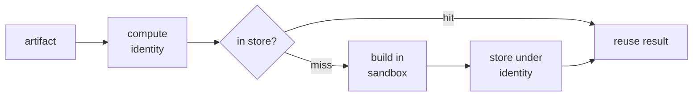
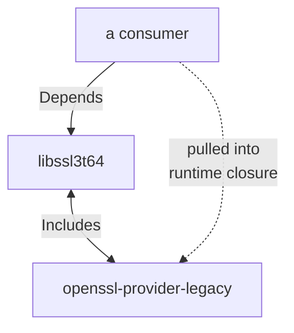
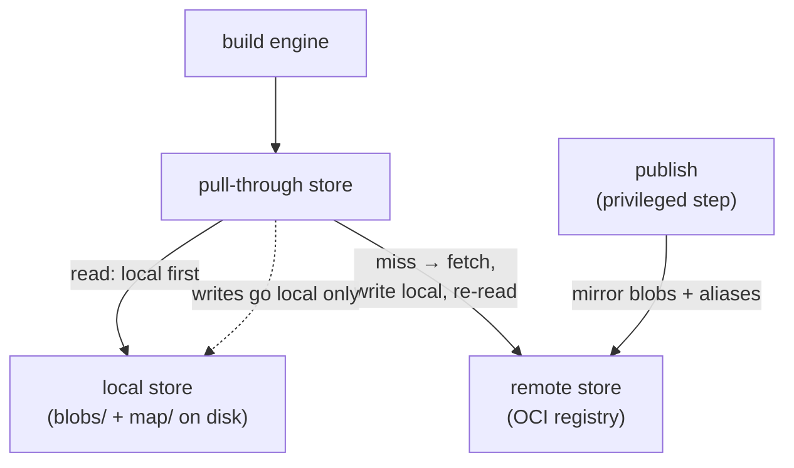
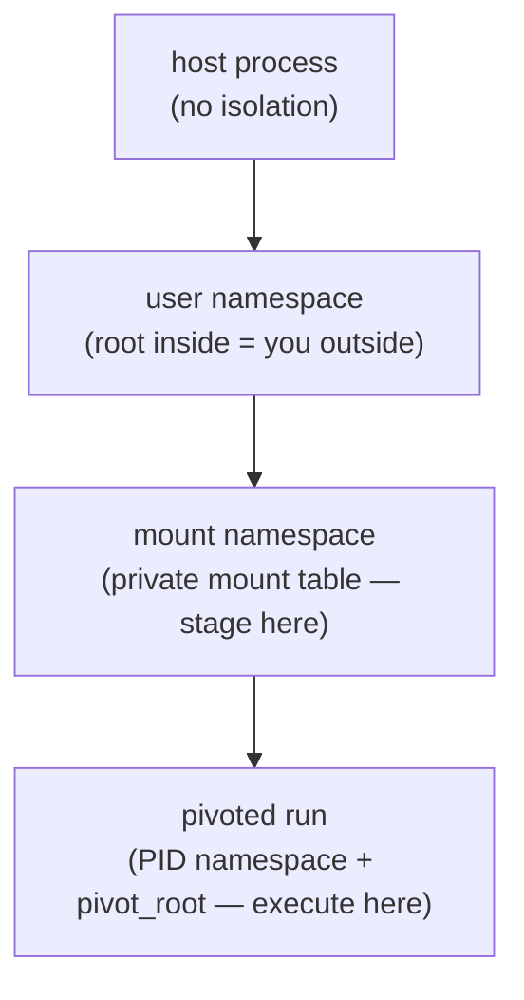
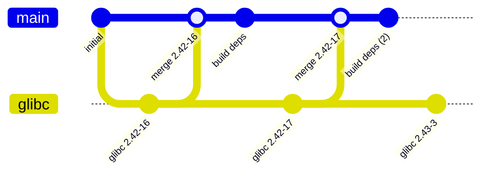
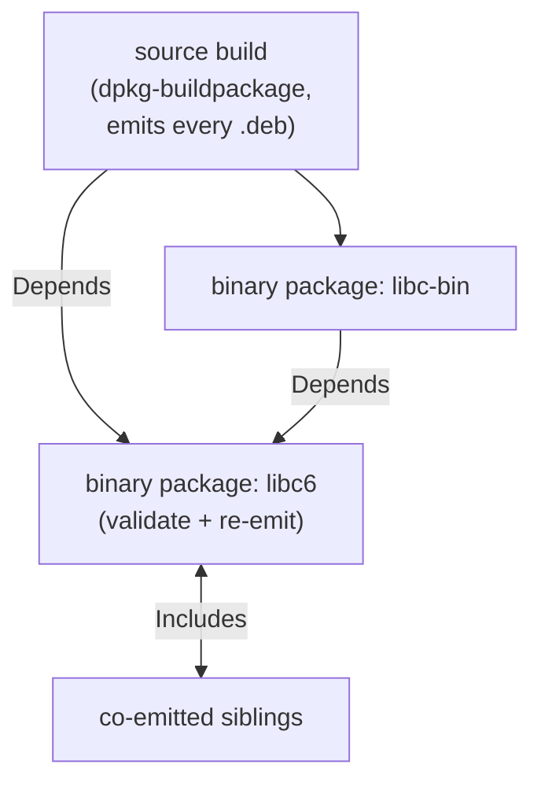
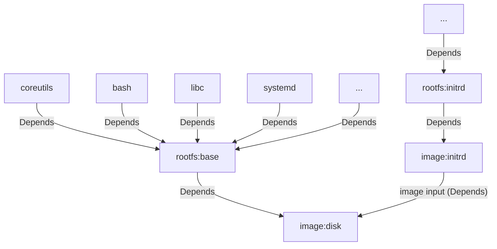

# Architecture

This chapter explains how glbx works as a whole: the pieces it is built from and,
above all, how they fit together. Each piece has its own deep-dive chapter later;
here the goal is the opposite of depth — it is to show the skeleton, name every
moving part once, and make the interactions between them clear. A reader who
finishes this chapter should understand how a source tree becomes a cached,
reproducible, from-source image, and know which later chapter to open for any
detail.

## The one loop

Everything glbx does reduces to a single loop over a single kind of thing.

> Everything glbx builds is an **artifact**. Each artifact has an **identity**
> derived from its inputs. The engine looks that identity up in a
> **content-addressed store**; on a hit it reuses the stored result; on a miss it
> builds the artifact inside a **hermetic sandbox** and stores the result under
> its identity.

Every other part of the architecture serves that loop: what an artifact is, how
its identity is computed, where results live, what "hermetic" means, and how a
graph of artifacts rises to a bootable image. The sections below take them in
turn, each ending at the seam where it meets the next.

## The artifact graph

An **artifact** is the smallest unit glbx builds, caches, and depends on. It is
not a file on disk — it is a *description* of a build: enough to compute an
identity, find a result in the store, and on a miss run the step that produces
one. To the engine every artifact is the same handful of things: an identity, a
human-readable key, a set of typed edges to other artifacts, and an opaque build
action. The engine has no built-in notion of "a package" or "an image"; building
a source package, validating a binary, and assembling an image are all just
artifacts with different build actions. One traversal drives the entire system.

Artifacts form an explicit graph. Dependencies are *declared*, never inferred from
the host or guessed from names, and the edges come in two genuinely different
kinds:

- **Depends** — "I am built from B." B builds first, B's output feeds this build,
  and B's identity folds into this artifact's identity, so a change to B rebuilds
  it. Depends edges are acyclic.
- **Includes** — "I carry B along for whoever uses me." No build order, no
  identity contribution; anything that Depends on this artifact also pulls in what
  it Includes. Because Includes imposes no order, Includes edges may form cycles.

The distinction exists for a real case: two libraries co-emitted by one source
build whose runtime metadata names each other. In the reference configuration
`openssl` emits both `libssl3t64` and `openssl-provider-legacy`, and each one's
runtime dependencies name the other. Neither is built from the other — a Depends
edge would be a forbidden cycle — so each *Includes* the other, and any consumer
of one drags in both.

The engine walks this graph with one general operation — resolve every identity
from the leaves up, look each up in the store, build the misses, reuse the rest —
and a bounded pool of workers runs independent nodes in parallel. Because a store
hit prunes an entire subgraph, an unchanged target collapses to a walk of
identities and a set of lookups with no build work at all. The
[artifact model](./artifact-model.md) chapter fixes the model and the traversal in
full.

## Content-derived identity

An artifact's identity is a SHA-256 hash folded deterministically from exactly its
identity-bearing inputs: the hash of its source tree, the target architecture, any
pinned external bytes, and the identities of its Depends dependencies — and
nothing else. Identities are *derived*, not assigned.

Two properties fall out, and the whole system leans on them. **Identical inputs
give an identical identity**, because every part of the fold is a deterministic
function of content — so a build on one machine hits a store another machine
populated. And **any difference gives a different identity**, which rolls up
through every artifact that depends on the changed one, to the image at the top.
The identity *is* the dependency ledger: what changed and what must rebuild both
fall out of comparing identities, and a cache hit is an exact equivalence rather
than a guess.

Reducing a source tree to one hash — a **dirhash** — is the one non-trivial piece.
It folds in exactly the content that affects a build (file bytes, names, the
executable bit, symlink targets, directory structure) and deliberately nothing
that varies between checkouts (owner, group, timestamps, the rest of the mode), so
two checkouts of the same commit hash identically. The fold also mixes in two
opaque **scheme seeds** — a global one and a per-artifact-kind one — so the scheme
can evolve without old and new identities ever colliding; the global seed has a
runtime override (`GLBX_ID_SEED_OVERRIDE`) for working in an isolated cache
namespace or forcing a full rebuild. The exact bytes are in the
[identity](./identity.md) chapter.

## The object store and the remote cache

Results live in one place: an **object store** of two kinds of content.

- **Blobs** — immutable byte sequences addressed by the SHA-256 of their content.
  Source archives, tooling `.deb`s, built packages, assembled images, and the
  small *manifest* blobs that tie an artifact's outputs together are all blobs.
- **Map entries** — a mapping from an artifact *identity* to the *manifest* blob
  recording its result. A lookup is two hash-keyed reads: identity → manifest →
  the named output blobs.

The store is a **pure cache**, not a system of record. Every blob is either a
build output (rebuildable) or an external input (re-fetchable from a recorded hash
and URL), so anything it drops can be reproduced. The durable source of truth is
git; the store only saves the system from redoing work. That is what keeps it
simple — a blob is a file named by its hash, a map entry is a one-line file, and
garbage collection is a set-membership sweep against a keep-set the engine hands
it.

The engine is written against a store *interface* with three implementations, and
cannot tell them apart:

The **local** store is the on-disk tree. The **remote** store presents the same
blobs and map entries over an **OCI registry** — a blob is a registry object
addressed by the same SHA-256, a map entry an extra tag — and is read-only and
path-less from the engine's side. The **pull-through** store composes the two: on
a local miss it fetches from the remote, *writes the bytes into the local store*
(re-hashing to verify them), and re-reads locally, so a remote result is never
handed back directly and the second read is a plain local hit. Writes always go to
the local member; filling the registry is a separate, privileged **publish** step,
so an untrusted build never mutates shared truth. This is the one channel a
distributed build needs: results built once are pulled, not rebuilt. The
[object store](./object-store.md) and [remote cache](./remote-cache.md) chapters
cover the on-disk shape, the OCI tag scheme, GC, and publishing.

## The hermetic sandbox

A reproducible build must run in a known environment, and glbx must construct that
environment **unprivileged** — a regular user, no root on the build box. Yet
inside it the unmodified Debian tooling must believe it is root, installing into a
root filesystem and running maintainer scripts. The sandbox squares this using
three Linux kernel namespaces, and nothing else — no Docker, no Podman, only
facilities the kernel already provides.

Each layer adds exactly one isolation property over the one beneath it. The **user
namespace** remaps IDs so inner UID 0 is the calling user outside — which is what
lets the sandbox mount, pivot, and chown unprivileged. The **mount namespace**
gives a private mount table to stage inputs into. The **pivoted run** enters a PID
namespace and `pivot_root`s into the assembled root to actually run the tooling.

The load-bearing decision is that staging and running are *separate layers*.
Inputs are bind-mounted into place and outputs are harvested from the mount
namespace — where host paths, including the object store, are still visible — while
only the innermost step pivots into the sealed root. A `.deb` can be hundreds of
megabytes; bind-mounting it from the store costs nothing, where copying would not.
Mount propagation is one-way (the staging layer's mounts appear inside the pivoted
run, but not the reverse), so the orchestrator can read the build's filesystem and
pack its result without ever being trapped inside the chroot. The network is
deliberately *not* isolated — fetching pinned tooling can need it, and the
from-source guarantee comes from pinned inputs and validation, not from cutting the
wire. The [execution environment](./exec-env.md) chapter details the namespaces,
the ID mapping, and the control channel that drives the sandbox from outside.

## Source lineage in git

The thing glbx builds *from* is a separate **configuration repository**, and the
way it stores package history is what makes updates tractable. Each source package
carries an independent **import lineage**: a chain of pristine commits, one per
imported upstream version, each recording *only* that version's packaging — no
local edits. The first import of a package is an orphan root; each later import is
parented on the previous one. Local modifications and the pinned build inputs live
on the **integration branch** (`main`, a release branch), joined to the pristine
imports through ordinary merge commits.

*`glibc`'s pristine import chain accumulates one commit per upstream version and
joins `main` through repeated merges, each followed by a lockfile bump
(`build deps`); 2.43-3 is imported but not yet merged. Two artifacts of the
drawing, not of the model: the lineage really has no common ancestor with `main`
(it is an orphan root, related only by that first merge), and each merge brings in
one specific import rather than a whole moving branch — neither of which
`gitGraph` can depict directly.*

Keeping the two apart makes bringing a package to a newer version an ordinary
three-way merge: the common ancestor is the old pristine import, one side is the
local integration state, the other is the new pristine import. Each pristine commit
carries a machine-readable marker in its message recording the package, the exact
version, and the logical series it tracks (e.g. `debian:testing`), so the history
itself is the record — no mutable pointer can drift. A quilt-format package commits
its `debian/` directory into the tree and pins its large upstream tarball(s) in a
`sources.yml` by hash and retrieval URL, keeping the binary bytes in the store
rather than in git. The [source lineage](./source-lineage.md) chapter fixes the
layout, the marker, and the source formats.

## From source, via lockfiles

Building a package needs build-time tooling — compilers, `debhelper`, headers —
that ends up in no shipped image. Because this tooling only ever helps *build*
something and never ships, it is fine to take it from Debian, provided it is taken
*reproducibly*: each source package pins the exact set in a **`build-deps.yml`
lockfile**, every external `.deb` identified by content hash plus where to fetch
it. Pinning is a step separate from building; by the time a build runs, every
external input is already in the store, verified by hash, and the build touches no
moving external archive.

These pins are *not* part of a package's pristine upstream lineage — a lockfile is
a resolution against a moving archive at a moment in time. They live on the
integration side, and each package pins its own tooling, so bumping a tool one
package needs does not rebuild everything else.

This sets up the system's central distinction, which the next section's gate
enforces: **build-time tooling** may be external (pinned, never shipped), but
**output binaries** — everything a shipped image consumes — must trace back
through the graph to sources glbx builds itself.

## Package build and the from-source gate

Compiling one source package is the expensive operation: a real `dpkg-buildpackage`
run inside the sandbox, against a chroot assembled from the pinned tooling (by
hash, from the store) with any locally built dependencies layered on top so that
what-we-built overrides what-the-mirror-supplies. A single run emits *many* `.deb`s.
glbx models this as two artifact kinds:

A **source-build** artifact is the one `dpkg-buildpackage` run, cached once per
package. A **binary-package** artifact is a cheap per-binary node that does no
compiling: it selects one named `.deb` from the source build's outputs and
*validates* it — that it exists, installs cleanly, and has a runtime closure
satisfiable entirely from *other locally built binaries* — then re-emits it as the
thing downstream artifacts depend on. A binary-package node exists only for
binaries something downstream actually selects, so a source's unused outputs, with
their reach into corners of Debian nobody builds, never block the package.

This per-binary validation is the **from-source gate**. Because each binary's
runtime dependencies must resolve locally, by the time an image is assembled its
entire runtime closure is local by construction — there is no point at which
assembly could reach for an external mirror.

Two kinds of edge, declared per package, shape this graph. `build_depends` names
outputs of *other* source builds needed in the chroot at compile time — the heavy
edge, since changing that dependency rebuilds this package. `runtime_depends`
names, per output binary, the other local binaries in its runtime closure — the
light edge, which may cycle among siblings and never forces a rebuild. The guiding
discipline is to keep `build_depends` shallow: a package compiles against the
tooling's libc (an external, pinned input) rather than taking a compile-time edge
to the freshly built libc, so a libc change does not cascade a rebuild of the
whole distribution; the real libc enters through the binaries' `runtime_depends`
and the validation stage confirms compatibility. In the reference configuration
almost every package works this way — `glibc`, `openssl`, `util-linux` declare only
`runtime_depends` — and a genuine compile-time edge (`glbx-pkcs11-forward` needs
`protobuf-c`'s `-dev` package in its chroot) is the rare exception. The
[package build](./package-build.md) chapter covers the chroot assembly, the local
version suffix, and the validation install-check.

## Rootfs and images

The top of the graph is where binary packages become something bootable, in two
stages.

A **rootfs** artifact installs the runtime closure of a chosen set of packages into
a root filesystem. The hard part is that installing packages *correctly* needs the
Debian machinery — `dpkg`, interpreters, the essential base — to run maintainer
scripts, yet that machinery must not *ship*. glbx resolves this structurally with a
three-layer overlay rather than by install-then-delete: the payload (our built
`.deb`s) and the throwaway tooling are raw-extracted into separate layers, `dpkg`
configures against the merged view with every mutation landing in a writable upper
layer, and the final image is composed from the payload and the mutations *only* —
leaving the tooling layer out of the stack entirely. Nothing is searched for and
deleted; the tooling vanishes because the layer holding it was never mounted into
the result. The reference configuration defines several rootfs variants (a full
`base`, a minimal `min`, an `initrd`), each a node of its own; per-variant setup
scripts run inside the rootfs after configuration for the finishing touches
(installing the kernel, symlinking `/bin/sh`, cleansing nondeterministic state).

An **image** sits one layer above the rootfs: it runs an *image type*'s assembly
script — handed the rootfs tarball and an output path — to produce a bootable disk
or an initramfs, and glbx stores whatever bytes the script writes. Images are
ordinary artifacts, so one image can take another as an **input** and depend on it:
in the reference configuration the `disk` image embeds the `initrd` image on its
EFI partition, which is a plain graph edge.

Determinism at this level is a contract the image type honors, not something glbx
can enforce from outside: the script derives every on-disk identifier (filesystem
UUIDs, partition GUIDs) from the image's content identity, passed in as
`GLBX_IMAGE_ID`, rather than from the clock or `/dev/urandom`. glbx stores and
content-addresses the bytes; keeping them stable is the type's job. The
[image assembly](./image-assembly.md) chapter details the overlay, the image
inputs, and the assembly-tooling universe.

## Distributed builds

A whole-tree build is a graph, and a graph fans out. glbx exposes a deterministic
machine-readable form of that graph (`glbx graph --format=json`), from which the CI
pipeline generates **one job per node**, wired in dependency order, with a shared
registry (ghcr) as the one channel between jobs: each job builds its node, pulls
its dependencies' outputs from the registry, and publishes its own. A node already
present in the registry is skipped before a runner starts, so an incremental change
rebuilds exactly its subgraph.

The same graph-and-lineage machinery drives the **package-update pipeline**:
`glbx check-updates` reads each lineage's pinned version and reports what the
archive now offers newer; an import opens a pull request that the fan-out build
gates; and on green, the update is merged and the accepted import is tagged. This
automation lives in the configuration repository's CI, but it is built out of
glbx's own primitives — import lineage, the graph export, per-node builds, scoped
publish — and so is documented here.
[Distributed builds & CI](./distributed-builds.md) covers the fan-out and the full
update loop.

## How the ideals hold

The [vision](./vision.md)'s four commitments are not enforced by separate
machinery; each is a consequence of the structure above.

- **Reproducible** — identity is a pure function of inputs and results are
  content-addressed, so an unchanged build is a cache lookup and a changed one
  yields identical bytes anywhere.
- **From source** — the per-binary validation gate rejects any runtime closure that
  reaches a binary not built from source, so an assembled image is local by
  construction.
- **Hermetic** — the sandbox sees only its declared, bind-mounted inputs, built
  from kernel namespaces an unprivileged user can stand up.
- **Traceable** — git holds the packaging and the pins, the store holds the bytes
  by hash, and the artifact graph ties every output to the exact inputs it was
  folded from.

Reproducibility has a bound worth stating plainly, and it belongs here rather than
in the vision: glbx determines a build's *inputs* exactly, but cannot stop a
package's own build from embedding a timestamp or other entropy in its output. Such
non-determinism is a property of that package, and glbx makes it *observable* — the
output hash differs between builds — rather than silently absorbing it. The
reproducibility check (`glbx build --check-reproducible`) exists to surface exactly
that.
