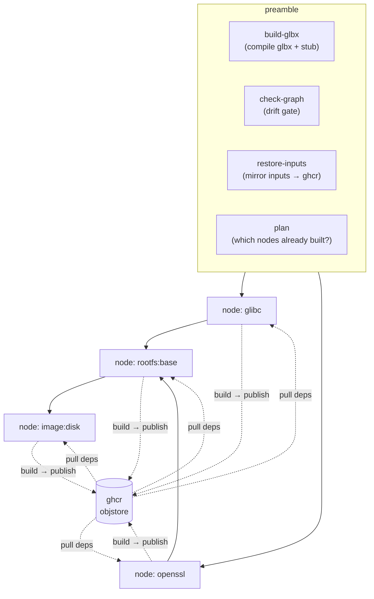
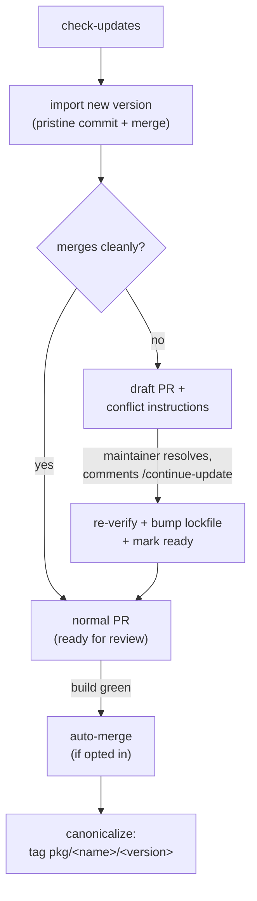

# Distributed builds & CI

A whole-tree build is a graph, and a graph fans out. This chapter covers the layer
that turns one build into a distributed pipeline: how the artifact graph becomes
one continuous-integration job per node over a shared cache, and how the same
graph-and-lineage machinery drives an automated package-update loop — from
detecting that an upstream version moved, through opening a pull request, to
merging it on green and recording the accepted import.

This automation lives in the **configuration repository's** CI, not in glbx. But
it is built entirely out of glbx's own primitives — the import lineage, the
deterministic graph export, per-node builds, scoped publish, the reproducibility
check — and glbx is the single source of documentation for the system, so it is
described here. Where a concrete name helps, the examples are the Garden Linux
`glbf-staging` configuration and the `build`/`update` workflows it carries.

## The core model: one node, one job, one shared cache

The build engine already resolves a graph of artifacts and could build the whole
thing on one machine. Fanning out trades that for parallelism across runners, and
needs exactly two things glbx provides: a stable description of the graph, and a
way for independent builders to share results.

The shared result channel is the **remote cache** ([remote cache](./remote-cache.md)):
a single OCI registry — `ghcr.io/<owner>/<repo>/objstore` in the reference setup —
behind each runner's pull-through store. A runner building one node pulls its
dependencies' outputs from the registry and publishes its own output back, and
that registry is the *only* channel between jobs. Inputs flow through it too, so
upstream archives and tooling `.deb`s are mirrored once, not re-fetched per node.

The graph description is `glbx graph --format=json`: a deterministic node/edge
export in a stable topological order, identical across runs and machines, that
records *structure* (which nodes exist, which depends on which) rather than
identities — so it changes when a package is added or removed, not on an ordinary
source edit. One node becomes one CI job; the edges become that job's dependency
ordering.

*Every node job talks only to the shared registry; the preamble jobs prepare the
executor, gate the graph, seed the inputs, and decide what to skip.*

### Generating the workflow

GitHub Actions cannot derive job structure at run time, so the per-node pipeline is
generated offline from the sources and committed. A small bash+jq script
(`generate-workflow.sh`) runs `glbx graph --format=json` and emits one caller job
per node into `build.yml`. The generated file is thin: all build logic lives in
hand-authored reusable workflows, and only the graph-shaped wiring — one job per
node with its `needs:` edges and skip guard — is generated.

Because the committed `build.yml` is a derived artifact, a **check-graph** gate
regenerates it from the current sources and fails the run on any drift. This is how
the pipeline proves its committed structure still matches the sources, given that
the structure cannot be computed at run time.

### The preamble and the skip gate

Four jobs run before any node:

- **build-glbx** compiles the `glbx` binary and the sandbox stub and shares them as
  a run-scoped artifact, so every node job runs the same executor.
- **check-graph** is the drift gate above.
- **restore-inputs** runs `glbx restore-cache` then `glbx publish` (with no target)
  to mirror every source archive and tooling `.deb` to the registry once. On a warm
  registry this is a near no-op — existence checks are HEADs, nothing is pulled to
  the runner.
- **plan** runs `glbx graph --format=json --check-built` and emits a JSON object
  mapping each node Key to whether its output is *already* present in the registry.

Each node job is gated on that plan output: a node already in the registry is
skipped before its runner starts, while a changed node — and its whole downstream
closure, whose identities changed with it — rebuilds. The gate is written
`if: !cancelled() && !failure() && (not already built)`; the `!cancelled() &&
!failure()` is load-bearing, because it replaces Actions' implicit `success()`
gate, which would otherwise treat a *skipped* (already-built) dependency as a
reason to skip a dependent that genuinely needs rebuilding.

### What a node job does

Each node is built, published, and then independently re-verified, across two jobs
on separate runners:

1. **build** runs `glbx build --target <Key> --no-recurse --stream`. `--no-recurse`
   requires every dependency to resolve from the (pull-through) cache — a miss is a
   hard error, never a local rebuild — so the job builds exactly its one node from
   inputs earlier jobs published. `--stream` forwards that node's log straight to
   the console for a legible CI log. It then runs `glbx publish --target <Key>` to
   mirror just that node's output blobs, manifest, log, and identity alias to the
   registry.
2. **check-reprod** runs `glbx build --check-reproducible --target <Key>`: it
   rebuilds the node and checks the result reproduces the output the build job
   published, by comparing manifest hashes. It carries no skip guard of its own, so
   it runs only when the build job actually ran — an already-built node skips both.

A note on the runner environment: Ubuntu runners restrict unprivileged user
namespaces through AppArmor, which would `EPERM` the sandbox, so each node job
first relaxes that (`sysctl -w kernel.apparmor_restrict_unprivileged_userns=0`).
The whole run can be forced to rebuild from scratch — ignoring every cached
result — by setting the `GLBX_ID_SEED_OVERRIDE` input, which reseeds every identity
so the plan finds nothing in the registry; the same override is threaded to the
node jobs so they build under the matching seed ([identity](./identity.md)).

## The package-update pipeline

The second use of the graph-and-lineage machinery is keeping packages current. An
update is detected from the lineage, imported as a pristine commit, trial-merged,
and opened as a pull request that the fan-out `build` pipeline gates; on green it is
merged, and the accepted import is tagged.

### Detecting and importing an update

`glbx check-updates` reads each package's pinned version off its import lineage
([source lineage](./source-lineage.md)) and, for the configured archive, reports
every package the archive now offers a newer version of. The candidate set is
filtered by the recorded auto-update series (a lineage tracking `debian:testing`
is only considered against `testing`), and the signed archive index is fetched once
and queried for every candidate, so a whole-tree check costs a single fetch.
`glbx get-pkg-metadata` lists the current baseline — the newest import per present
package — that this builds on.

For each updatable package, a job imports the new version with `glbx import`, which
appends a pristine commit to that package's lineage and then merges it into the
update branch. The import is recorded on its own upstream chain regardless of
whether the merge is clean.

### Clean merge, or conflict

The trial merge has two outcomes, and the pull request reflects which:

On a **clean merge**, the pipeline opens an ordinary pull request. On a
**conflict**, it opens a *draft* pull request carrying the conflicting paths and
step-by-step resolution instructions — crucially, to resolve with `git merge` and
never `git rebase`, because rebasing would rewrite the import's upstream lineage and
break future three-way-merge updates. A maintainer resolves the conflict on the
branch and comments `/continue-update`; a handler re-verifies that the branch now
merges cleanly, optionally bumps the lockfile, and promotes the draft to ready. Every
outcome of that handler is a safe repeat.

Each pull request embeds a machine-readable **state block** — a fenced YAML comment
(`# glbf-update-state`) recording the package, old and new version, target branch,
the archive it came from, the import commit, and whether auto-merge is enabled.
This is both the human-readable record and the memo the later stages recover their
decision from, rather than re-deriving it from the branch name (which is only a
convenience label, `update-staging/<target>/<pkg>-<version>`).

### The reproducible-replay trick

Updates are tested without waiting for the live archive to move: the update is
dispatched with a recorded auto-update series (say `debian:testing`) but pointed at
a **snapshot** of the archive frozen at a timestamp. The marker records the logical
series it stands in for, while the snapshot supplies reproducibility — the same
snapshot yields the same source bytes, hence the same identities, hence cache hits,
so only the genuinely changed package and its downstream closure rebuild. This is
what makes exercising the whole pipeline cheap.

### Merging on green and canonicalizing

When a bot-opened update PR's `build` run goes green, an **auto-merge** handler can
merge it. The gate is deliberately strict, and its load-bearing check is
authorship: only a PR opened by *this* update App's bot — matched by the bot's
stable numeric user id, never a login string — is eligible, so no arbitrary
contributor's PR can be auto-merged whatever it puts in its branch or body. The
handler additionally checks the branch convention, PR readiness, the `auto_merge`
opt-in from the state block, and a race guard (the green build must have run on the
current PR tip). It merges with a merge commit — never squash or rebase — so the
import's upstream lineage is preserved into the integration branch.

Because these handlers push and merge as a **GitHub App** rather than with the
default `GITHUB_TOKEN`, a bot-opened PR's build is actually triggered (the default
token deliberately does not cascade-trigger workflows), and the commits attribute
to the App.

The merge to the integration branch triggers **canonicalization**: a handler that
scans the newly-landed commits for import markers and, for each accepted pristine
import, writes an immutable tag `pkg/<name>/<version>`. Reachability alone does not
make an import "accepted" — the tag is the durable record of acceptance, and it
survives the package later being removed from the tree. The tags are a readable
index over the lineage; the authority remains the commit graph and its markers
([source lineage](./source-lineage.md)).

## Why it composes

None of this layer re-implements build logic or invents a second notion of
identity. The fan-out is the artifact graph exported and laid out one node per job;
the shared cache is the ordinary remote store; a node job is a scoped build plus a
scoped publish; the update loop is the import lineage plus the same build pipeline
used as a gate. The automation adds process — pull requests, review, merge policy,
tagging — around primitives that already exist, which is why it stays thin and why
glbx, not the CI, is where it is documented.

## See also

- The deterministic graph export and the identity-skip the plan relies on:
  [the artifact model](./artifact-model.md), [identity](./identity.md).
- The shared registry, scoped publish, and the pull-through cache the node jobs run
  against: [the remote cache](./remote-cache.md), [the object store](./object-store.md).
- The import lineage, markers, and three-way-merge update model the pipeline
  automates: [source lineage](./source-lineage.md).
