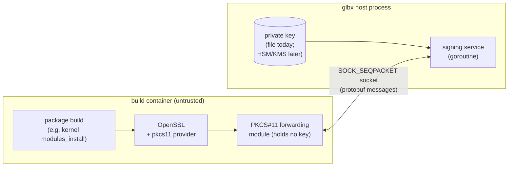
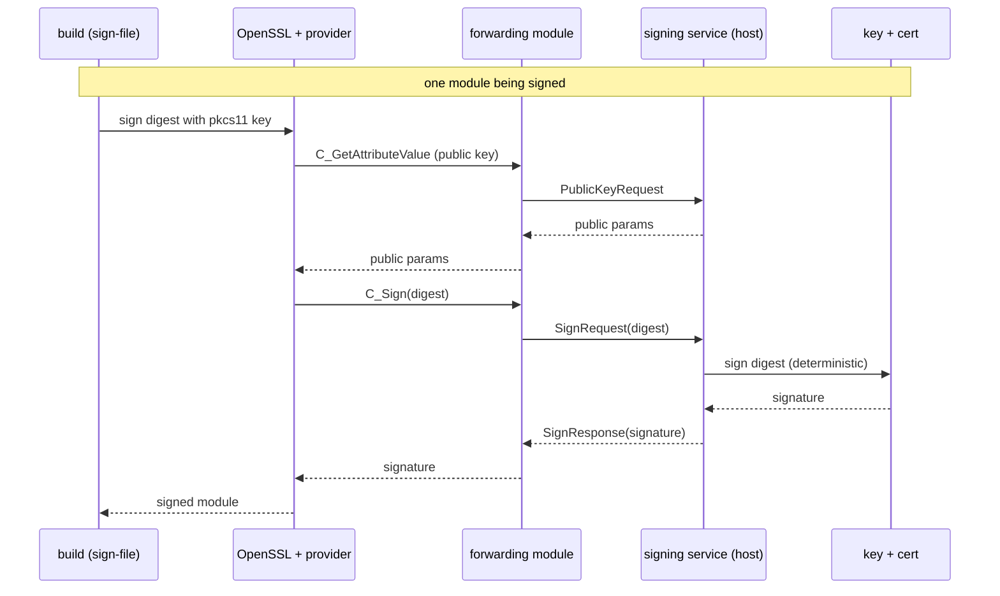

# Out-of-container signing

Some build steps must sign their output — most importantly the Linux kernel,
whose modules (and, on some configurations, the boot image) are signed during the
package build. Done the ordinary way, signing requires the **private signing key
to be present inside the build**, where arbitrary upstream packaging code runs.
glbx avoids this: the private key stays outside the build container, and the
build reaches it only through a narrow "sign this digest" channel.

## Why

- **Keep private key material out of the build container.** The build sandbox runs
  a large amount of third-party packaging and upstream build code. A signing key
  placed there — even transiently — is exposed to all of it. In glbx the key is
  never inside the container; the container can request signatures but can never
  read the key.
- **Make the key source pluggable.** The component that actually holds the key and
  produces signatures sits behind a small request/response protocol. Today it
  signs with a key file; the same protocol can later be served by a hardware
  security token, a cloud KMS, or a secrets manager, with no change to anything
  inside the build.
- **Reproducible signatures (a side benefit).** Because the signer is a single
  controlled component, it can sign deterministically (for ECDSA keys it uses an
  RFC 6979 deterministic nonce), so the same input yields byte-identical
  signatures across builds. This falls out of the design rather than driving it.

## The pieces

Signing involves four cooperating parts. Two live outside the container (the
signing service and the key), one lives inside as a thin shim (a PKCS#11 module),
and the fourth is the build's own signing tool (for the kernel, `sign-file`
invoked through OpenSSL).



- **The signing service** runs as a goroutine in the glbx process, on the host. It
  owns the key and the certificate, listens on a Unix socket, and answers three
  kinds of request: "return the public key", "return the certificate", and "sign
  this digest". It is not PKCS#11-aware — it speaks a minimal protocol about
  public keys, certificates, and signatures. Its signing backend is an interface;
  the built-in backend reads an on-disk key and cert and signs by invoking
  OpenSSL, and other backends can replace it.
- **The socket** is a `SOCK_SEQPACKET` Unix socket, created on the host and
  bind-mounted into the container at a fixed path under
  `/glbx/signing-service/`. Message boundaries are preserved, so each
  request and response is one datagram. Messages are protobuf. The socket is the
  one trust boundary: everything the key-holder exposes — public key, certificate,
  signatures — travels this channel, and the private key never comes back.
- **The PKCS#11 forwarding module** is a small shared library inside the
  container, loaded by OpenSSL's pkcs11 provider. It implements only the handful
  of PKCS#11 operations a signing flow needs. It holds no key and performs no
  cryptography: it presents a single token bearing one key object and one
  certificate object, serves their public attributes (fetched from the service),
  and forwards each signing operation to the service. It finds the socket through
  the `GLBX_SIGN_SOCKET` environment variable.
- **The build's signing tool** is unchanged. For the kernel this is the upstream
  `sign-file`, which signs each module through OpenSSL. Pointed at a PKCS#11 key,
  OpenSSL routes the operation through the forwarding module. The kernel's
  certificate-extraction step likewise reads the certificate from the token
  through the module.

## How a signature flows



The certificate the build needs to embed and trust is fetched the same way: the
kernel's extract step reads the token's certificate object, which the module
serves from a `CertRequest` to the service. The module opens a fresh socket
connection per operation and closes it immediately after, so no connection state
is held across the (otherwise stateless) PKCS#11 calls.

## Enabling it for a package

A package opts in through a `signing` block in its `build.yml`, one entry per key:

```yaml
signing:
  - key_name: kernel
    private_key_file: keys/kernel-sign.key   # host-side, never enters the container
    cert_file: keys/kernel-sign.crt          # public cert, served over the socket
```

- `key_name` identifies the key and fixes its socket location,
  `/glbx/signing-service/<key_name>`, exported to the build as
  `GLBX_SIGN_SOCKET`.
- `private_key_file` is resolved on the host and read only by the signing service.
- `cert_file` is the matching public certificate, also read only by the service
  on the host. It is not a file in the container: the build obtains it over the
  socket, through the module's certificate object.

When a `signing` block is present, glbx starts a signing service per key before
the container is created, bind-mounts each socket in, and sets `GLBX_SIGN_SOCKET`.
It also adds the forwarding-module package to the build's dependencies
implicitly — the package is installed into the chroot and participates in the
build's content identity, but is not written into any dependency file. A build
with no `signing` block behaves exactly as before.

Because the signing configuration and the certificate content feed the build's
content identity, enabling signing or changing the certificate produces a
distinct cached result. The private key is never read into the identity.

## The kernel build

The kernel is the first consumer. Stock Debian kernel packaging generates an
ephemeral signing key inside the build and signs modules with it. Under external
signing the packaging instead:

- points the kernel's module-signing key at the PKCS#11 token (`pkcs11:token=glbx`)
  rather than a generated key file, so `sign-file` signs through the forwarding
  module, and the kernel's certificate-extraction step reads the certificate from
  the same token;
- skips generating a key;
- activates OpenSSL's pkcs11 provider (pointing it at the forwarding module) for
  the signing and certificate-extraction steps.

The kernel build gains the OpenSSL pkcs11 provider as build tooling and the
forwarding module through the implicit signing dependency; the forwarding module's
own runtime library is built from source alongside it.
