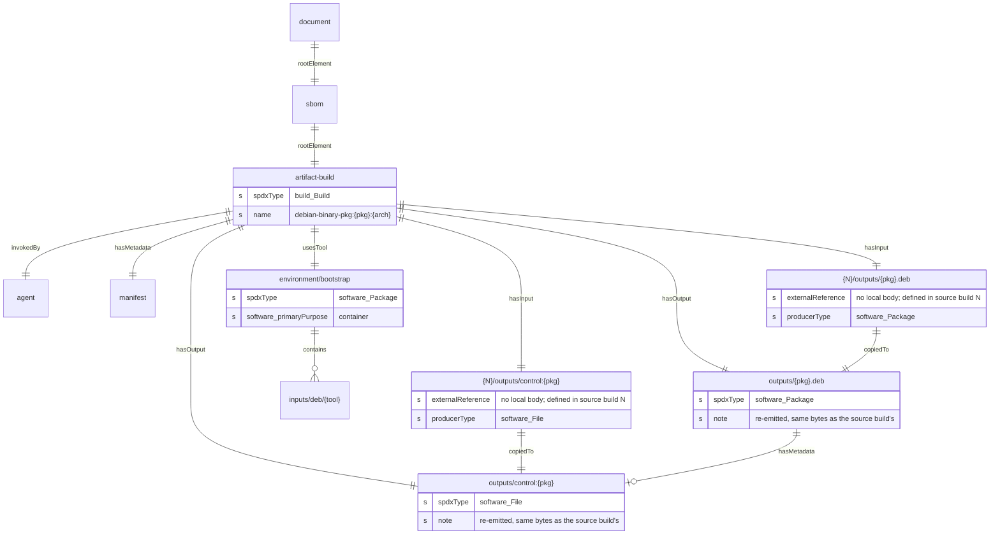
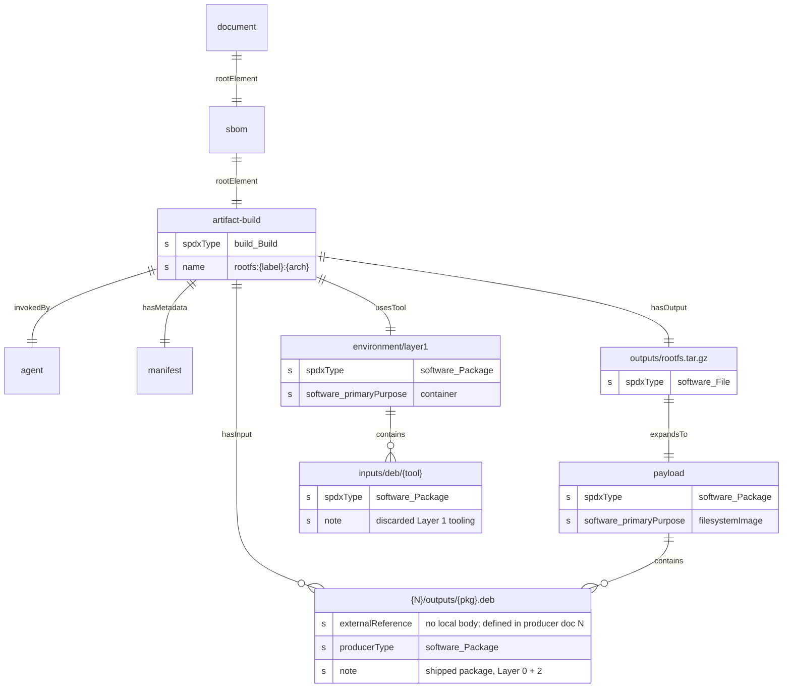
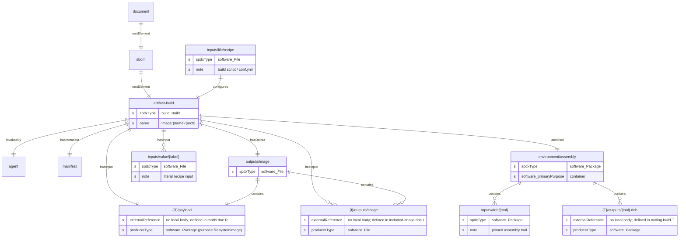

# SBOMs

glbx emits an SPDX software bill of materials for every artifact result it
builds. There is **one SPDX document per artifact result in a selected SBOM
namespace**, and that result is identified by the hash of its
[output manifest](./artifact-model.md#the-output-manifest). A source build that
emits ten Debian binary packages produces one SPDX document with ten named
package outputs; binary validation, rootfs assembly, image assembly and image
tooling builds each describe their own artifact result the same way.

Each document describes one glbx build and its outputs. Sources and the artifact
`Depends` inputs it was built from get `hasInput` edges; the build `usesTool` a
single environment container that `contains` every package making up the build
rootfs; each package named in an emitted binary's `Built-Using` or
`Static-Built-Using` field gets a `hasStaticLink` edge from that binary. A package
can play more than one role, and for any role its
*origin* decides its SPDX shape: a lockfile-provided package is described locally,
while a glbx-provided one references the producing SPDX element in that producer's
own document.

The documents are retrieved two ways. A glbx consumer pulls an individual SPDX
document through the [object store](./object-store.md), exactly as it pulls any
other blob. A consumer with only ORAS pulls the OCI tag
`sbom-<output-manifest-hash>` and gets the root SPDX document together with every
document it imports, directly or transitively — the **SPDX closure** — in one
call. Both paths reference the same underlying bytes.

This chapter fixes the addressing, the SPDX graph glbx emits, how one document
pins the producer documents it imports, how each artifact kind maps onto SPDX,
and the object-store and OCI retrieval contracts. The format is SPDX 3.0.1
JSON-LD throughout, serialized with the official context under a single `@graph`,
using the Core, Software and Build profiles.

## Addresses and terminology

Several distinct hashes travel together in this chapter, and keeping them apart
is the whole of understanding the addressing. A document checksum is not an
output-manifest hash, and neither is the OCI manifest digest that an OCI tag
resolves to.

| Name | What it identifies |
| --- | --- |
| **Output-manifest hash** `M` | The SHA-256 of an artifact's [output manifest](./artifact-model.md#the-output-manifest), which lists the named outputs and their object-store blob hashes. `N` denotes the same kind of hash for a *producer* artifact. |
| **SPDX document checksum** `D` | The SHA-256 of one serialized SPDX document. Locally it is the object-store blob hash of that document; after publication, `sha256:<D>` is the OCI blob digest of the same bytes. |
| **Payload checksum** | The checksum of a named artifact output — e.g. the whole `fixture.deb` archive. The corresponding SPDX output element records this checksum. |
| **SBOM map key** `K(A,M)` | The object-store map key folded from a dedicated SBOM seed, the selected SBOM namespace `A`, and the output-manifest hash `M`. The map entry under it points at `D`. |
| **OCI manifest digest** | The digest of an OCI manifest's own bytes. An OCI tag such as `sbom-<M>` resolves to an OCI manifest digest; the `M` in that tag names the artifact result. |

The SBOM namespace `A` is set with `GLBX_SBOM_NAMESPACE` and defaults to
`localhost`; Garden Linux CI uses `gardenlinux.io`. The same output manifest can
carry a local SPDX document and a CI SPDX document at once, each under its own
SBOM map entry.

SPDX element IDs are minted under the prefix `urn:spdx:<A>/glbx/sboms/<M>`,
abbreviated `B(A,M)` below, with the element path appended — so CI's Debian
package element is
`urn:spdx:gardenlinux.io/glbx/sboms/<M>/outputs/fixture.deb`. The exported file
is named `<M>.spdx.json`, and a reader follows a reference by matching the full
SPDX element ID inside that file. These URNs are glbx identifiers: the `spdx`
URN namespace has no IANA registration and no SPDX-provided resolver.

## The SPDX graph for one artifact

A reader enters a document at its SPDX `SpdxDocument`. Its `rootElement` selects
the SPDX SBOM, whose `rootElement` selects the `artifact-build`. From that build,
`hasOutput` reaches the deliverables, `hasInput` reaches the source materials,
`usesTool` reaches the build environment, and `hasMetadata` reaches the output
manifest.

The bytes are SPDX 3.0.1 JSON-LD with the official context, one `@graph`, and the
Core, Software and Build profiles. For the same evidence,
creation metadata and producer-document pins, glbx emits byte-reproducible SPDX:
SPDX imports and OCI layer descriptors refer to the exact bytes first stored.

### SPDX elements

The paths below are written relative to `B(A,M)/` for readability; the emitted
IDs and references use the full URI.

| Element path | SPDX type and meaning |
| --- | --- |
| `document` | `SpdxDocument`. Its `element` lists the locally defined elements other than itself; its `import` lists the foreign elements this document uses. |
| `sbom` | `software_Sbom` with `software_sbomType: ["build"]`. Groups the elements describing this artifact result; its `rootElement` is the `artifact-build`. |
| `artifact-build` and `manifest` | `build_Build` — the build process, and also the SBOM root. SPDX forbids one element being both a `build_Build` and a `software_Package`, so the build (a Core element) carries the result `name` (the build target key, e.g. `debian-pkg-build:openssl:arm64`) directly rather than through a separate result package. It has `build_buildType: "urn:spdx:gardenlinux.io/glbx/build-types/<kind>"` (shared across SBOM namespaces), the target architecture as the `arch` build parameter, is `invokedBy` the glbx `SoftwareAgent`, and `hasMetadata` a `software_File` for the [output manifest](./artifact-model.md#the-output-manifest) (`software_primaryPurpose: "manifest"`, checksum `M`). |
| `creation` | A shared `CreationInfo` carries the SPDX version, creator and creation time; glbx uses the normalized epoch `1970-01-01T00:00:00Z` so generation is reproducible. |
| `outputs/<name>` | One element per named payload or control output. A Debian binary is a `software_Package` with its name, version, architecture-bearing PURL and archive checksum; a control stanza, rootfs archive or disk image is a `software_File` with its own checksum. The output name is preserved as an identifiable URI segment, e.g. `outputs/control%3Afixture` for `control:fixture`. |
| `source` and `payload` | `source` is the Debian source package for a package or tooling build. For a rootfs, `payload` is the logical filesystem the delivered rootfs archive represents, a `software_Package` with `software_primaryPurpose: "filesystemImage"`. |
| `inputs/…` and `environment/<role>` | Elements for locally described materials and for the packages present in a build environment. Each environment is a `software_Package` with `software_primaryPurpose: "container"`: `build-container-rootfs` for a source build, `bootstrap` for binary validation, `layer1` for the discarded rootfs configuration tooling, `assembly` for an image build. Foreign glbx inputs instead use their producer's existing IDs. |
| `documents/<N>` | A `software_File` in the *consumer's* document describing the producer's serialized SPDX document for output-manifest hash `N`. |
| `relationships/<H>` | A relationship belongs to the document asserting it, even when its `from` is foreign. Its identity folds the source ID, relationship type, lifecycle scope, target ID and comment, as applicable. |

### Materials described in the consuming document

When a material's origin is local rather than another glbx build, the document
describes it directly:

| Material | What the element identifies |
| --- | --- |
| Upstream orig tarball | A `software_File` identified by the archive name and the checksum of the actual `.orig.tar.*` bytes; each supplied component orig is recorded separately. Among the Debian source materials, only a real orig archive is a checksummed tarball — and it is the one class of source input pinned by its own bytes (through `sources.yml`) rather than carried inside the package directory. |
| Debian packaging directory | A `software_Package` with source purpose and an `externalRef` of type `vcs`, whose Git source reference identifies the repository, commit and repo-relative subdirectory (e.g. `pkgs/openssl/src/debian`). No directory hashes, Git tree IDs or synthetic `.dsc` / `debian.tar.*` artifacts. A native source package kept in Git references its source subdirectory the same way. |
| Build recipe (`build.yml`), configuration, script, certificate or staged file | A `software_File` for the actual file glbx consumed. `build.yml` governs the source build — build profiles, options, `pkg_type`, signing — so it `configures` the build. The packaging directory and its patches are already covered by the Git reference. |
| Lockfile-provided package | Described locally. A binary tool carries its binary coordinates and archive checksum; a static-link declaration naming a source package is a source-purpose package with the declared source name and version. |
| Package supplied by an artifact `Depends` | Uses the producer's existing element — a chroot tool references the actual glbx binary output; a static-link declaration naming a Debian source references the producer's source-package element when identified — under the import rule below. |

These source inputs are recorded as *evidence*, and are not all addressed the
same way glbx's identity model addresses them. A package directory's bytes —
`build.yml`, the `src/debian` packaging tree, every script and certificate under
it — are folded as a whole into the source build's content identity through the
directory hash, so the document's job is to make the relevant ones individually
visible (the packaging tree by Git reference, `build.yml` and other consumed
files by their own checksum), not to re-pin bytes the identity already covers.
The orig tarball is the exception: it lives outside the package directory and is
pinned by its own hash in `sources.yml`, so its `software_File` checksum is the
primary record of those bytes.

The Git repository is selected from `GLBX_SBOM_SOURCE_REPO` when set, else the
current repository's `origin` URL, else the absolute filesystem path of the
repository root; the commit and subdirectory are always recorded alongside it.
Byte checksums use SPDX `verifiedUsing`. A Debian PURL carries package
coordinates (e.g. `pkg:deb/debian/autoconf@2.73-2?arch=all`) using the effective
Debian version, the package architecture (including `all`), `arch=source` for a
source package, and the `gardenlinux` vendor for Garden Linux builds.

### SPDX relationships

An edge reads from SPDX `from` to SPDX `to`. Build-scoped facts —
including `hasStaticLink` — are `LifecycleScopedRelationship` with
`scope: "build"`; unscoped facts such as byte copies and containment are plain
`Relationship`. Each assertion names a single target.

| Direction | What the edge establishes |
| --- | --- |
| Build → `hasInput` → source or artifact input | The source materials and any output supplied by an artifact `Depends` edge actually consumed as a build input. |
| Build → `usesTool` → environment | The build used the one environment container; the packages in it are reached through the environment's `contains`, not by a direct build→package edge. |
| Environment → `contains` → package | Each package present in that build environment (the whole closure, transitive, whether or not any command from it ran). |
| `build.yml` / recipe → `configures` → build | The build recipe governed the build. It is recorded only through `configures` — no separate `hasInput` edge, since its bytes are already covered by the source identity. |
| Build → `hasOutput` → output | The build emitted that named payload or control output. |
| Product → `contains` → component | The component ships in the product; an installed Debian package represents shipped software at package granularity. Inclusion of the actual `.deb` archive is claimed only when the product carries the archive bytes. |
| Source-build output → `copiedTo` → validation output | The two stages own distinct output elements with identical archive or control bytes; the validation document asserts the copy. |
| Emitted binary → `hasStaticLink` → declared package | One edge per distinct package and version named by `Built-Using` or `Static-Built-Using` in that binary's final control stanza. |
| Rootfs archive → `expandsTo` → logical filesystem | Connects the tar archive to the filesystem whose contents it represents. |
| Build / Debian package → `hasMetadata` → SPDX file | Connects the build to its output manifest, or a Debian package to its control stanza. |

A build reaches the packages in an environment only through that single
`usesTool → environment → contains → package` path — there is no redundant direct
`build → package` edge. The environment inventory uses the actual chroot after
package selection and local overrides. A glbx-built package installed through an
artifact `Depends` edge is the producer's imported output element; a package
supplied by `build-deps.yml` is a local package entry for the lockfile selection.
No invocation tracking is involved.

## The source-build graph at a glance

The entity/relationship diagram below shows every element kind a
`debian-pkg-build` document contains and every relationship between them. Element
names are the spdxId path (relative to `urn:spdx:<A>/glbx/sboms/<M>/`);
`{…}` marks a per-instance segment. The `document` and `sbom` are SPDX envelope;
everything of substance hangs off `artifact-build`. `tooling-pkg-build` has the
identical shape (only the build type differs); the other artifact kinds vary the
inputs, environment and outputs but reuse the same scaffolding and edge
vocabulary.

```mermaid
erDiagram
    "document"                           ||--|| "sbom"                           : rootElement
    "sbom"                               ||--|| "artifact-build"                  : rootElement
    "artifact-build"                     ||--|| "agent"                           : invokedBy
    "artifact-build"                     ||--|| "manifest"                        : hasMetadata
    "artifact-build"                     ||--|| "source"                          : hasInput
    "inputs/file/build.yml"              ||--|| "artifact-build"                  : configures
    "source"                             ||--o{ "inputs/file/{orig}"              : contains
    "source"                             ||--|| "inputs/git/packaging"            : contains
    "artifact-build"                     ||--|| "environment/build-container-rootfs" : usesTool
    "environment/build-container-rootfs" ||--o{ "inputs/deb/{tool}"              : contains
    "environment/build-container-rootfs" ||--o{ "{N}/outputs/{dep}.deb"          : contains
    "artifact-build"                     ||--|{ "outputs/{pkg}.deb"               : hasOutput
    "artifact-build"                     ||--o{ "outputs/control:{pkg}"           : hasOutput
    "outputs/{pkg}.deb"                  ||--o| "outputs/control:{pkg}"           : hasMetadata
    "outputs/{pkg}.deb"                  ||--o{ "static-link/{n}/{v}"             : hasStaticLink

    "artifact-build" {
        s spdxType "build_Build"
        s name "debian-pkg-build:{pkg}:{arch}"
        s build_buildType ".../build-types/debian-pkg-build"
        s build_parameter "key=arch value={arch}"
    }
    "manifest" {
        s spdxType "software_File"
        s software_primaryPurpose "manifest"
        s verifiedUsing "sha256 == M"
    }
    "source" {
        s spdxType "software_Package"
        s software_packageUrl "pkg:deb/gardenlinux/{pkg}@{version}?arch=source"
        s software_primaryPurpose "source"
    }
    "inputs/file/{orig}" {
        s spdxType "software_File"
        s verifiedUsing "sha256 of the .orig.tar.* bytes"
    }
    "inputs/git/packaging" {
        s spdxType "software_Package"
        s software_primaryPurpose "source"
        s externalRef "vcs: git+{repo}@{commit}#{subdir}"
    }
    "inputs/file/build.yml" {
        s spdxType "software_File"
        s verifiedUsing "sha256 of build.yml bytes"
    }
    "environment/build-container-rootfs" {
        s spdxType "software_Package"
        s software_primaryPurpose "container"
    }
    "inputs/deb/{tool}" {
        s spdxType "software_Package"
        s software_packageUrl "pkg:deb/debian/{tool}@{version}?arch={arch}"
        s verifiedUsing "sha256 == .deb blob hash"
    }
    "{N}/outputs/{dep}.deb" {
        s externalReference "no local body; defined in producer doc N"
        s producerType "software_Package"
    }
    "outputs/{pkg}.deb" {
        s spdxType "software_Package"
        s software_packageUrl "pkg:deb/gardenlinux/{pkg}@{version}?arch={arch}"
        s verifiedUsing "sha256 == .deb blob hash"
    }
    "outputs/control:{pkg}" {
        s spdxType "software_File"
        s verifiedUsing "sha256 of the control stanza"
    }
    "static-link/{n}/{v}" {
        s spdxType "software_Package"
        s software_packageUrl "pkg:deb/debian/{n}@{v}?arch=source"
        s software_primaryPurpose "source"
    }
```



The build reaches every chroot package only through the one
`usesTool → environment/build-container-rootfs → contains → package` path — no
redundant direct `build → package` edge. A locally-built chroot dependency
(`{N}/outputs/{dep}.deb`) is the producer's own output element, imported under
that producer's manifest hash `N` (see [Cross-document inputs](#cross-document-inputs));
every other chroot package is a lockfile tool minted locally under `inputs/deb/`.
The `static-link/{n}/{v}` elements appear only when an emitted binary's control
declares `Built-Using` / `Static-Built-Using`.

## Cross-document inputs

When one build consumes another's outputs, the consuming document does not
re-describe them. The glbx source build emits `fixture.deb` and `control:fixture`;
binary validation consumes both and re-emits them. The validation document
records **which producer elements it used** and **which file bytes define those
elements**, in three parts.

### Naming the foreign SPDX elements

The consumer's `SpdxDocument` carries one SPDX `ExternalMap` per distinct foreign
element. Each `externalSpdxId` is the ID the producer minted; both
`definingArtifact` references point at the same local `software_File` that pins
the producer document. (This `ExternalMap` is an SPDX record, distinct from an
object-store map entry.)

```json
{
  "type": "SpdxDocument",
  "spdxId": "urn:spdx:gardenlinux.io/glbx/sboms/d74839e2f86a843b23ec6f27a390aba02277ea5cf798c393e64e5f18435d0f82/document",
  "import": [
    {
      "type": "ExternalMap",
      "externalSpdxId": "urn:spdx:gardenlinux.io/glbx/sboms/23535630f5dda35be564fa6aa2b3c87c8a192c350f327e917f530d1013c5bb22/outputs/control%3Afixture",
      "definingArtifact": "urn:spdx:gardenlinux.io/glbx/sboms/d74839e2f86a843b23ec6f27a390aba02277ea5cf798c393e64e5f18435d0f82/documents/23535630f5dda35be564fa6aa2b3c87c8a192c350f327e917f530d1013c5bb22",
      "locationHint": "23535630f5dda35be564fa6aa2b3c87c8a192c350f327e917f530d1013c5bb22.spdx.json"
    },
    {
      "type": "ExternalMap",
      "externalSpdxId": "urn:spdx:gardenlinux.io/glbx/sboms/23535630f5dda35be564fa6aa2b3c87c8a192c350f327e917f530d1013c5bb22/outputs/fixture.deb",
      "definingArtifact": "urn:spdx:gardenlinux.io/glbx/sboms/d74839e2f86a843b23ec6f27a390aba02277ea5cf798c393e64e5f18435d0f82/documents/23535630f5dda35be564fa6aa2b3c87c8a192c350f327e917f530d1013c5bb22",
      "locationHint": "23535630f5dda35be564fa6aa2b3c87c8a192c350f327e917f530d1013c5bb22.spdx.json"
    }
  ]
}
```

### Pinning the file that defines those elements

The second part is a `software_File` in the consumer's `@graph` whose `spdxId`
matches both `definingArtifact` values above. Its `verifiedUsing` checksum covers
the producer's *entire* serialized document, whose own `SpdxDocument` element
lives in that external file.

```json
{
  "type": "software_File",
  "spdxId": "urn:spdx:gardenlinux.io/glbx/sboms/d74839e2f86a843b23ec6f27a390aba02277ea5cf798c393e64e5f18435d0f82/documents/23535630f5dda35be564fa6aa2b3c87c8a192c350f327e917f530d1013c5bb22",
  "name": "23535630f5dda35be564fa6aa2b3c87c8a192c350f327e917f530d1013c5bb22.spdx.json",
  "contentType": "application/spdx+json",
  "verifiedUsing": [
    {
      "type": "Hash",
      "algorithm": "sha256",
      "hashValue": "f7c4d43657536c0ab78dd0eddd1058fb9c037b3dc163e28a459cf9d80970b802"
    }
  ],
  "creationInfo": "urn:spdx:gardenlinux.io/glbx/sboms/d74839e2f86a843b23ec6f27a390aba02277ea5cf798c393e64e5f18435d0f82/creation"
}
```

### Using a foreign element as a build input

With the element named and its defining file pinned, the validation build's
`hasInput` edge points directly at the original package element in the producer's
graph.

```json
{
  "type": "LifecycleScopedRelationship",
  "spdxId": "urn:spdx:gardenlinux.io/glbx/sboms/d74839e2f86a843b23ec6f27a390aba02277ea5cf798c393e64e5f18435d0f82/relationships/ca6ffbe3f7b585e023d56f27cba80cff7cb66d90faa3079a8551bb19fa892465",
  "relationshipType": "hasInput",
  "scope": "build",
  "from": "urn:spdx:gardenlinux.io/glbx/sboms/d74839e2f86a843b23ec6f27a390aba02277ea5cf798c393e64e5f18435d0f82/artifact-build",
  "to": [
    "urn:spdx:gardenlinux.io/glbx/sboms/23535630f5dda35be564fa6aa2b3c87c8a192c350f327e917f530d1013c5bb22/outputs/fixture.deb"
  ],
  "creationInfo": "urn:spdx:gardenlinux.io/glbx/sboms/d74839e2f86a843b23ec6f27a390aba02277ea5cf798c393e64e5f18435d0f82/creation"
}
```

To follow such a reference offline, a reader opens the sibling file named by
`locationHint`, checks its bytes against the `software_File` checksum, and finds
the exact `externalSpdxId` in the producer's graph. Here `d74839…` is the
validation output-manifest hash and `235356…` is the source-build
output-manifest hash — which is why the exported producer file begins with
`235356…`, its bytes hash to `f7c4d4…`, and the package entry inside carries the
separate `fixture.deb` archive checksum `b03beb…`.

The same import rule applies to every foreign reference, including a foreign
`from` on a `copiedTo` relationship. Every producer document in a closure uses the
root's SBOM namespace, and the closure is discovered by following
`SpdxDocument.import`. A Git URL, PURL or JSON-LD context is a different kind of
reference and not an import. SPDX relationships may form cycles, but the document
import graph is **acyclic**, because each consumer pins its producers' document
bytes.

## Mapping artifacts to SPDX

The graph and relationships above apply to every artifact kind; what differs is
which inputs, tools and outputs each kind contributes. The kinds correspond to the
build actions in [package building](./package-build.md) and
[image assembly](./image-assembly.md).

### Debian source build · `debian-pkg-build`

The `artifact-build` gets `hasInput` edges to the logical Debian source and the
inputs supplied by artifact `Depends`; the orig archive(s) and Git packaging
reference are reached through the source (`hasInput source` → `source contains
…`), and the `build.yml` recipe `configures` the build. It `usesTool` the one
`build-container-rootfs` environment, and `hasOutput` each emitted `<bin>.deb` and
`control:<bin>`. Each emitted package `hasMetadata` its control stanza.

Every package in the build container comes from the source package's
`build-deps.yml` lockfile (minus any a locally-built dependency overrides), and
each one is recorded the same way: a `software_Package` under
`inputs/deb/<name>/<version>/<arch>/<sha256>`, carrying the tool's Debian PURL and
the `.deb`'s archive checksum, reached by an `environment/build-container-rootfs
→ contains → <pkg>` edge (the build reaches it only through the container, not by
a direct edge). This covers the whole closure, transitively — not only the tools a
command happened to invoke — so a compiler toolchain shows up as its constituent
packages. For example, `gcc` from `build-deps.yml` becomes

```json
{
  "type": "software_Package",
  "spdxId": "urn:spdx:gardenlinux.io/glbx/sboms/<M>/inputs/deb/gcc/4%3A16.1.0-3/arm64/67597a51b7b04601ec7c1aa30a50d4aeca9feb80886e3e108c268b539a1adde0",
  "name": "gcc",
  "verifiedUsing": [{ "type": "Hash", "algorithm": "sha256", "hashValue": "67597a51b7b04601ec7c1aa30a50d4aeca9feb80886e3e108c268b539a1adde0" }],
  "creationInfo": "urn:spdx:gardenlinux.io/glbx/sboms/<M>/creation",
  "software_packageUrl": "pkg:deb/debian/gcc@4:16.1.0-3?arch=arm64",
  "software_packageVersion": "4:16.1.0-3"
}
```

with an `environment/build-container-rootfs → contains → gcc` relationship
pointing at that element. (The version's Debian epoch `4:` is URL-encoded to
`4%3A` in the ID path segment but kept verbatim in the PURL.) A tool that is
itself locally built (an entry satisfied by an artifact `Depends` rather than the
lockfile) is not minted here — the container instead `contains` the producing
build's own `.deb` output element, imported under that producer's manifest, as
the materials table above describes.

For a quilt package the logical Debian source `contains` the orig archive(s) and
the packaging Git reference. In glbf-staging, OpenSSL's orig archive supplies the
upstream bytes and `pkgs/openssl/src/debian` holds the packaging and patches, with
the Git commit and subdirectory identifying that packaging input.

#### From a control stanza to static-link edges

These edges are the SBOM's record of a critical fact that nothing else in the
graph captures: a binary that statically embeds code from another source package
inherits that source's vulnerabilities, with no runtime dependency edge to betray
the link. Go binaries are the standing case — a CVE in a package named only by
`Static-Built-Using` can affect the shipped binary even though that package
appears nowhere in its runtime closure. So glbx records the static link
explicitly rather than leaving it to be inferred.

For each emitted `.deb`, glbx reads **its own final control stanza** and takes the
union of the entries in `Built-Using` and `Static-Built-Using`. Every distinct
declared package and version yields one build-scoped
`<that .deb> → hasStaticLink → <declared package>` edge; either field alone
suffices, and when both are absent or empty the output gets no such edges. This is
glbx's interpretation of the two Debian fields — it needs no linker trace, ELF
inspection or per-executable evidence. For example, a stanza

```text
Package: example-cli
Built-Using: go-helper (= 1.2)
Static-Built-Using: go-helper (= 1.2), bundled-lib (= 3.0)
```

gives `example-cli.deb` two `hasStaticLink` edges, to `go-helper@1.2` and
`bundled-lib@3.0`; a sibling binary from the same build gets only the edges its
own stanza warrants. A lockfile-supplied source is a local source-package entry; a
source supplied by another glbx build references that producer's source element;
when only the declaration is known, its source name and version are recorded
locally without guessing a producer.

Debian `Build-Depends` (and its variants), `Depends` and `Pre-Depends` generate
**no** SPDX edges. Build inputs come from the artifact `Depends` relation and
tools from actual chroot membership; a Debian dependency clause contributes
neither an inferred runtime `dependsOn` nor an extra build prerequisite.

### Binary package validation · `debian-binary-pkg`

The validation build has `hasInput` edges to the original source-build package
and its control stanza, plus the artifact inputs used for installability
validation, describing the actual packages selected for the check (permitted
lockfile inputs included). Every package in the validation chroot gets a direct
`usesTool` edge, including the essential bootstrap packages drawn from the source
build's lockfile.

New output IDs are minted under the validation output-manifest hash for the
re-emitted `.deb` and control stanza. The document asserts `hasOutput` for both,
plus two `copiedTo` edges from the source-build outputs to their byte-identical
validation outputs; the original binary's control-derived `hasStaticLink` edges
remain reachable through `copiedTo`. The installability check adds no runtime
dependency edges. The output actually supplied is the one referenced — a
co-produced sibling can be taken directly from a completed source build, as with
`libssl3t64` and `openssl-provider-legacy` in staging — and importing the
source-build outputs keeps the validation documents independent of one another.



### Image tooling packages · `tooling-pkg-build`

The source-build rules apply to `images.d/tooling/<src>`, using that tooling
build's own inputs and build lock. The tooling build emits its own binary packages
and controls, and an image-assembly document can import a tool directly from the
tooling build's `outputs/<bin>.deb` element.

### Root filesystem · `rootfs`

A rootfs is assembled through a three-layer overlay, and its two package
populations are described separately because only one of them ships. **Layer 0**
(the locally-built packages) and **Layer 2** (the mutations `dpkg` writes while
configuring) together are the shipped filesystem; **Layer 1** is the lockfile
Debian infrastructure — raw-extracted only so `dpkg` can configure against it, and
then left out of the final image. The build consumes the selected package set from
`rootfs-<label>.yml`, the effective configuration scripts and relevant control
stanzas, and the output is `rootfs.tar.gz`.

The `layer1` tool environment describes the packages present only to configure the
rootfs — the discarded Layer 1, including selections from `rootfs-deps.yml`. The
build `usesTool` that one environment, which `contains` each Layer-1 package (no
direct build→package edge). The shipped packages are not an environment: the
document records `rootfs.tar.gz → expandsTo → payload`, and from the logical
filesystem `payload` uses `contains` to reach the validated package elements
actually present in the final filesystem (Layer 0 plus Layer 2) — each imported
from its producing binary-package SBOM — accounting for additions and removals by
the scripts. So a local `dpkg` that the Garden Linux base rootfs ships appears
under `payload`'s `contains` (as an imported producer output), while a mirror
`dpkg` extracted only into Layer 1 to drive configuration appears in the `layer1`
environment and never in the shipped set.



### Assembled image · `image`

The build gets `hasInput` edges to the rootfs payload and each image output
supplied to the recipe; the image recipe (`build` script and `conf.yml`)
`configures` the build, and literal inputs are recorded as `software_File`s. Its
`assembly` tool environment `contains` the effective mirror tools and locally
built helpers populated into the assembly container (reached through the one
`usesTool → assembly` edge). Its `hasOutput` is the output named `image`. Product
`contains` relationships are used only for content the recipe carries into the
delivered image.

- **Disk image.** When the disk carries the base filesystem across its partitions,
  its image file `contains` the rootfs producer's logical `payload`, and also
  `contains` the exact initrd image output copied onto the ESP. The assembly
  container `contains` the locally built `mkfat32`, patched `e2fsprogs` and
  `mv-data` packages (imported from their producing tooling builds), whose own
  SPDX imports reveal how they were built.
- **Pruned initrd.** The cpio recipe consumes a rootfs, removes files and the dpkg
  database, and prunes modules; the rootfs is recorded as a build input and
  `contains` is asserted only for components evidenced in the final initrd. The
  same principle holds for any recipe that discards or transforms its inputs.



## Object store storage and lookup

A serialized SPDX document is an ordinary [object-store](./object-store.md) blob,
and a **map entry** from the SBOM map key `K(A,M)` to the document checksum `D`
records where it lives. That key is folded, by the usual glbx hash-fold
convention, from the dedicated SBOM seed, the SBOM namespace and the
output-manifest hash. The name `<M>.spdx.json` belongs to the exported file;
local glbx consumers use the object-store interface, which treats the SPDX bytes
as an opaque blob like any other.

Because the key folds in the namespace, one output manifest reproduced both
locally and in CI carries the same `M` but two independent SBOM map entries: the
entry for `(localhost,M)` can already exist when a developer asks for
`(gardenlinux.io,M)`, the configured pull-through store resolves the CI entry
independently, and both documents coexist locally.

The first valid SBOM map entry for a given namespace and output manifest
establishes the canonical SPDX bytes. A reproducible rebuild — including a
candidate differing only in its creation timestamp — reuses those bytes, and
concurrent writers converge on the established document, which consumers pin by
checksum. Inconsistent material evidence or damaged content is reported, and the
established entry preserved; retaining an SBOM also retains its imported documents,
across local cleanup and later pull-through reads.

The dedicated seed scopes only the SBOM map key. Rotating it gives the same
namespace and output manifest a fresh key that, for an established result, still
designates the same SPDX bytes, leaving existing producer-checksum pins valid. The
public SPDX IDs and the OCI tag `sbom-<M>` do not include the seed.

## OCI layout and publication

glbx publishes the same SPDX bytes in two forms for two readers. A glbx consumer
uses the **ordinary object-store representation in OCI** to fetch one document; an
ORAS consumer uses an **OCI closure manifest** to fetch the whole SPDX closure in
one pull. Both forms reference the same OCI blobs. The underlying OCI conventions
are those of the [remote cache](./remote-cache.md).

### Objects in the target OCI repository

For a requested output-manifest hash `M`, let `N` range over `M` and every
producer hash reached by SPDX imports, and let `D_N` be the document checksum for
`N` in the selected SBOM namespace `A`.

| OCI object or tag | What the registry stores or resolves |
| --- | --- |
| **Blob** at `sha256:<D_N>` | The raw, uncompressed SPDX document bytes for `N`. The local counterpart is the object-store blob with content hash `D_N`. |
| **Tag** `blob-<D_N>` | The ordinary glbx **single-layer wrapper manifest** whose layer descriptor references the SPDX content blob — the same wrapper format as for any object-store blob. |
| **Tag** `map-<K(A,N)>` | The **same** single-layer wrapper manifest as `blob-<D_N>` (the two tags resolve to one manifest digest). This is the OCI form of the named SBOM map entry. |
| **Tag** `sbom-<M>` | A separate **closure manifest** for the requested result, whose layer descriptors reference the SPDX content blobs for the entire closure directly. One such tag per requested `M`, including a result with no imports. |

The closure manifest is an OCI image manifest (`schemaVersion: 2`, media type
`application/vnd.oci.image.manifest.v1+json`) with glbx artifact type
`application/vnd.gardenlinux.glbx.sbom-closure` and the standard empty config
(`application/vnd.oci.empty.v1+json`, content `{}`). The root document is first,
followed by one layer per distinct imported document in output-manifest-hash
order; each layer descriptor has media type `application/spdx+json`, the digest
and size of the exact bytes, and `org.opencontainers.image.title: "<N>.spdx.json"`.
The flat filenames let SPDX `locationHint` references resolve in the downloaded
directory.

The closure manifest adds only its own manifest bytes per result; its layer
descriptors reuse the blobs the single-layer wrappers already reference. An
optional release alias is another tag onto the same closure manifest, and release
aliases never enter SPDX IDs or content.

### What an ORAS user sees

Given the output-manifest hash `M`, the following pulls the root and every
imported file; `oras resolve` on the same tag would return the closure manifest
digest.

```sh
repo=ghcr.io/gardenlinux/glbf-staging/objstore
oras pull -o sboms "${repo}:sbom-${M}"
jq '.["@graph"][] | select(.type == "SpdxDocument") | {rootElement, import: .["import"]}' \
  "sboms/${M}.spdx.json"
```

For the [worked example](#worked-example--debian-source-build-and-binary-validation),
the first layer descriptor names the validation file and the second the
source-build file; the filename stems are output-manifest hashes and the layer
digests are the document checksums.

```json
{
  "schemaVersion": 2,
  "mediaType": "application/vnd.oci.image.manifest.v1+json",
  "config": {
    "mediaType": "application/vnd.oci.empty.v1+json",
    "digest": "sha256:44136fa355b3678a1146ad16f7e8649e94fb4fc21fe77e8310c060f61caaff8a",
    "size": 2
  },
  "artifactType": "application/vnd.gardenlinux.glbx.sbom-closure",
  "layers": [
    {
      "mediaType": "application/spdx+json",
      "digest": "sha256:14ba1d27890fe4748da9a2e52e36acafefab8e0b36510b9407c90edf48ac194a",
      "size": 23756,
      "annotations": {
        "org.opencontainers.image.title": "d74839e2f86a843b23ec6f27a390aba02277ea5cf798c393e64e5f18435d0f82.spdx.json"
      }
    },
    {
      "mediaType": "application/spdx+json",
      "digest": "sha256:f7c4d43657536c0ab78dd0eddd1058fb9c037b3dc163e28a459cf9d80970b802",
      "size": 23337,
      "annotations": {
        "org.opencontainers.image.title": "23535630f5dda35be564fa6aa2b3c87c8a192c350f327e917f530d1013c5bb22.spdx.json"
      }
    }
  ]
}
```

### Publish modes

Publishing artifact results includes SBOM publication by default; ordinary
artifact publication still handles payloads, output manifests and graph aliases as
[described for distributed builds](./distributed-builds.md). SBOM publication is
also detachable: it takes a set of output-manifest hashes and an SBOM namespace,
and can run on another machine that reaches the configured pull-through store.

| Entry point | Which closures are published |
| --- | --- |
| Publish a graph | One closure per selected output-manifest hash. Ordinary input blobs, payloads and logs do not each become SPDX roots. |
| Publish a target | The closure rooted at the selected target's output-manifest hash. |
| Publish `--manifest M` | The closure for precisely that output-manifest hash, including a retained divergent rebuild; the existing graph-identity-alias behaviour is preserved. |
| Deferred `--aliases-to` / `--aliases-from` | Before the build runner disappears, the SPDX documents are made discoverable through their SBOM map entries in OCI. The later publisher recovers the intended output-manifest hashes and namespace without a checkout, publishes the closures, and respects the existing reproducibility gate on graph aliases. Log aliases never select an SPDX root; ambiguous roots or conflicting namespace selections are reported. |

For each requested result, glbx follows every SPDX import through the pull-through
store — including producer documents held only in the remote OCI repository —
verifying each producer's pinned checksum and referenced element, and ensures the
blobs and ordinary wrapper tags exist for every member before exposing the closure
tag. A missing document, a conflicting producer checksum or an unresolved
reference makes a closure incomplete; repeating a successful publication preserves
the existing closure.

The public tag `sbom-<M>` has no namespace component: Garden Linux CI owns it in
its publication repository and uses the `gardenlinux.io` namespace, while normal
local builds and object-store reads use their object-store keys. Only explicit
publication creates the closure tag. If another namespace claims an existing
closure tag, or a parent pins different bytes than those established at the
destination, the conflict is reported and the existing tag and object-store
bindings preserved.

## Why byte-identical outputs still get distinct SBOMs

Keying one SPDX document per *output-manifest hash* only works because an output
manifest already distinguishes builds that happen to emit the same bytes. A
source build can emit exactly `fixture.deb` and `control:fixture`, and binary
validation can re-emit those two files byte for byte; if a manifest named only its
payload and control outputs, the two builds would share one output-manifest hash
and so compete for a single SBOM address, even though one compiled the package and
the other merely checked it. Changing a build input while producing identical
payloads would create the same collision.

glbx avoids this at the manifest layer: every output manifest also names a
reserved `.glbx-provenance` output whose deterministic bytes fold in the build's
full target key and graph identity, so distinct build histories produce distinct
output-manifest hashes even when every payload is identical. The mechanism, and
its bounds, are part of the output manifest itself —
[the artifact model](./artifact-model.md#the-output-manifest) introduces it and
[the engine implementation](../impl/engine.md#the-provenance-output-and-manifest-uniqueness)
gives the exact bytes. From the SBOM's side the consequences are simply that:

- two builds that differ in target, graph identity or output bytes get different
  output-manifest hashes, hence different SPDX IDs, OCI tags and SBOM addresses;
- a reproducible rebuild with the same target, identity and outputs reuses the
  established document, since the SBOM namespace and build-run timestamp are
  independent of the output manifest;
- the `.glbx-provenance` entry is carried by the generic object-store operations
  but excluded from the payloads of Debian packages, root filesystems and images,
  so a downloaded SPDX closure contains only SPDX documents.

Where the graph identity cannot distinguish two builds that still emit identical
files — the bound stated for the manifest — glbx reports the provenance
discrepancy rather than overwriting an established document. A future incompatible
SBOM change that needs a different public identity for an already-established
result gives that result a new output-manifest hash.

## Worked example · Debian source build and binary validation

A Debian source package named `fixture` produces one architecture-independent
`fixture.deb` and its `control:fixture` stanza on an `amd64` target. Its upstream
input is `fixture_1.orig.tar.xz` and its Debian packaging input is a Git reference
to `pkgs/fixture/src/debian`. A second target checks installability and re-emits
both outputs. Both documents use namespace `gardenlinux.io` and one example build
container tool, `dpkg`. `fixture.deb` declares `Static-Built-Using: go-helper (=
1.2)`, so it carries one `hasStaticLink` edge. The package data, versions and
hashes are synthetic.

### Follow the package

Below, `S/` is the source build's element prefix and `V/` the validation build's;
their output-manifest hashes begin `235356…` and `d74839…`. The two inline
documents use the full IDs.

| In this SBOM | Follow these entries | What the reader learns |
| --- | --- | --- |
| Source build | `S/artifact-build → hasInput → S/source`; the source `contains` the orig archive and the packaging Git reference. | The `software_File` pins the orig archive bytes; the source-purpose `software_Package` identifies the packaging by Git repository, commit and subdirectory. The build reaches both through the source, not by a direct edge. |
| Source build | `S/artifact-build → usesTool → S/environment/build-container-rootfs → contains → S/inputs/deb/dpkg/…`. | Every `build-deps.yml` package in the container is reached only through the container; the build has no direct per-package edge. |
| Source build | `S/artifact-build → hasOutput → S/outputs/fixture.deb`; the package `hasMetadata` `S/outputs/control%3Afixture`, and `hasStaticLink` `S/static-link/go-helper/1.2`. | The delivered archive, its separate control stanza, and the statically-linked source are identifiable, each with its own checksum/coordinates. |
| Binary validation | `V/artifact-build → hasInput → S/outputs/fixture.deb`; a second input selects `S/outputs/control%3Afixture`. | Both inputs use the producer's original IDs; the two `ExternalMap` entries name the same local `software_File` (`V/documents/235356…`), pinning the producer SBOM once. |
| Binary validation | `V/artifact-build → usesTool → V/environment/bootstrap → contains → V/inputs/deb/…`. | The validation build records its own bootstrap container, reached the same container-only way. |
| Binary validation | `S/outputs/fixture.deb → copiedTo → V/outputs/fixture.deb` and `V/artifact-build → hasOutput → V/outputs/fixture.deb`; likewise for the control stanza. | The source and validation occurrences have different IDs; matching checksums establish which bytes glbx re-emitted, and both copy assertions live in the validation document. |

### Identify the bytes behind each checksum

| SHA-256 in the example | Bytes identified | Where it appears |
| --- | --- | --- |
| `23535630f5dda35be564fa6aa2b3c87c8a192c350f327e917f530d1013c5bb22` | Output manifest for the source build | Source-build ID prefix and exported source-build filename. |
| `d74839e2f86a843b23ec6f27a390aba02277ea5cf798c393e64e5f18435d0f82` | Output manifest for binary validation | Validation ID prefix, exported validation filename and public OCI tag suffix. |
| `f7c4d43657536c0ab78dd0eddd1058fb9c037b3dc163e28a459cf9d80970b802` | Entire serialized source-build document | Consumer's `software_File.verifiedUsing` checksum (`V/documents/235356…`), object-store blob hash, and source SPDX content OCI blob digest. |
| `14ba1d27890fe4748da9a2e52e36acafefab8e0b36510b9407c90edf48ac194a` | Entire serialized validation document | Object-store blob hash and root SPDX content OCI blob digest in the closure manifest. |
| `b03beb0bd17807c4cc3a8816f2a257f02667f60cc5bb7660897ebc96b5fd00f5` | Complete `fixture.deb` archive | Both output manifests and both SPDX package elements. |
| `4a766d343f5ca89e44c6779b472fd7876dd1d2f6ee0bba4f4cc06bcb2f4472c4` | Complete Debian control stanza | Both output manifests and both SPDX control-file elements. |

The listings below contain every element for this one-tool example and are
indented for reading. Their SPDX checksums refer to the JSON serialized with RFC
8785 (the JSON Canonicalization Scheme), not to the Markdown display.

### Source-build SPDX document

The exported file is `23535630f5dda35be564fa6aa2b3c87c8a192c350f327e917f530d1013c5bb22.spdx.json`. Its root is the `artifact-build`; `hasOutput` reaches each package, `hasMetadata` reaches the output-manifest `software_File`, and `usesTool` reaches the build container.

```json
{
  "@context": "https://spdx.org/rdf/3.0.1/spdx-context.jsonld",
  "@graph": [
    {
      "creationInfo": "urn:spdx:gardenlinux.io/glbx/sboms/23535630f5dda35be564fa6aa2b3c87c8a192c350f327e917f530d1013c5bb22/creation",
      "name": "glbx",
      "spdxId": "urn:spdx:gardenlinux.io/glbx/sboms/23535630f5dda35be564fa6aa2b3c87c8a192c350f327e917f530d1013c5bb22/agent",
      "type": "SoftwareAgent"
    },
    {
      "build_buildType": "urn:spdx:gardenlinux.io/glbx/build-types/debian-pkg-build",
      "build_parameter": [
        {
          "key": "arch",
          "type": "DictionaryEntry",
          "value": "amd64"
        }
      ],
      "creationInfo": "urn:spdx:gardenlinux.io/glbx/sboms/23535630f5dda35be564fa6aa2b3c87c8a192c350f327e917f530d1013c5bb22/creation",
      "name": "debian-pkg-build:fixture:amd64",
      "spdxId": "urn:spdx:gardenlinux.io/glbx/sboms/23535630f5dda35be564fa6aa2b3c87c8a192c350f327e917f530d1013c5bb22/artifact-build",
      "type": "build_Build"
    },
    {
      "creationInfo": "urn:spdx:gardenlinux.io/glbx/sboms/23535630f5dda35be564fa6aa2b3c87c8a192c350f327e917f530d1013c5bb22/creation",
      "from": "urn:spdx:gardenlinux.io/glbx/sboms/23535630f5dda35be564fa6aa2b3c87c8a192c350f327e917f530d1013c5bb22/artifact-build",
      "relationshipType": "invokedBy",
      "scope": "build",
      "spdxId": "urn:spdx:gardenlinux.io/glbx/sboms/23535630f5dda35be564fa6aa2b3c87c8a192c350f327e917f530d1013c5bb22/relationships/3ec1321ac9ef3dea15364c029f8c9af8cef3dd0ed8c7d8b04e873ca0d0416c95",
      "to": [
        "urn:spdx:gardenlinux.io/glbx/sboms/23535630f5dda35be564fa6aa2b3c87c8a192c350f327e917f530d1013c5bb22/agent"
      ],
      "type": "LifecycleScopedRelationship"
    },
    {
      "creationInfo": "urn:spdx:gardenlinux.io/glbx/sboms/23535630f5dda35be564fa6aa2b3c87c8a192c350f327e917f530d1013c5bb22/creation",
      "name": "glbx output manifest",
      "software_primaryPurpose": "manifest",
      "spdxId": "urn:spdx:gardenlinux.io/glbx/sboms/23535630f5dda35be564fa6aa2b3c87c8a192c350f327e917f530d1013c5bb22/manifest",
      "type": "software_File",
      "verifiedUsing": [
        {
          "algorithm": "sha256",
          "hashValue": "23535630f5dda35be564fa6aa2b3c87c8a192c350f327e917f530d1013c5bb22",
          "type": "Hash"
        }
      ]
    },
    {
      "creationInfo": "urn:spdx:gardenlinux.io/glbx/sboms/23535630f5dda35be564fa6aa2b3c87c8a192c350f327e917f530d1013c5bb22/creation",
      "from": "urn:spdx:gardenlinux.io/glbx/sboms/23535630f5dda35be564fa6aa2b3c87c8a192c350f327e917f530d1013c5bb22/artifact-build",
      "relationshipType": "hasMetadata",
      "spdxId": "urn:spdx:gardenlinux.io/glbx/sboms/23535630f5dda35be564fa6aa2b3c87c8a192c350f327e917f530d1013c5bb22/relationships/92ebed80f5ceac7873ed2297a64fe2ba127fa4a86f96f3ce30e96be7651b6ff7",
      "to": [
        "urn:spdx:gardenlinux.io/glbx/sboms/23535630f5dda35be564fa6aa2b3c87c8a192c350f327e917f530d1013c5bb22/manifest"
      ],
      "type": "Relationship"
    },
    {
      "creationInfo": "urn:spdx:gardenlinux.io/glbx/sboms/23535630f5dda35be564fa6aa2b3c87c8a192c350f327e917f530d1013c5bb22/creation",
      "name": "fixture",
      "software_packageUrl": "pkg:deb/gardenlinux/fixture@0.0-0+gl~00000000?arch=source",
      "software_packageVersion": "0.0-0+gl~00000000",
      "software_primaryPurpose": "source",
      "spdxId": "urn:spdx:gardenlinux.io/glbx/sboms/23535630f5dda35be564fa6aa2b3c87c8a192c350f327e917f530d1013c5bb22/source",
      "type": "software_Package"
    },
    {
      "creationInfo": "urn:spdx:gardenlinux.io/glbx/sboms/23535630f5dda35be564fa6aa2b3c87c8a192c350f327e917f530d1013c5bb22/creation",
      "from": "urn:spdx:gardenlinux.io/glbx/sboms/23535630f5dda35be564fa6aa2b3c87c8a192c350f327e917f530d1013c5bb22/artifact-build",
      "relationshipType": "hasInput",
      "scope": "build",
      "spdxId": "urn:spdx:gardenlinux.io/glbx/sboms/23535630f5dda35be564fa6aa2b3c87c8a192c350f327e917f530d1013c5bb22/relationships/8c82e9ea85091e610efce60fc9ddb29d1142a16dadec2a55329422d0451c22bd",
      "to": [
        "urn:spdx:gardenlinux.io/glbx/sboms/23535630f5dda35be564fa6aa2b3c87c8a192c350f327e917f530d1013c5bb22/source"
      ],
      "type": "LifecycleScopedRelationship"
    },
    {
      "creationInfo": "urn:spdx:gardenlinux.io/glbx/sboms/23535630f5dda35be564fa6aa2b3c87c8a192c350f327e917f530d1013c5bb22/creation",
      "name": "fixture_1.orig.tar.xz",
      "spdxId": "urn:spdx:gardenlinux.io/glbx/sboms/23535630f5dda35be564fa6aa2b3c87c8a192c350f327e917f530d1013c5bb22/inputs/file/fixture_1.orig.tar.xz/bca208062fe3df8d9852f3747a7463c7c28f3369155dc8453d3aa7672b9d4ada",
      "type": "software_File",
      "verifiedUsing": [
        {
          "algorithm": "sha256",
          "hashValue": "bca208062fe3df8d9852f3747a7463c7c28f3369155dc8453d3aa7672b9d4ada",
          "type": "Hash"
        }
      ]
    },
    {
      "creationInfo": "urn:spdx:gardenlinux.io/glbx/sboms/23535630f5dda35be564fa6aa2b3c87c8a192c350f327e917f530d1013c5bb22/creation",
      "from": "urn:spdx:gardenlinux.io/glbx/sboms/23535630f5dda35be564fa6aa2b3c87c8a192c350f327e917f530d1013c5bb22/source",
      "relationshipType": "contains",
      "spdxId": "urn:spdx:gardenlinux.io/glbx/sboms/23535630f5dda35be564fa6aa2b3c87c8a192c350f327e917f530d1013c5bb22/relationships/7379fb6b431c59c3c91b06dc8ffb54dce1a69b3ff3bd0aa34787d5970f5bc572",
      "to": [
        "urn:spdx:gardenlinux.io/glbx/sboms/23535630f5dda35be564fa6aa2b3c87c8a192c350f327e917f530d1013c5bb22/inputs/file/fixture_1.orig.tar.xz/bca208062fe3df8d9852f3747a7463c7c28f3369155dc8453d3aa7672b9d4ada"
      ],
      "type": "Relationship"
    },
    {
      "creationInfo": "urn:spdx:gardenlinux.io/glbx/sboms/23535630f5dda35be564fa6aa2b3c87c8a192c350f327e917f530d1013c5bb22/creation",
      "externalRef": [
        {
          "externalRefType": "vcs",
          "locator": [
            "git+https://git.example.org/gardenlinux/recipes.git@fbfb3a904e7fa11795b1d1b4d5019f5a8e41ab06#pkgs/fixture/src/debian"
          ],
          "type": "ExternalRef"
        }
      ],
      "name": "pkgs/fixture/src/debian",
      "software_primaryPurpose": "source",
      "spdxId": "urn:spdx:gardenlinux.io/glbx/sboms/23535630f5dda35be564fa6aa2b3c87c8a192c350f327e917f530d1013c5bb22/inputs/git/packaging",
      "type": "software_Package"
    },
    {
      "creationInfo": "urn:spdx:gardenlinux.io/glbx/sboms/23535630f5dda35be564fa6aa2b3c87c8a192c350f327e917f530d1013c5bb22/creation",
      "from": "urn:spdx:gardenlinux.io/glbx/sboms/23535630f5dda35be564fa6aa2b3c87c8a192c350f327e917f530d1013c5bb22/source",
      "relationshipType": "contains",
      "spdxId": "urn:spdx:gardenlinux.io/glbx/sboms/23535630f5dda35be564fa6aa2b3c87c8a192c350f327e917f530d1013c5bb22/relationships/f52e438271a65bf68d189dacca0156bacaa3dc6bfa93d2e3cf78e18e287fc92e",
      "to": [
        "urn:spdx:gardenlinux.io/glbx/sboms/23535630f5dda35be564fa6aa2b3c87c8a192c350f327e917f530d1013c5bb22/inputs/git/packaging"
      ],
      "type": "Relationship"
    },
    {
      "creationInfo": "urn:spdx:gardenlinux.io/glbx/sboms/23535630f5dda35be564fa6aa2b3c87c8a192c350f327e917f530d1013c5bb22/creation",
      "name": "build container rootfs",
      "software_primaryPurpose": "container",
      "spdxId": "urn:spdx:gardenlinux.io/glbx/sboms/23535630f5dda35be564fa6aa2b3c87c8a192c350f327e917f530d1013c5bb22/environment/build-container-rootfs",
      "type": "software_Package"
    },
    {
      "creationInfo": "urn:spdx:gardenlinux.io/glbx/sboms/23535630f5dda35be564fa6aa2b3c87c8a192c350f327e917f530d1013c5bb22/creation",
      "from": "urn:spdx:gardenlinux.io/glbx/sboms/23535630f5dda35be564fa6aa2b3c87c8a192c350f327e917f530d1013c5bb22/artifact-build",
      "relationshipType": "usesTool",
      "scope": "build",
      "spdxId": "urn:spdx:gardenlinux.io/glbx/sboms/23535630f5dda35be564fa6aa2b3c87c8a192c350f327e917f530d1013c5bb22/relationships/dcd814947f93c41e06cf9ca6e10605ec6ffff702bd43585054df382a511e9f13",
      "to": [
        "urn:spdx:gardenlinux.io/glbx/sboms/23535630f5dda35be564fa6aa2b3c87c8a192c350f327e917f530d1013c5bb22/environment/build-container-rootfs"
      ],
      "type": "LifecycleScopedRelationship"
    },
    {
      "creationInfo": "urn:spdx:gardenlinux.io/glbx/sboms/23535630f5dda35be564fa6aa2b3c87c8a192c350f327e917f530d1013c5bb22/creation",
      "name": "dpkg",
      "software_packageUrl": "pkg:deb/debian/dpkg@1.22.11?arch=amd64",
      "software_packageVersion": "1.22.11",
      "spdxId": "urn:spdx:gardenlinux.io/glbx/sboms/23535630f5dda35be564fa6aa2b3c87c8a192c350f327e917f530d1013c5bb22/inputs/deb/dpkg/1.22.11/amd64/ccc8c2f02fdd45284bcae636c4ad201433bfdc3df718f578d95cd44da9e78ddc",
      "type": "software_Package",
      "verifiedUsing": [
        {
          "algorithm": "sha256",
          "hashValue": "ccc8c2f02fdd45284bcae636c4ad201433bfdc3df718f578d95cd44da9e78ddc",
          "type": "Hash"
        }
      ]
    },
    {
      "creationInfo": "urn:spdx:gardenlinux.io/glbx/sboms/23535630f5dda35be564fa6aa2b3c87c8a192c350f327e917f530d1013c5bb22/creation",
      "from": "urn:spdx:gardenlinux.io/glbx/sboms/23535630f5dda35be564fa6aa2b3c87c8a192c350f327e917f530d1013c5bb22/environment/build-container-rootfs",
      "relationshipType": "contains",
      "spdxId": "urn:spdx:gardenlinux.io/glbx/sboms/23535630f5dda35be564fa6aa2b3c87c8a192c350f327e917f530d1013c5bb22/relationships/103b609b7021aa9ef1d41b4b1b6b705d9210196d9e5e1f1a039fbbe608427276",
      "to": [
        "urn:spdx:gardenlinux.io/glbx/sboms/23535630f5dda35be564fa6aa2b3c87c8a192c350f327e917f530d1013c5bb22/inputs/deb/dpkg/1.22.11/amd64/ccc8c2f02fdd45284bcae636c4ad201433bfdc3df718f578d95cd44da9e78ddc"
      ],
      "type": "Relationship"
    },
    {
      "creationInfo": "urn:spdx:gardenlinux.io/glbx/sboms/23535630f5dda35be564fa6aa2b3c87c8a192c350f327e917f530d1013c5bb22/creation",
      "name": "fixture",
      "software_packageUrl": "pkg:deb/gardenlinux/fixture@1?arch=all",
      "software_packageVersion": "1",
      "spdxId": "urn:spdx:gardenlinux.io/glbx/sboms/23535630f5dda35be564fa6aa2b3c87c8a192c350f327e917f530d1013c5bb22/outputs/fixture.deb",
      "type": "software_Package",
      "verifiedUsing": [
        {
          "algorithm": "sha256",
          "hashValue": "b03beb0bd17807c4cc3a8816f2a257f02667f60cc5bb7660897ebc96b5fd00f5",
          "type": "Hash"
        }
      ]
    },
    {
      "creationInfo": "urn:spdx:gardenlinux.io/glbx/sboms/23535630f5dda35be564fa6aa2b3c87c8a192c350f327e917f530d1013c5bb22/creation",
      "from": "urn:spdx:gardenlinux.io/glbx/sboms/23535630f5dda35be564fa6aa2b3c87c8a192c350f327e917f530d1013c5bb22/artifact-build",
      "relationshipType": "hasOutput",
      "scope": "build",
      "spdxId": "urn:spdx:gardenlinux.io/glbx/sboms/23535630f5dda35be564fa6aa2b3c87c8a192c350f327e917f530d1013c5bb22/relationships/93a1ac7b5e262eba34dc17124c8b6a19656ad6ad71522c94c7a3b2e3492c149f",
      "to": [
        "urn:spdx:gardenlinux.io/glbx/sboms/23535630f5dda35be564fa6aa2b3c87c8a192c350f327e917f530d1013c5bb22/outputs/fixture.deb"
      ],
      "type": "LifecycleScopedRelationship"
    },
    {
      "creationInfo": "urn:spdx:gardenlinux.io/glbx/sboms/23535630f5dda35be564fa6aa2b3c87c8a192c350f327e917f530d1013c5bb22/creation",
      "name": "control:fixture",
      "spdxId": "urn:spdx:gardenlinux.io/glbx/sboms/23535630f5dda35be564fa6aa2b3c87c8a192c350f327e917f530d1013c5bb22/outputs/control%3Afixture",
      "type": "software_File",
      "verifiedUsing": [
        {
          "algorithm": "sha256",
          "hashValue": "4a766d343f5ca89e44c6779b472fd7876dd1d2f6ee0bba4f4cc06bcb2f4472c4",
          "type": "Hash"
        }
      ]
    },
    {
      "creationInfo": "urn:spdx:gardenlinux.io/glbx/sboms/23535630f5dda35be564fa6aa2b3c87c8a192c350f327e917f530d1013c5bb22/creation",
      "from": "urn:spdx:gardenlinux.io/glbx/sboms/23535630f5dda35be564fa6aa2b3c87c8a192c350f327e917f530d1013c5bb22/artifact-build",
      "relationshipType": "hasOutput",
      "scope": "build",
      "spdxId": "urn:spdx:gardenlinux.io/glbx/sboms/23535630f5dda35be564fa6aa2b3c87c8a192c350f327e917f530d1013c5bb22/relationships/bcf4e1be135880ed8c4247294d7c419b5495b4c0c5af15dfbca846a0f0e07591",
      "to": [
        "urn:spdx:gardenlinux.io/glbx/sboms/23535630f5dda35be564fa6aa2b3c87c8a192c350f327e917f530d1013c5bb22/outputs/control%3Afixture"
      ],
      "type": "LifecycleScopedRelationship"
    },
    {
      "creationInfo": "urn:spdx:gardenlinux.io/glbx/sboms/23535630f5dda35be564fa6aa2b3c87c8a192c350f327e917f530d1013c5bb22/creation",
      "from": "urn:spdx:gardenlinux.io/glbx/sboms/23535630f5dda35be564fa6aa2b3c87c8a192c350f327e917f530d1013c5bb22/outputs/fixture.deb",
      "relationshipType": "hasMetadata",
      "spdxId": "urn:spdx:gardenlinux.io/glbx/sboms/23535630f5dda35be564fa6aa2b3c87c8a192c350f327e917f530d1013c5bb22/relationships/3fe0007a15c035168e21571e9595d636e543aa79e60e87dfa7eb3dfa407a7987",
      "to": [
        "urn:spdx:gardenlinux.io/glbx/sboms/23535630f5dda35be564fa6aa2b3c87c8a192c350f327e917f530d1013c5bb22/outputs/control%3Afixture"
      ],
      "type": "Relationship"
    },
    {
      "creationInfo": "urn:spdx:gardenlinux.io/glbx/sboms/23535630f5dda35be564fa6aa2b3c87c8a192c350f327e917f530d1013c5bb22/creation",
      "name": "go-helper",
      "software_packageUrl": "pkg:deb/debian/go-helper@1.2?arch=source",
      "software_packageVersion": "1.2",
      "software_primaryPurpose": "source",
      "spdxId": "urn:spdx:gardenlinux.io/glbx/sboms/23535630f5dda35be564fa6aa2b3c87c8a192c350f327e917f530d1013c5bb22/static-link/go-helper/1.2",
      "type": "software_Package"
    },
    {
      "creationInfo": "urn:spdx:gardenlinux.io/glbx/sboms/23535630f5dda35be564fa6aa2b3c87c8a192c350f327e917f530d1013c5bb22/creation",
      "from": "urn:spdx:gardenlinux.io/glbx/sboms/23535630f5dda35be564fa6aa2b3c87c8a192c350f327e917f530d1013c5bb22/outputs/fixture.deb",
      "relationshipType": "hasStaticLink",
      "scope": "build",
      "spdxId": "urn:spdx:gardenlinux.io/glbx/sboms/23535630f5dda35be564fa6aa2b3c87c8a192c350f327e917f530d1013c5bb22/relationships/395f8a219168ad1a688530b7df85b02716b857db3b346dcffd629c34f6ed1c4d",
      "to": [
        "urn:spdx:gardenlinux.io/glbx/sboms/23535630f5dda35be564fa6aa2b3c87c8a192c350f327e917f530d1013c5bb22/static-link/go-helper/1.2"
      ],
      "type": "LifecycleScopedRelationship"
    },
    {
      "@id": "urn:spdx:gardenlinux.io/glbx/sboms/23535630f5dda35be564fa6aa2b3c87c8a192c350f327e917f530d1013c5bb22/creation",
      "created": "1970-01-01T00:00:00Z",
      "createdBy": [
        "urn:spdx:gardenlinux.io/glbx/sboms/23535630f5dda35be564fa6aa2b3c87c8a192c350f327e917f530d1013c5bb22/agent"
      ],
      "specVersion": "3.0.1",
      "type": "CreationInfo"
    },
    {
      "creationInfo": "urn:spdx:gardenlinux.io/glbx/sboms/23535630f5dda35be564fa6aa2b3c87c8a192c350f327e917f530d1013c5bb22/creation",
      "element": [
        "urn:spdx:gardenlinux.io/glbx/sboms/23535630f5dda35be564fa6aa2b3c87c8a192c350f327e917f530d1013c5bb22/agent",
        "urn:spdx:gardenlinux.io/glbx/sboms/23535630f5dda35be564fa6aa2b3c87c8a192c350f327e917f530d1013c5bb22/artifact-build",
        "urn:spdx:gardenlinux.io/glbx/sboms/23535630f5dda35be564fa6aa2b3c87c8a192c350f327e917f530d1013c5bb22/environment/build-container-rootfs",
        "urn:spdx:gardenlinux.io/glbx/sboms/23535630f5dda35be564fa6aa2b3c87c8a192c350f327e917f530d1013c5bb22/inputs/deb/dpkg/1.22.11/amd64/ccc8c2f02fdd45284bcae636c4ad201433bfdc3df718f578d95cd44da9e78ddc",
        "urn:spdx:gardenlinux.io/glbx/sboms/23535630f5dda35be564fa6aa2b3c87c8a192c350f327e917f530d1013c5bb22/inputs/file/fixture_1.orig.tar.xz/bca208062fe3df8d9852f3747a7463c7c28f3369155dc8453d3aa7672b9d4ada",
        "urn:spdx:gardenlinux.io/glbx/sboms/23535630f5dda35be564fa6aa2b3c87c8a192c350f327e917f530d1013c5bb22/inputs/git/packaging",
        "urn:spdx:gardenlinux.io/glbx/sboms/23535630f5dda35be564fa6aa2b3c87c8a192c350f327e917f530d1013c5bb22/manifest",
        "urn:spdx:gardenlinux.io/glbx/sboms/23535630f5dda35be564fa6aa2b3c87c8a192c350f327e917f530d1013c5bb22/outputs/control%3Afixture",
        "urn:spdx:gardenlinux.io/glbx/sboms/23535630f5dda35be564fa6aa2b3c87c8a192c350f327e917f530d1013c5bb22/outputs/fixture.deb",
        "urn:spdx:gardenlinux.io/glbx/sboms/23535630f5dda35be564fa6aa2b3c87c8a192c350f327e917f530d1013c5bb22/relationships/103b609b7021aa9ef1d41b4b1b6b705d9210196d9e5e1f1a039fbbe608427276",
        "urn:spdx:gardenlinux.io/glbx/sboms/23535630f5dda35be564fa6aa2b3c87c8a192c350f327e917f530d1013c5bb22/relationships/395f8a219168ad1a688530b7df85b02716b857db3b346dcffd629c34f6ed1c4d",
        "urn:spdx:gardenlinux.io/glbx/sboms/23535630f5dda35be564fa6aa2b3c87c8a192c350f327e917f530d1013c5bb22/relationships/3ec1321ac9ef3dea15364c029f8c9af8cef3dd0ed8c7d8b04e873ca0d0416c95",
        "urn:spdx:gardenlinux.io/glbx/sboms/23535630f5dda35be564fa6aa2b3c87c8a192c350f327e917f530d1013c5bb22/relationships/3fe0007a15c035168e21571e9595d636e543aa79e60e87dfa7eb3dfa407a7987",
        "urn:spdx:gardenlinux.io/glbx/sboms/23535630f5dda35be564fa6aa2b3c87c8a192c350f327e917f530d1013c5bb22/relationships/7379fb6b431c59c3c91b06dc8ffb54dce1a69b3ff3bd0aa34787d5970f5bc572",
        "urn:spdx:gardenlinux.io/glbx/sboms/23535630f5dda35be564fa6aa2b3c87c8a192c350f327e917f530d1013c5bb22/relationships/8c82e9ea85091e610efce60fc9ddb29d1142a16dadec2a55329422d0451c22bd",
        "urn:spdx:gardenlinux.io/glbx/sboms/23535630f5dda35be564fa6aa2b3c87c8a192c350f327e917f530d1013c5bb22/relationships/92ebed80f5ceac7873ed2297a64fe2ba127fa4a86f96f3ce30e96be7651b6ff7",
        "urn:spdx:gardenlinux.io/glbx/sboms/23535630f5dda35be564fa6aa2b3c87c8a192c350f327e917f530d1013c5bb22/relationships/93a1ac7b5e262eba34dc17124c8b6a19656ad6ad71522c94c7a3b2e3492c149f",
        "urn:spdx:gardenlinux.io/glbx/sboms/23535630f5dda35be564fa6aa2b3c87c8a192c350f327e917f530d1013c5bb22/relationships/bcf4e1be135880ed8c4247294d7c419b5495b4c0c5af15dfbca846a0f0e07591",
        "urn:spdx:gardenlinux.io/glbx/sboms/23535630f5dda35be564fa6aa2b3c87c8a192c350f327e917f530d1013c5bb22/relationships/dcd814947f93c41e06cf9ca6e10605ec6ffff702bd43585054df382a511e9f13",
        "urn:spdx:gardenlinux.io/glbx/sboms/23535630f5dda35be564fa6aa2b3c87c8a192c350f327e917f530d1013c5bb22/relationships/f52e438271a65bf68d189dacca0156bacaa3dc6bfa93d2e3cf78e18e287fc92e",
        "urn:spdx:gardenlinux.io/glbx/sboms/23535630f5dda35be564fa6aa2b3c87c8a192c350f327e917f530d1013c5bb22/source",
        "urn:spdx:gardenlinux.io/glbx/sboms/23535630f5dda35be564fa6aa2b3c87c8a192c350f327e917f530d1013c5bb22/static-link/go-helper/1.2"
      ],
      "rootElement": [
        "urn:spdx:gardenlinux.io/glbx/sboms/23535630f5dda35be564fa6aa2b3c87c8a192c350f327e917f530d1013c5bb22/artifact-build"
      ],
      "software_sbomType": [
        "build"
      ],
      "spdxId": "urn:spdx:gardenlinux.io/glbx/sboms/23535630f5dda35be564fa6aa2b3c87c8a192c350f327e917f530d1013c5bb22/sbom",
      "type": "software_Sbom"
    },
    {
      "creationInfo": "urn:spdx:gardenlinux.io/glbx/sboms/23535630f5dda35be564fa6aa2b3c87c8a192c350f327e917f530d1013c5bb22/creation",
      "element": [
        "urn:spdx:gardenlinux.io/glbx/sboms/23535630f5dda35be564fa6aa2b3c87c8a192c350f327e917f530d1013c5bb22/agent",
        "urn:spdx:gardenlinux.io/glbx/sboms/23535630f5dda35be564fa6aa2b3c87c8a192c350f327e917f530d1013c5bb22/artifact-build",
        "urn:spdx:gardenlinux.io/glbx/sboms/23535630f5dda35be564fa6aa2b3c87c8a192c350f327e917f530d1013c5bb22/environment/build-container-rootfs",
        "urn:spdx:gardenlinux.io/glbx/sboms/23535630f5dda35be564fa6aa2b3c87c8a192c350f327e917f530d1013c5bb22/inputs/deb/dpkg/1.22.11/amd64/ccc8c2f02fdd45284bcae636c4ad201433bfdc3df718f578d95cd44da9e78ddc",
        "urn:spdx:gardenlinux.io/glbx/sboms/23535630f5dda35be564fa6aa2b3c87c8a192c350f327e917f530d1013c5bb22/inputs/file/fixture_1.orig.tar.xz/bca208062fe3df8d9852f3747a7463c7c28f3369155dc8453d3aa7672b9d4ada",
        "urn:spdx:gardenlinux.io/glbx/sboms/23535630f5dda35be564fa6aa2b3c87c8a192c350f327e917f530d1013c5bb22/inputs/git/packaging",
        "urn:spdx:gardenlinux.io/glbx/sboms/23535630f5dda35be564fa6aa2b3c87c8a192c350f327e917f530d1013c5bb22/manifest",
        "urn:spdx:gardenlinux.io/glbx/sboms/23535630f5dda35be564fa6aa2b3c87c8a192c350f327e917f530d1013c5bb22/outputs/control%3Afixture",
        "urn:spdx:gardenlinux.io/glbx/sboms/23535630f5dda35be564fa6aa2b3c87c8a192c350f327e917f530d1013c5bb22/outputs/fixture.deb",
        "urn:spdx:gardenlinux.io/glbx/sboms/23535630f5dda35be564fa6aa2b3c87c8a192c350f327e917f530d1013c5bb22/relationships/103b609b7021aa9ef1d41b4b1b6b705d9210196d9e5e1f1a039fbbe608427276",
        "urn:spdx:gardenlinux.io/glbx/sboms/23535630f5dda35be564fa6aa2b3c87c8a192c350f327e917f530d1013c5bb22/relationships/395f8a219168ad1a688530b7df85b02716b857db3b346dcffd629c34f6ed1c4d",
        "urn:spdx:gardenlinux.io/glbx/sboms/23535630f5dda35be564fa6aa2b3c87c8a192c350f327e917f530d1013c5bb22/relationships/3ec1321ac9ef3dea15364c029f8c9af8cef3dd0ed8c7d8b04e873ca0d0416c95",
        "urn:spdx:gardenlinux.io/glbx/sboms/23535630f5dda35be564fa6aa2b3c87c8a192c350f327e917f530d1013c5bb22/relationships/3fe0007a15c035168e21571e9595d636e543aa79e60e87dfa7eb3dfa407a7987",
        "urn:spdx:gardenlinux.io/glbx/sboms/23535630f5dda35be564fa6aa2b3c87c8a192c350f327e917f530d1013c5bb22/relationships/7379fb6b431c59c3c91b06dc8ffb54dce1a69b3ff3bd0aa34787d5970f5bc572",
        "urn:spdx:gardenlinux.io/glbx/sboms/23535630f5dda35be564fa6aa2b3c87c8a192c350f327e917f530d1013c5bb22/relationships/8c82e9ea85091e610efce60fc9ddb29d1142a16dadec2a55329422d0451c22bd",
        "urn:spdx:gardenlinux.io/glbx/sboms/23535630f5dda35be564fa6aa2b3c87c8a192c350f327e917f530d1013c5bb22/relationships/92ebed80f5ceac7873ed2297a64fe2ba127fa4a86f96f3ce30e96be7651b6ff7",
        "urn:spdx:gardenlinux.io/glbx/sboms/23535630f5dda35be564fa6aa2b3c87c8a192c350f327e917f530d1013c5bb22/relationships/93a1ac7b5e262eba34dc17124c8b6a19656ad6ad71522c94c7a3b2e3492c149f",
        "urn:spdx:gardenlinux.io/glbx/sboms/23535630f5dda35be564fa6aa2b3c87c8a192c350f327e917f530d1013c5bb22/relationships/bcf4e1be135880ed8c4247294d7c419b5495b4c0c5af15dfbca846a0f0e07591",
        "urn:spdx:gardenlinux.io/glbx/sboms/23535630f5dda35be564fa6aa2b3c87c8a192c350f327e917f530d1013c5bb22/relationships/dcd814947f93c41e06cf9ca6e10605ec6ffff702bd43585054df382a511e9f13",
        "urn:spdx:gardenlinux.io/glbx/sboms/23535630f5dda35be564fa6aa2b3c87c8a192c350f327e917f530d1013c5bb22/relationships/f52e438271a65bf68d189dacca0156bacaa3dc6bfa93d2e3cf78e18e287fc92e",
        "urn:spdx:gardenlinux.io/glbx/sboms/23535630f5dda35be564fa6aa2b3c87c8a192c350f327e917f530d1013c5bb22/sbom",
        "urn:spdx:gardenlinux.io/glbx/sboms/23535630f5dda35be564fa6aa2b3c87c8a192c350f327e917f530d1013c5bb22/source",
        "urn:spdx:gardenlinux.io/glbx/sboms/23535630f5dda35be564fa6aa2b3c87c8a192c350f327e917f530d1013c5bb22/static-link/go-helper/1.2"
      ],
      "profileConformance": [
        "build",
        "core",
        "software"
      ],
      "rootElement": [
        "urn:spdx:gardenlinux.io/glbx/sboms/23535630f5dda35be564fa6aa2b3c87c8a192c350f327e917f530d1013c5bb22/sbom"
      ],
      "spdxId": "urn:spdx:gardenlinux.io/glbx/sboms/23535630f5dda35be564fa6aa2b3c87c8a192c350f327e917f530d1013c5bb22/document",
      "type": "SpdxDocument"
    }
  ]
}
```

### Binary-validation SPDX document

The exported file is `d74839e2f86a843b23ec6f27a390aba02277ea5cf798c393e64e5f18435d0f82.spdx.json`. Both `ExternalMap` records in `SpdxDocument.import` point at one consumer-side `software_File` (`documents/23535630f5dda35be564fa6aa2b3c87c8a192c350f327e917f530d1013c5bb22`) that pins the entire source-build document; the `externalSpdxId` values name the original package and control stanza within it.

```json
{
  "@context": "https://spdx.org/rdf/3.0.1/spdx-context.jsonld",
  "@graph": [
    {
      "creationInfo": "urn:spdx:gardenlinux.io/glbx/sboms/d74839e2f86a843b23ec6f27a390aba02277ea5cf798c393e64e5f18435d0f82/creation",
      "name": "glbx",
      "spdxId": "urn:spdx:gardenlinux.io/glbx/sboms/d74839e2f86a843b23ec6f27a390aba02277ea5cf798c393e64e5f18435d0f82/agent",
      "type": "SoftwareAgent"
    },
    {
      "build_buildType": "urn:spdx:gardenlinux.io/glbx/build-types/debian-binary-pkg",
      "build_parameter": [
        {
          "key": "arch",
          "type": "DictionaryEntry",
          "value": "amd64"
        }
      ],
      "creationInfo": "urn:spdx:gardenlinux.io/glbx/sboms/d74839e2f86a843b23ec6f27a390aba02277ea5cf798c393e64e5f18435d0f82/creation",
      "name": "debian-binary-pkg:fixture:fixture:amd64",
      "spdxId": "urn:spdx:gardenlinux.io/glbx/sboms/d74839e2f86a843b23ec6f27a390aba02277ea5cf798c393e64e5f18435d0f82/artifact-build",
      "type": "build_Build"
    },
    {
      "creationInfo": "urn:spdx:gardenlinux.io/glbx/sboms/d74839e2f86a843b23ec6f27a390aba02277ea5cf798c393e64e5f18435d0f82/creation",
      "from": "urn:spdx:gardenlinux.io/glbx/sboms/d74839e2f86a843b23ec6f27a390aba02277ea5cf798c393e64e5f18435d0f82/artifact-build",
      "relationshipType": "invokedBy",
      "scope": "build",
      "spdxId": "urn:spdx:gardenlinux.io/glbx/sboms/d74839e2f86a843b23ec6f27a390aba02277ea5cf798c393e64e5f18435d0f82/relationships/6c824a98f3ec515c93e3cb52bbf9be70870d301dde79fa419efb70cf9147f9a1",
      "to": [
        "urn:spdx:gardenlinux.io/glbx/sboms/d74839e2f86a843b23ec6f27a390aba02277ea5cf798c393e64e5f18435d0f82/agent"
      ],
      "type": "LifecycleScopedRelationship"
    },
    {
      "creationInfo": "urn:spdx:gardenlinux.io/glbx/sboms/d74839e2f86a843b23ec6f27a390aba02277ea5cf798c393e64e5f18435d0f82/creation",
      "name": "glbx output manifest",
      "software_primaryPurpose": "manifest",
      "spdxId": "urn:spdx:gardenlinux.io/glbx/sboms/d74839e2f86a843b23ec6f27a390aba02277ea5cf798c393e64e5f18435d0f82/manifest",
      "type": "software_File",
      "verifiedUsing": [
        {
          "algorithm": "sha256",
          "hashValue": "d74839e2f86a843b23ec6f27a390aba02277ea5cf798c393e64e5f18435d0f82",
          "type": "Hash"
        }
      ]
    },
    {
      "creationInfo": "urn:spdx:gardenlinux.io/glbx/sboms/d74839e2f86a843b23ec6f27a390aba02277ea5cf798c393e64e5f18435d0f82/creation",
      "from": "urn:spdx:gardenlinux.io/glbx/sboms/d74839e2f86a843b23ec6f27a390aba02277ea5cf798c393e64e5f18435d0f82/artifact-build",
      "relationshipType": "hasMetadata",
      "spdxId": "urn:spdx:gardenlinux.io/glbx/sboms/d74839e2f86a843b23ec6f27a390aba02277ea5cf798c393e64e5f18435d0f82/relationships/8b088523557cb13c5b25e423e268b1e7b0a4c1a0d1f0c6add964131e0df7b15e",
      "to": [
        "urn:spdx:gardenlinux.io/glbx/sboms/d74839e2f86a843b23ec6f27a390aba02277ea5cf798c393e64e5f18435d0f82/manifest"
      ],
      "type": "Relationship"
    },
    {
      "contentType": "application/spdx+json",
      "creationInfo": "urn:spdx:gardenlinux.io/glbx/sboms/d74839e2f86a843b23ec6f27a390aba02277ea5cf798c393e64e5f18435d0f82/creation",
      "name": "23535630f5dda35be564fa6aa2b3c87c8a192c350f327e917f530d1013c5bb22.spdx.json",
      "spdxId": "urn:spdx:gardenlinux.io/glbx/sboms/d74839e2f86a843b23ec6f27a390aba02277ea5cf798c393e64e5f18435d0f82/documents/23535630f5dda35be564fa6aa2b3c87c8a192c350f327e917f530d1013c5bb22",
      "type": "software_File",
      "verifiedUsing": [
        {
          "algorithm": "sha256",
          "hashValue": "f7c4d43657536c0ab78dd0eddd1058fb9c037b3dc163e28a459cf9d80970b802",
          "type": "Hash"
        }
      ]
    },
    {
      "creationInfo": "urn:spdx:gardenlinux.io/glbx/sboms/d74839e2f86a843b23ec6f27a390aba02277ea5cf798c393e64e5f18435d0f82/creation",
      "from": "urn:spdx:gardenlinux.io/glbx/sboms/d74839e2f86a843b23ec6f27a390aba02277ea5cf798c393e64e5f18435d0f82/artifact-build",
      "relationshipType": "hasInput",
      "scope": "build",
      "spdxId": "urn:spdx:gardenlinux.io/glbx/sboms/d74839e2f86a843b23ec6f27a390aba02277ea5cf798c393e64e5f18435d0f82/relationships/ca6ffbe3f7b585e023d56f27cba80cff7cb66d90faa3079a8551bb19fa892465",
      "to": [
        "urn:spdx:gardenlinux.io/glbx/sboms/23535630f5dda35be564fa6aa2b3c87c8a192c350f327e917f530d1013c5bb22/outputs/fixture.deb"
      ],
      "type": "LifecycleScopedRelationship"
    },
    {
      "creationInfo": "urn:spdx:gardenlinux.io/glbx/sboms/d74839e2f86a843b23ec6f27a390aba02277ea5cf798c393e64e5f18435d0f82/creation",
      "from": "urn:spdx:gardenlinux.io/glbx/sboms/d74839e2f86a843b23ec6f27a390aba02277ea5cf798c393e64e5f18435d0f82/artifact-build",
      "relationshipType": "hasInput",
      "scope": "build",
      "spdxId": "urn:spdx:gardenlinux.io/glbx/sboms/d74839e2f86a843b23ec6f27a390aba02277ea5cf798c393e64e5f18435d0f82/relationships/04555a034afa9888dd365df008ac64fef64ef17a8a55a08379b1631cb0b94d18",
      "to": [
        "urn:spdx:gardenlinux.io/glbx/sboms/23535630f5dda35be564fa6aa2b3c87c8a192c350f327e917f530d1013c5bb22/outputs/control%3Afixture"
      ],
      "type": "LifecycleScopedRelationship"
    },
    {
      "creationInfo": "urn:spdx:gardenlinux.io/glbx/sboms/d74839e2f86a843b23ec6f27a390aba02277ea5cf798c393e64e5f18435d0f82/creation",
      "name": "fixture",
      "software_packageUrl": "pkg:deb/gardenlinux/fixture@1?arch=all",
      "software_packageVersion": "1",
      "spdxId": "urn:spdx:gardenlinux.io/glbx/sboms/d74839e2f86a843b23ec6f27a390aba02277ea5cf798c393e64e5f18435d0f82/outputs/fixture.deb",
      "type": "software_Package",
      "verifiedUsing": [
        {
          "algorithm": "sha256",
          "hashValue": "b03beb0bd17807c4cc3a8816f2a257f02667f60cc5bb7660897ebc96b5fd00f5",
          "type": "Hash"
        }
      ]
    },
    {
      "creationInfo": "urn:spdx:gardenlinux.io/glbx/sboms/d74839e2f86a843b23ec6f27a390aba02277ea5cf798c393e64e5f18435d0f82/creation",
      "from": "urn:spdx:gardenlinux.io/glbx/sboms/d74839e2f86a843b23ec6f27a390aba02277ea5cf798c393e64e5f18435d0f82/artifact-build",
      "relationshipType": "hasOutput",
      "scope": "build",
      "spdxId": "urn:spdx:gardenlinux.io/glbx/sboms/d74839e2f86a843b23ec6f27a390aba02277ea5cf798c393e64e5f18435d0f82/relationships/a4c304190d9ceeee571a42a7ffd7b4a0a52cb98164dc5f431eeeb71920e1bdce",
      "to": [
        "urn:spdx:gardenlinux.io/glbx/sboms/d74839e2f86a843b23ec6f27a390aba02277ea5cf798c393e64e5f18435d0f82/outputs/fixture.deb"
      ],
      "type": "LifecycleScopedRelationship"
    },
    {
      "creationInfo": "urn:spdx:gardenlinux.io/glbx/sboms/d74839e2f86a843b23ec6f27a390aba02277ea5cf798c393e64e5f18435d0f82/creation",
      "name": "control:fixture",
      "spdxId": "urn:spdx:gardenlinux.io/glbx/sboms/d74839e2f86a843b23ec6f27a390aba02277ea5cf798c393e64e5f18435d0f82/outputs/control%3Afixture",
      "type": "software_File",
      "verifiedUsing": [
        {
          "algorithm": "sha256",
          "hashValue": "4a766d343f5ca89e44c6779b472fd7876dd1d2f6ee0bba4f4cc06bcb2f4472c4",
          "type": "Hash"
        }
      ]
    },
    {
      "creationInfo": "urn:spdx:gardenlinux.io/glbx/sboms/d74839e2f86a843b23ec6f27a390aba02277ea5cf798c393e64e5f18435d0f82/creation",
      "from": "urn:spdx:gardenlinux.io/glbx/sboms/d74839e2f86a843b23ec6f27a390aba02277ea5cf798c393e64e5f18435d0f82/artifact-build",
      "relationshipType": "hasOutput",
      "scope": "build",
      "spdxId": "urn:spdx:gardenlinux.io/glbx/sboms/d74839e2f86a843b23ec6f27a390aba02277ea5cf798c393e64e5f18435d0f82/relationships/fca62ddcfd4848c040993c379022828aba87e103c20bd49bb08c15712db90095",
      "to": [
        "urn:spdx:gardenlinux.io/glbx/sboms/d74839e2f86a843b23ec6f27a390aba02277ea5cf798c393e64e5f18435d0f82/outputs/control%3Afixture"
      ],
      "type": "LifecycleScopedRelationship"
    },
    {
      "creationInfo": "urn:spdx:gardenlinux.io/glbx/sboms/d74839e2f86a843b23ec6f27a390aba02277ea5cf798c393e64e5f18435d0f82/creation",
      "from": "urn:spdx:gardenlinux.io/glbx/sboms/d74839e2f86a843b23ec6f27a390aba02277ea5cf798c393e64e5f18435d0f82/outputs/fixture.deb",
      "relationshipType": "hasMetadata",
      "spdxId": "urn:spdx:gardenlinux.io/glbx/sboms/d74839e2f86a843b23ec6f27a390aba02277ea5cf798c393e64e5f18435d0f82/relationships/d0a83638fd8fe62ce368df85d35f035d223cc9aafb1a36f143eb80919db7ee56",
      "to": [
        "urn:spdx:gardenlinux.io/glbx/sboms/d74839e2f86a843b23ec6f27a390aba02277ea5cf798c393e64e5f18435d0f82/outputs/control%3Afixture"
      ],
      "type": "Relationship"
    },
    {
      "creationInfo": "urn:spdx:gardenlinux.io/glbx/sboms/d74839e2f86a843b23ec6f27a390aba02277ea5cf798c393e64e5f18435d0f82/creation",
      "name": "go-helper",
      "software_packageUrl": "pkg:deb/debian/go-helper@1.2?arch=source",
      "software_packageVersion": "1.2",
      "software_primaryPurpose": "source",
      "spdxId": "urn:spdx:gardenlinux.io/glbx/sboms/d74839e2f86a843b23ec6f27a390aba02277ea5cf798c393e64e5f18435d0f82/static-link/go-helper/1.2",
      "type": "software_Package"
    },
    {
      "creationInfo": "urn:spdx:gardenlinux.io/glbx/sboms/d74839e2f86a843b23ec6f27a390aba02277ea5cf798c393e64e5f18435d0f82/creation",
      "from": "urn:spdx:gardenlinux.io/glbx/sboms/d74839e2f86a843b23ec6f27a390aba02277ea5cf798c393e64e5f18435d0f82/outputs/fixture.deb",
      "relationshipType": "hasStaticLink",
      "scope": "build",
      "spdxId": "urn:spdx:gardenlinux.io/glbx/sboms/d74839e2f86a843b23ec6f27a390aba02277ea5cf798c393e64e5f18435d0f82/relationships/4fd4f0a82e44fdd43eac82b11d44487641f5e08df5730f70637b32fb8d036d72",
      "to": [
        "urn:spdx:gardenlinux.io/glbx/sboms/d74839e2f86a843b23ec6f27a390aba02277ea5cf798c393e64e5f18435d0f82/static-link/go-helper/1.2"
      ],
      "type": "LifecycleScopedRelationship"
    },
    {
      "creationInfo": "urn:spdx:gardenlinux.io/glbx/sboms/d74839e2f86a843b23ec6f27a390aba02277ea5cf798c393e64e5f18435d0f82/creation",
      "from": "urn:spdx:gardenlinux.io/glbx/sboms/23535630f5dda35be564fa6aa2b3c87c8a192c350f327e917f530d1013c5bb22/outputs/fixture.deb",
      "relationshipType": "copiedTo",
      "spdxId": "urn:spdx:gardenlinux.io/glbx/sboms/d74839e2f86a843b23ec6f27a390aba02277ea5cf798c393e64e5f18435d0f82/relationships/13d515646374a1d42782923c48b967a269d9a1bbe9add16fd8212f1b28563b9b",
      "to": [
        "urn:spdx:gardenlinux.io/glbx/sboms/d74839e2f86a843b23ec6f27a390aba02277ea5cf798c393e64e5f18435d0f82/outputs/fixture.deb"
      ],
      "type": "Relationship"
    },
    {
      "creationInfo": "urn:spdx:gardenlinux.io/glbx/sboms/d74839e2f86a843b23ec6f27a390aba02277ea5cf798c393e64e5f18435d0f82/creation",
      "from": "urn:spdx:gardenlinux.io/glbx/sboms/23535630f5dda35be564fa6aa2b3c87c8a192c350f327e917f530d1013c5bb22/outputs/control%3Afixture",
      "relationshipType": "copiedTo",
      "spdxId": "urn:spdx:gardenlinux.io/glbx/sboms/d74839e2f86a843b23ec6f27a390aba02277ea5cf798c393e64e5f18435d0f82/relationships/62799e46d77d157fd237b7e7d2e7d7afc7749031f12b013b59d1a229d2d19f86",
      "to": [
        "urn:spdx:gardenlinux.io/glbx/sboms/d74839e2f86a843b23ec6f27a390aba02277ea5cf798c393e64e5f18435d0f82/outputs/control%3Afixture"
      ],
      "type": "Relationship"
    },
    {
      "creationInfo": "urn:spdx:gardenlinux.io/glbx/sboms/d74839e2f86a843b23ec6f27a390aba02277ea5cf798c393e64e5f18435d0f82/creation",
      "name": "bootstrap environment",
      "software_primaryPurpose": "container",
      "spdxId": "urn:spdx:gardenlinux.io/glbx/sboms/d74839e2f86a843b23ec6f27a390aba02277ea5cf798c393e64e5f18435d0f82/environment/bootstrap",
      "type": "software_Package"
    },
    {
      "creationInfo": "urn:spdx:gardenlinux.io/glbx/sboms/d74839e2f86a843b23ec6f27a390aba02277ea5cf798c393e64e5f18435d0f82/creation",
      "from": "urn:spdx:gardenlinux.io/glbx/sboms/d74839e2f86a843b23ec6f27a390aba02277ea5cf798c393e64e5f18435d0f82/artifact-build",
      "relationshipType": "usesTool",
      "scope": "build",
      "spdxId": "urn:spdx:gardenlinux.io/glbx/sboms/d74839e2f86a843b23ec6f27a390aba02277ea5cf798c393e64e5f18435d0f82/relationships/6f28b8e902b811ca4c109b46c062950c3f230913d8bd5f6c96116ce95e311ee2",
      "to": [
        "urn:spdx:gardenlinux.io/glbx/sboms/d74839e2f86a843b23ec6f27a390aba02277ea5cf798c393e64e5f18435d0f82/environment/bootstrap"
      ],
      "type": "LifecycleScopedRelationship"
    },
    {
      "creationInfo": "urn:spdx:gardenlinux.io/glbx/sboms/d74839e2f86a843b23ec6f27a390aba02277ea5cf798c393e64e5f18435d0f82/creation",
      "name": "dpkg",
      "software_packageUrl": "pkg:deb/debian/dpkg@1.22.11?arch=amd64",
      "software_packageVersion": "1.22.11",
      "spdxId": "urn:spdx:gardenlinux.io/glbx/sboms/d74839e2f86a843b23ec6f27a390aba02277ea5cf798c393e64e5f18435d0f82/inputs/deb/dpkg/1.22.11/amd64/ccc8c2f02fdd45284bcae636c4ad201433bfdc3df718f578d95cd44da9e78ddc",
      "type": "software_Package",
      "verifiedUsing": [
        {
          "algorithm": "sha256",
          "hashValue": "ccc8c2f02fdd45284bcae636c4ad201433bfdc3df718f578d95cd44da9e78ddc",
          "type": "Hash"
        }
      ]
    },
    {
      "creationInfo": "urn:spdx:gardenlinux.io/glbx/sboms/d74839e2f86a843b23ec6f27a390aba02277ea5cf798c393e64e5f18435d0f82/creation",
      "from": "urn:spdx:gardenlinux.io/glbx/sboms/d74839e2f86a843b23ec6f27a390aba02277ea5cf798c393e64e5f18435d0f82/environment/bootstrap",
      "relationshipType": "contains",
      "spdxId": "urn:spdx:gardenlinux.io/glbx/sboms/d74839e2f86a843b23ec6f27a390aba02277ea5cf798c393e64e5f18435d0f82/relationships/b478f54ae9253b94970aaafce8bb67254b3f4c41b328389e40a6babce3a2ece1",
      "to": [
        "urn:spdx:gardenlinux.io/glbx/sboms/d74839e2f86a843b23ec6f27a390aba02277ea5cf798c393e64e5f18435d0f82/inputs/deb/dpkg/1.22.11/amd64/ccc8c2f02fdd45284bcae636c4ad201433bfdc3df718f578d95cd44da9e78ddc"
      ],
      "type": "Relationship"
    },
    {
      "@id": "urn:spdx:gardenlinux.io/glbx/sboms/d74839e2f86a843b23ec6f27a390aba02277ea5cf798c393e64e5f18435d0f82/creation",
      "created": "1970-01-01T00:00:00Z",
      "createdBy": [
        "urn:spdx:gardenlinux.io/glbx/sboms/d74839e2f86a843b23ec6f27a390aba02277ea5cf798c393e64e5f18435d0f82/agent"
      ],
      "specVersion": "3.0.1",
      "type": "CreationInfo"
    },
    {
      "creationInfo": "urn:spdx:gardenlinux.io/glbx/sboms/d74839e2f86a843b23ec6f27a390aba02277ea5cf798c393e64e5f18435d0f82/creation",
      "element": [
        "urn:spdx:gardenlinux.io/glbx/sboms/d74839e2f86a843b23ec6f27a390aba02277ea5cf798c393e64e5f18435d0f82/agent",
        "urn:spdx:gardenlinux.io/glbx/sboms/d74839e2f86a843b23ec6f27a390aba02277ea5cf798c393e64e5f18435d0f82/artifact-build",
        "urn:spdx:gardenlinux.io/glbx/sboms/d74839e2f86a843b23ec6f27a390aba02277ea5cf798c393e64e5f18435d0f82/documents/23535630f5dda35be564fa6aa2b3c87c8a192c350f327e917f530d1013c5bb22",
        "urn:spdx:gardenlinux.io/glbx/sboms/d74839e2f86a843b23ec6f27a390aba02277ea5cf798c393e64e5f18435d0f82/environment/bootstrap",
        "urn:spdx:gardenlinux.io/glbx/sboms/d74839e2f86a843b23ec6f27a390aba02277ea5cf798c393e64e5f18435d0f82/inputs/deb/dpkg/1.22.11/amd64/ccc8c2f02fdd45284bcae636c4ad201433bfdc3df718f578d95cd44da9e78ddc",
        "urn:spdx:gardenlinux.io/glbx/sboms/d74839e2f86a843b23ec6f27a390aba02277ea5cf798c393e64e5f18435d0f82/manifest",
        "urn:spdx:gardenlinux.io/glbx/sboms/d74839e2f86a843b23ec6f27a390aba02277ea5cf798c393e64e5f18435d0f82/outputs/control%3Afixture",
        "urn:spdx:gardenlinux.io/glbx/sboms/d74839e2f86a843b23ec6f27a390aba02277ea5cf798c393e64e5f18435d0f82/outputs/fixture.deb",
        "urn:spdx:gardenlinux.io/glbx/sboms/d74839e2f86a843b23ec6f27a390aba02277ea5cf798c393e64e5f18435d0f82/relationships/04555a034afa9888dd365df008ac64fef64ef17a8a55a08379b1631cb0b94d18",
        "urn:spdx:gardenlinux.io/glbx/sboms/d74839e2f86a843b23ec6f27a390aba02277ea5cf798c393e64e5f18435d0f82/relationships/13d515646374a1d42782923c48b967a269d9a1bbe9add16fd8212f1b28563b9b",
        "urn:spdx:gardenlinux.io/glbx/sboms/d74839e2f86a843b23ec6f27a390aba02277ea5cf798c393e64e5f18435d0f82/relationships/4fd4f0a82e44fdd43eac82b11d44487641f5e08df5730f70637b32fb8d036d72",
        "urn:spdx:gardenlinux.io/glbx/sboms/d74839e2f86a843b23ec6f27a390aba02277ea5cf798c393e64e5f18435d0f82/relationships/62799e46d77d157fd237b7e7d2e7d7afc7749031f12b013b59d1a229d2d19f86",
        "urn:spdx:gardenlinux.io/glbx/sboms/d74839e2f86a843b23ec6f27a390aba02277ea5cf798c393e64e5f18435d0f82/relationships/6c824a98f3ec515c93e3cb52bbf9be70870d301dde79fa419efb70cf9147f9a1",
        "urn:spdx:gardenlinux.io/glbx/sboms/d74839e2f86a843b23ec6f27a390aba02277ea5cf798c393e64e5f18435d0f82/relationships/6f28b8e902b811ca4c109b46c062950c3f230913d8bd5f6c96116ce95e311ee2",
        "urn:spdx:gardenlinux.io/glbx/sboms/d74839e2f86a843b23ec6f27a390aba02277ea5cf798c393e64e5f18435d0f82/relationships/8b088523557cb13c5b25e423e268b1e7b0a4c1a0d1f0c6add964131e0df7b15e",
        "urn:spdx:gardenlinux.io/glbx/sboms/d74839e2f86a843b23ec6f27a390aba02277ea5cf798c393e64e5f18435d0f82/relationships/a4c304190d9ceeee571a42a7ffd7b4a0a52cb98164dc5f431eeeb71920e1bdce",
        "urn:spdx:gardenlinux.io/glbx/sboms/d74839e2f86a843b23ec6f27a390aba02277ea5cf798c393e64e5f18435d0f82/relationships/b478f54ae9253b94970aaafce8bb67254b3f4c41b328389e40a6babce3a2ece1",
        "urn:spdx:gardenlinux.io/glbx/sboms/d74839e2f86a843b23ec6f27a390aba02277ea5cf798c393e64e5f18435d0f82/relationships/ca6ffbe3f7b585e023d56f27cba80cff7cb66d90faa3079a8551bb19fa892465",
        "urn:spdx:gardenlinux.io/glbx/sboms/d74839e2f86a843b23ec6f27a390aba02277ea5cf798c393e64e5f18435d0f82/relationships/d0a83638fd8fe62ce368df85d35f035d223cc9aafb1a36f143eb80919db7ee56",
        "urn:spdx:gardenlinux.io/glbx/sboms/d74839e2f86a843b23ec6f27a390aba02277ea5cf798c393e64e5f18435d0f82/relationships/fca62ddcfd4848c040993c379022828aba87e103c20bd49bb08c15712db90095",
        "urn:spdx:gardenlinux.io/glbx/sboms/d74839e2f86a843b23ec6f27a390aba02277ea5cf798c393e64e5f18435d0f82/static-link/go-helper/1.2"
      ],
      "rootElement": [
        "urn:spdx:gardenlinux.io/glbx/sboms/d74839e2f86a843b23ec6f27a390aba02277ea5cf798c393e64e5f18435d0f82/artifact-build"
      ],
      "software_sbomType": [
        "build"
      ],
      "spdxId": "urn:spdx:gardenlinux.io/glbx/sboms/d74839e2f86a843b23ec6f27a390aba02277ea5cf798c393e64e5f18435d0f82/sbom",
      "type": "software_Sbom"
    },
    {
      "creationInfo": "urn:spdx:gardenlinux.io/glbx/sboms/d74839e2f86a843b23ec6f27a390aba02277ea5cf798c393e64e5f18435d0f82/creation",
      "element": [
        "urn:spdx:gardenlinux.io/glbx/sboms/d74839e2f86a843b23ec6f27a390aba02277ea5cf798c393e64e5f18435d0f82/agent",
        "urn:spdx:gardenlinux.io/glbx/sboms/d74839e2f86a843b23ec6f27a390aba02277ea5cf798c393e64e5f18435d0f82/artifact-build",
        "urn:spdx:gardenlinux.io/glbx/sboms/d74839e2f86a843b23ec6f27a390aba02277ea5cf798c393e64e5f18435d0f82/documents/23535630f5dda35be564fa6aa2b3c87c8a192c350f327e917f530d1013c5bb22",
        "urn:spdx:gardenlinux.io/glbx/sboms/d74839e2f86a843b23ec6f27a390aba02277ea5cf798c393e64e5f18435d0f82/environment/bootstrap",
        "urn:spdx:gardenlinux.io/glbx/sboms/d74839e2f86a843b23ec6f27a390aba02277ea5cf798c393e64e5f18435d0f82/inputs/deb/dpkg/1.22.11/amd64/ccc8c2f02fdd45284bcae636c4ad201433bfdc3df718f578d95cd44da9e78ddc",
        "urn:spdx:gardenlinux.io/glbx/sboms/d74839e2f86a843b23ec6f27a390aba02277ea5cf798c393e64e5f18435d0f82/manifest",
        "urn:spdx:gardenlinux.io/glbx/sboms/d74839e2f86a843b23ec6f27a390aba02277ea5cf798c393e64e5f18435d0f82/outputs/control%3Afixture",
        "urn:spdx:gardenlinux.io/glbx/sboms/d74839e2f86a843b23ec6f27a390aba02277ea5cf798c393e64e5f18435d0f82/outputs/fixture.deb",
        "urn:spdx:gardenlinux.io/glbx/sboms/d74839e2f86a843b23ec6f27a390aba02277ea5cf798c393e64e5f18435d0f82/relationships/04555a034afa9888dd365df008ac64fef64ef17a8a55a08379b1631cb0b94d18",
        "urn:spdx:gardenlinux.io/glbx/sboms/d74839e2f86a843b23ec6f27a390aba02277ea5cf798c393e64e5f18435d0f82/relationships/13d515646374a1d42782923c48b967a269d9a1bbe9add16fd8212f1b28563b9b",
        "urn:spdx:gardenlinux.io/glbx/sboms/d74839e2f86a843b23ec6f27a390aba02277ea5cf798c393e64e5f18435d0f82/relationships/4fd4f0a82e44fdd43eac82b11d44487641f5e08df5730f70637b32fb8d036d72",
        "urn:spdx:gardenlinux.io/glbx/sboms/d74839e2f86a843b23ec6f27a390aba02277ea5cf798c393e64e5f18435d0f82/relationships/62799e46d77d157fd237b7e7d2e7d7afc7749031f12b013b59d1a229d2d19f86",
        "urn:spdx:gardenlinux.io/glbx/sboms/d74839e2f86a843b23ec6f27a390aba02277ea5cf798c393e64e5f18435d0f82/relationships/6c824a98f3ec515c93e3cb52bbf9be70870d301dde79fa419efb70cf9147f9a1",
        "urn:spdx:gardenlinux.io/glbx/sboms/d74839e2f86a843b23ec6f27a390aba02277ea5cf798c393e64e5f18435d0f82/relationships/6f28b8e902b811ca4c109b46c062950c3f230913d8bd5f6c96116ce95e311ee2",
        "urn:spdx:gardenlinux.io/glbx/sboms/d74839e2f86a843b23ec6f27a390aba02277ea5cf798c393e64e5f18435d0f82/relationships/8b088523557cb13c5b25e423e268b1e7b0a4c1a0d1f0c6add964131e0df7b15e",
        "urn:spdx:gardenlinux.io/glbx/sboms/d74839e2f86a843b23ec6f27a390aba02277ea5cf798c393e64e5f18435d0f82/relationships/a4c304190d9ceeee571a42a7ffd7b4a0a52cb98164dc5f431eeeb71920e1bdce",
        "urn:spdx:gardenlinux.io/glbx/sboms/d74839e2f86a843b23ec6f27a390aba02277ea5cf798c393e64e5f18435d0f82/relationships/b478f54ae9253b94970aaafce8bb67254b3f4c41b328389e40a6babce3a2ece1",
        "urn:spdx:gardenlinux.io/glbx/sboms/d74839e2f86a843b23ec6f27a390aba02277ea5cf798c393e64e5f18435d0f82/relationships/ca6ffbe3f7b585e023d56f27cba80cff7cb66d90faa3079a8551bb19fa892465",
        "urn:spdx:gardenlinux.io/glbx/sboms/d74839e2f86a843b23ec6f27a390aba02277ea5cf798c393e64e5f18435d0f82/relationships/d0a83638fd8fe62ce368df85d35f035d223cc9aafb1a36f143eb80919db7ee56",
        "urn:spdx:gardenlinux.io/glbx/sboms/d74839e2f86a843b23ec6f27a390aba02277ea5cf798c393e64e5f18435d0f82/relationships/fca62ddcfd4848c040993c379022828aba87e103c20bd49bb08c15712db90095",
        "urn:spdx:gardenlinux.io/glbx/sboms/d74839e2f86a843b23ec6f27a390aba02277ea5cf798c393e64e5f18435d0f82/sbom",
        "urn:spdx:gardenlinux.io/glbx/sboms/d74839e2f86a843b23ec6f27a390aba02277ea5cf798c393e64e5f18435d0f82/static-link/go-helper/1.2"
      ],
      "import": [
        {
          "definingArtifact": "urn:spdx:gardenlinux.io/glbx/sboms/d74839e2f86a843b23ec6f27a390aba02277ea5cf798c393e64e5f18435d0f82/documents/23535630f5dda35be564fa6aa2b3c87c8a192c350f327e917f530d1013c5bb22",
          "externalSpdxId": "urn:spdx:gardenlinux.io/glbx/sboms/23535630f5dda35be564fa6aa2b3c87c8a192c350f327e917f530d1013c5bb22/outputs/fixture.deb",
          "locationHint": "23535630f5dda35be564fa6aa2b3c87c8a192c350f327e917f530d1013c5bb22.spdx.json",
          "type": "ExternalMap"
        },
        {
          "definingArtifact": "urn:spdx:gardenlinux.io/glbx/sboms/d74839e2f86a843b23ec6f27a390aba02277ea5cf798c393e64e5f18435d0f82/documents/23535630f5dda35be564fa6aa2b3c87c8a192c350f327e917f530d1013c5bb22",
          "externalSpdxId": "urn:spdx:gardenlinux.io/glbx/sboms/23535630f5dda35be564fa6aa2b3c87c8a192c350f327e917f530d1013c5bb22/outputs/control%3Afixture",
          "locationHint": "23535630f5dda35be564fa6aa2b3c87c8a192c350f327e917f530d1013c5bb22.spdx.json",
          "type": "ExternalMap"
        }
      ],
      "profileConformance": [
        "build",
        "core",
        "software"
      ],
      "rootElement": [
        "urn:spdx:gardenlinux.io/glbx/sboms/d74839e2f86a843b23ec6f27a390aba02277ea5cf798c393e64e5f18435d0f82/sbom"
      ],
      "spdxId": "urn:spdx:gardenlinux.io/glbx/sboms/d74839e2f86a843b23ec6f27a390aba02277ea5cf798c393e64e5f18435d0f82/document",
      "type": "SpdxDocument"
    }
  ]
}
```

## See also

- How the generator is built — the helper library, the per-kind writers, and the
  ID invariant behind cross-document references:
  [SBOM generation](../impl/sbom.md).
- The output manifest these documents are keyed on, and the reserved
  `.glbx-provenance` output that keeps distinct builds distinctly addressed:
  [the artifact model](./artifact-model.md#the-output-manifest) and
  [the engine implementation](../impl/engine.md#the-provenance-output-and-manifest-uniqueness).
- The object store that holds each serialized document as a blob and each SBOM map
  entry: [object-store.md](./object-store.md).
- The OCI tag and wrapper-manifest conventions the SBOM OCI layout builds on:
  [remote-cache.md](./remote-cache.md).
- The publish step SBOM publication rides on, and the graph export it reuses:
  [distributed-builds.md](./distributed-builds.md).
- The artifact kinds whose builds each document describes:
  [package-build.md](./package-build.md) and
  [image-assembly.md](./image-assembly.md).

## References

- SPDX 3.0.1:
  [JSON-LD serialization](https://spdx.github.io/spdx-spec/v3.0.1/serializations/),
  [Build profile](https://spdx.github.io/spdx-spec/v3.0.1/model/Build/Build/),
  [relationship vocabulary](https://spdx.github.io/spdx-spec/v3.0.1/model/Core/Vocabularies/RelationshipType/),
  [`SpdxDocument`](https://spdx.github.io/spdx-spec/v3.0.1/model/Core/Classes/SpdxDocument/),
  [`ExternalMap`](https://spdx.github.io/spdx-spec/v3.0.1/model/Core/Classes/ExternalMap/),
  [`CreationInfo`](https://spdx.github.io/spdx-spec/v3.0.1/model/Core/Classes/CreationInfo/).
- Debian package metadata:
  [deb-control(5)](https://manpages.debian.org/unstable/dpkg-dev/deb-control.5.en.html),
  [Debian PURL type](https://github.com/package-url/purl-spec/blob/main/types/deb-definition.json).
- Distribution:
  [OCI 1.1 image manifest](https://github.com/opencontainers/image-spec/blob/v1.1.1/manifest.md),
  [OCI annotations](https://github.com/opencontainers/image-spec/blob/v1.1.1/annotations.md),
  [ORAS pull](https://oras.land/docs/commands/oras_pull/),
  [SPDX JSON media type](https://www.iana.org/assignments/media-types/application/spdx+json),
  [JSON Canonicalization Scheme (RFC 8785)](https://www.rfc-editor.org/rfc/rfc8785).
