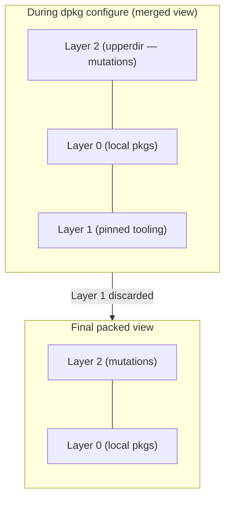
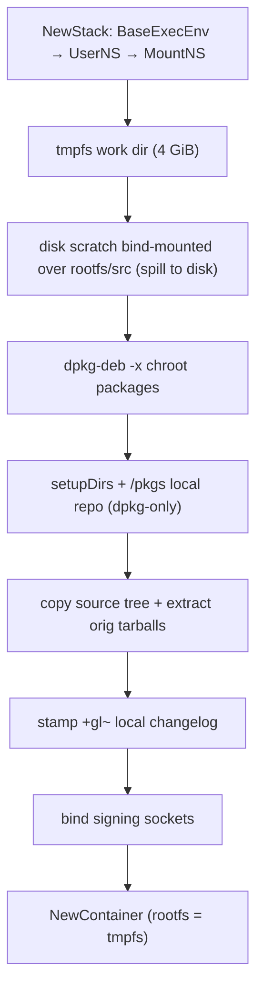

# Package build and image assembly

`internal/build` is the integration layer: the place where the artifact engine,
the kernel-primitive sandbox (`internal/container`), the Debian metadata layer
(`internal/debian`), and the content-addressed store (`internal/objstore`) meet.
Everything below the graph is reusable machinery; everything in this package is a
*concrete artifact kind* — a Go type that implements `artifact.Artifact` by
folding a content-addressed identity out of the lower layers and running a build
action that assembles a chroot, drives dpkg, and harvests blobs back into the
store.

This is the largest package in the tree (~4000 lines). It is dense because the
work is dense: six artifact kinds, a chroot-assembly pipeline shared between
three of them, an overlay-based rootfs model, an out-of-container signing
service, and the registries that wire references between all of it. This chapter
is the field guide for working on that code. It assumes the engine's
`artifact.Artifact` contract is already understood (see the artifact-engine
chapter); here we only quote the parts that bear directly on how a build kind
composes identity and inputs.

## The artifact contract, briefly

Every kind in this package implements the same interface. The methods that matter
for the discussion below:

```go
type Artifact interface {
	Key() string
	Identity() (objstore.Hash, error)
	Depends() []Artifact
	Includes() []Artifact
	Inputs() []Input
	Build(ctx BuildContext) ([]Output, error)
	OutputRefs(store *objstore.Store) (manifest objstore.Hash, leaves []objstore.Hash, err error)
	ShortName() string
}
```

Two distinctions run through the whole package and are worth fixing before the
per-kind detail:

- **`Key()` versus `Identity()`.** `Key()` is a stable, human-legible node
  address (`debian-pkg-build:glibc:amd64`). It is *position* in the graph, not
  content. `Identity()` is the content-addressed SHA-256 fold over everything
  that can change the build result; it is the key under which the node's output
  manifest is stored in `store.Map`, and the thing the cache keys on. A changed
  source byte, dependency, or tool moves the identity but never the key.
- **`Depends()` versus `Includes()`.** `Depends` are build-order edges (and the
  only ones the cycle detector enforces). `Includes` are closure-only edges:
  they pull an artifact into a consumer's transitive runtime/install closure
  without imposing build order, so same-source siblings that reference each
  other do not form an artificial cycle. Their actual co-production happens in
  the shared parent source build, which *is* a `Depends`.

### Identity folding

Identities are built with `objstore.ConcatHash(parts...)`: each string part is
SHA-256'd to a fixed 32-byte frame, the frames are concatenated in order, and the
concatenation is hashed again. The fixed-frame reduction makes the encoding
unambiguous — moving a byte between adjacent parts always changes the result —
so **fold order is part of the contract.** Changing the order of the parts, or
inserting one, silently invalidates every cache entry of that kind. The per-kind
fold orders below are therefore exact, not illustrative.

Every fold begins with two parts in this order:

1. `artifact.IDSeed()` — the global identity-scheme seed (overridable at runtime
   via `$GLBX_ID_SEED_OVERRIDE` for an independent cache namespace). Changing it
   invalidates the entire cache.
2. a **per-type seed** — a distinct 128-bit hex constant per kind
   (`sourceSeed`, `binarySeed`, `rootfsSeed`, `imageSeed`, `toolingSeed`). These
   namespace the cache by kind: regenerating one seed invalidates exactly that
   kind and leaves the others untouched, and their distinctness guarantees two
   kinds can never alias on identity even over byte-identical inputs. The exact
   hex values live in the respective source files; you do not need them to reason
   about the code, only to know they exist and are distinct.

## The six artifact kinds

| Kind | Type | `Key()` format | File |
|---|---|---|---|
| Source build | `DebianPkgBuild` | `debian-pkg-build:<name>:<arch>` | `source.go` |
| Binary package | `debianBinaryPkg` | `debian-binary-pkg:<src>:<bin>:<arch>` | `binary.go` |
| Rootfs | `Rootfs` | `rootfs:<label>:<arch>` | `rootfs.go` |
| Image | `Image` | `image:<name>:<arch>` | `image.go` |
| Tooling build | `ToolingPkgBuild` | `tooling-pkg-build:<name>:<arch>` | `tooling.go` |

The first two are the shipped-package world: a source compile and the
per-binary validation that re-emits its outputs. The rootfs and image are the
assembly tiers stacked on top. The tooling build is a parallel, structurally
isolated world for image-assembly tools.

---

## Source build — `DebianPkgBuild` (`source.go`)

A source build compiles one source package into its binary `.deb`s inside the
sandbox. Its `Key()` is `debian-pkg-build:<name>:<arch>`.

### Identity fold order

`Identity()` folds, in this exact order:

1. `artifact.IDSeed()`
2. `sourceSeed`
3. `dirhash.HashDirectory(PkgDir)` — the content hash of the whole package
   directory (`build.yml`, `build-deps.yml`, `sources.yml`, `src/`)
4. `Arch`
5. for each dependency in `DepArtifacts` (resolved order), its `Identity().String()`
6. **only when signing is configured:** for each key in `build.yml`'s `signing`
   list order, the hex SHA-256 of that key's *certificate* content
   (`hashSigningCert`)

The signing certs are appended **only** when the package requests signing, so a
non-signing package hashes exactly as it would with no signing support in the
tree. The private key is never read — the cert hash alone suffices to make
toggling or rotating signing yield a distinct identity.

### Dependency resolution

`resolveDeps()` (idempotent, guarded by `depsResolved`) reads `build.yml` and
turns each `build_depends` entry — written `<source>:<binary>` — into a binary
artifact via the `binaryResolver` (the `PackageSet`; see below). The resolved
binaries land in `DepArtifacts`.

The signing module is an **implicit** build dependency. If `build.yml` declares
any signing keys, `resolveDeps` additionally pulls in `glbx-pkcs11-forward`
(both source and binary of that name) as a `DepArtifacts` entry. It is
deliberately not listed in any depends file: *requesting signing* is what pulls
it in, so it is installed into the chroot for the build's signing tooling to
load, and it participates in the identity (through the standard dep-identity
fold, step 5) so toggling signing invalidates the cache. A signing request with
that package absent from the tree is a hard error.

`Inputs()` references each binary dependency's `<name>.deb` and
`control:<name>` outputs — the engine resolves these to blob hashes before
`Build` runs.

### The local version suffix

A built package never carries its upstream version verbatim. `computeVersion()`
reads the top `debian/changelog` entry's base version and appends
`+gl~<srcHash[:8]>` — the literal tag `+gl~` followed by the first eight hex
digits of `dirhash.HashDirectory(PkgDir/src)`. `stampLocalChangelog` prepends a
synthetic changelog entry carrying that version (authored by `nobody`, reusing
the original trailer date so `dpkg-buildpackage` reads the same
`SOURCE_DATE_EPOCH` and the `.deb` stays reproducible). The suffix makes the
package version a pure function of its source content, so same-source siblings
can depend on each other by exact version and a rebuilt source never collides
with a prior build at a different content.

### The build action

`Build` orchestrates, in order: resolve deps → load the pinned build-tooling
index → compose the chroot package set → start signing services → set up the
build env → run the build → collect outputs. The chroot-assembly phases
(`build_phases.go`) are detailed in their own section below, since the tooling
build reuses them verbatim.

One composition rule lives here and is load-bearing: **a locally-built package
overrides same-named pinned tooling.** `Build` loads the pins
(`build-deps.yml` → `pinnedToolingIndex`), loads the local dependency closure,
and drops any pinned package whose name a local build also produces. The local
copy is then the only candidate in the chroot, so the pinned (archive) version
cannot shadow or downgrade a locally-built library that same-source siblings
depend on by exact version.

`Binary(name)` is the factory for the per-binary artifacts this source build
produces: it memoizes one `debianBinaryPkg` per name, back-pointing at the
source build. The `PackageSet` additionally stamps each returned binary with the
resolver so it can resolve its own runtime deps.

---

## Binary package — `debianBinaryPkg` (`binary.go`)

A binary package performs **no compilation.** It selects one named binary from
its parent source build's outputs, validates it, and re-emits it as the thing
downstream artifacts depend on. Its `Key()` is
`debian-binary-pkg:<src>:<bin>:<arch>`.

### Edges

- `Depends()` is its source build plus its `extraDeps` (cross-source binaries it
  depends on). The source build edge is what forces the compile before the
  validation.
- `Includes()` is its same-source **siblings** — binaries co-produced by the same
  source build that this one references via `runtime_depends`. They are closure
  edges, not build edges: the shared source build already produces them, so an
  explicit `Depends` would only manufacture a cycle.

`resolveExtraDeps()` reads `build.yml`'s `runtime_depends[<binary>]` and
`build_depends`, resolving each `<source>:<binary>` through the resolver. A
resolved binary whose source build is *this* source build is classified as an
`include`; anything else is an `extraDep`. (`build_depends` count toward locality
too, so they are classified the same way.)

### Identity fold order

`Identity()` folds, in this exact order:

1. `artifact.IDSeed()`
2. `binarySeed`
3. `b.name` — the binary's own name
4. the source build's `Identity().String()`
5. for each `extraDep`, its `Identity().String()`
6. for each sibling `include`, the string `"include:" + sib.Key()`

Siblings fold their **`Key()`**, not their `Identity()` — deliberately, to avoid
the mutual recursion two cross-referencing siblings would otherwise cause
(`Identity` → sibling `Identity` → back). The same-source content that a sibling
would contribute is already captured through the shared source build's identity
(step 4), so folding the key is sufficient to distinguish the edge without
re-hashing content.

### The build action: locality check + install check

`Build` pulls the `.deb` and `control:<name>` from the resolved inputs and runs
two checks:

1. **`validateLocality`** parses the binary's control stanza and verifies that
   every runtime `Depends`/`Pre-Depends` alternative is satisfiable *either* from
   the local build closure (`buildLocalSet()` — the transitive names reachable
   via `extraDeps` + `includes`, plus their virtual `Provides`) *or* from this
   binary's declared `lockfile_deps` allowance. An unsatisfied dependency fails
   the build with the offending alternatives listed. `lockfile_deps` are strictly
   local to the declaring binary and never inherited by consumers.

2. **the install check** (`install_check.go`) proves the binary physically
   unpacks and configures with dpkg against a database that knows only our
   packages. This is the subtlest piece in the package and gets its own section.

On success the binary re-emits its validated `.deb` and `control:<name>` as its
own outputs — the same blobs it received as inputs, now addressable under this
node's identity.

### The install check (`install_check.go`)

The problem: a locally-built package's maintainer scripts assume a working base
system (a populated `/etc/passwd`, a configured libc, `ldconfig` already run),
but we must not let the *base* packages' own dependency reasoning interfere with
validating *our* package — the pinned base may sit at a different point in the
archive's history than our locally-built libraries.

The resolution is a three-step sequence inside a fresh sandbox:

1. **Bootstrap a base** from the pinned build-tooling's essential set
   (`install.Bootstrap`) — extract and fully dpkg-configure it, so the chroot
   has the filesystem state maintainer scripts expect.
2. **`install.ResetDpkgDatabase`** — truncate `var/lib/dpkg/status` and
   `available` while leaving every base file on disk. dpkg now has *no record* of
   the base packages: it will not reconfigure them or check their dependencies.
   The base's filesystem state (`/etc/passwd`, the linker cache, …) survives to
   satisfy maintainer scripts, but a base package coupled to a different libc can
   no longer break the install by being reconfigured against the wrong library.
3. **Install the binary and its local closure** on top of the wiped base
   (`install.InstallResolved`), so dpkg reasons *only* over the packages we
   build. A missing local dependency fails resolution; a dpkg problem fails the
   install — both are the correct signal that the local build universe is
   incomplete.

The test package itself is synthesized from its control stanza and `.deb` hash
(`buildTestPackageEntry`) and added to the local index so resolution can see it.
Declared `lockfile_deps` present in the pinned tooling are resolved and folded
into the local index as an allowance; names absent from the current archive are
skipped rather than failing.

---

## Rootfs — `Rootfs` (`rootfs.go`)

The rootfs is a root filesystem assembled from locally-built packages via a
three-layer overlay. Its `Key()` is `rootfs:<label>:<arch>`, one node per
`rootfs-<label>.yml` variant. `NewRootfs` reads that file's `src:pkg` entries and
resolves each through the `PackageSet` into a `DirectDeps` list of binary
artifacts. `Depends()` is those direct binaries; the full binary closure is
walked transitively through `Inputs()` and `allBinaryDeps()`.

### Identity fold order

`Identity()` folds, in this exact order:

1. `artifact.IDSeed()`
2. `rootfsSeed`
3. `Label`
4. `Arch`
5. for each pinned image-tooling file in `rootfs-deps.yml` (tool order, then file
   order within a tool), that file's content hash
6. the string `"conf.d:" + dirhash(rootfs-<label>.conf.d)`, or `"conf.d:none"`
   when the directory is absent
7. for each binary in the transitive closure (`allBinaryDeps()`), its
   `Identity().String()`

The conf.d fold uses `dirhash.HashDirectory`, which folds a symlinked script's
*target string* (not the pointed-to content) — deterministic, and a fixed marker
when the directory is absent so it is stable and distinct.

### The three-layer overlay

The assembly uses three overlay layers, built in a tmpfs workspace inside the
mount namespace:

- **Layer 0** — the locally-built packages, raw-extracted (`dpkg-deb -x`). This
  is what ships.
- **Layer 1** — the pinned image-configuration tooling (`rootfs-deps.yml`),
  raw-extracted, **filtered to exclude anything already in Layer 0 by name.**
  This is the Debian infrastructure dpkg needs to configure against; it is
  *discarded* from the final image.
- **Layer 2** — the writable upper dir that captures everything the dpkg steps
  mutate: postinst output, `ldconfig`, `update-alternatives`, and so on.

During configuration, dpkg runs against a merged view with Layer 0 + Layer 1 as
lowerdirs and Layer 2 as the upper; the final packed image is Layer 2 over Layer
0 only.



### Narrowing the install set

Before extraction, `narrowInstallSet` resolves the install closure of
`DirectDeps` against the local packages' own dependency metadata (merged over the
tooling index, so externals like `libc6` still resolve through Layer 1). Only the
locally-built packages that fall in that closure become Layer 0 — build-only
siblings (`-dev`, `-static`) that the build closure drags in but the runtime does
not need are dropped. `loadLayer1Pkgs` then filters the pins by the *actually
extracted* Layer 0 names, not the full build closure: a package can appear in the
closure as a sibling-include (e.g. `libc-bin` pulled in by `libc6`'s
runtime_depends purely for the source build's install-check coupling) without
belonging to the rootfs's runtime set, in which case the lockfile-mirror copy is
still what belongs in Layer 1.

### dpkg and the conf.d scripts

`runDpkg` mounts the build overlay, bind-mounts the local `.deb`s into `/pkgs`,
creates the container, and runs the two-phase dpkg (`--unpack --force-depends`
then `--configure --pending`) against the merged view.

After configuration, `runConfScripts` runs the variant's setup scripts: the
executable regular files of `rootfs-<label>.conf.d`, in **byte-wise name order**,
each staged into the container at `/glbx-conf.d` and executed by its shebang
(`#!/bin/bash`, with `set -e` convention) at `/`. A non-zero exit fails the
build. Symlinks are followed (so one variant's conf.d may link into another's to
share a script), and a missing or empty directory is a no-op.

Both the `/pkgs` staging area and the `/glbx-conf.d` directory are torn down
*before the overlay is unmounted*, so their removal is recorded in the writable
upper layer and neither appears in the packed rootfs.

### Packing

`packFinal` mounts the final overlay — `lowerdir=<layer2>:<layer0>`, i.e. Layer 2
*over* Layer 0, Layer 1 gone — and packs it to a deterministic `tar.gz`
(`--mtime=@0 --sort=name --numeric-owner`) streamed straight from the mount
namespace into the store as the single `rootfs.tar.gz` output. The pack runs
`tar` inside the namespace and pipes its stdout into the hash-on-write store with
no copy out of the sandbox.

---

## Image — `Image` (`image.go`)

The image is the top of the graph: it runs an image *type*'s assembly script
inside a container built from that type's tooling lock, handing the script the
rootfs tarball and harvesting the disk image the script writes. Its `Key()` is
`image:<name>:<arch>`, one node per `images.yml` entry.

### Edges and inputs

`Depends()` is the one rootfs node, each `local_tooling` build, and each image
named by an image input. These are the only cross-universe edges: image →
rootfs, image → tooling build, image → image. `Inputs()` references the rootfs
`rootfs.tar.gz`, each local-tooling build's named `.deb`, and each distinct
referenced image's single `image` output. Image inputs are resolved *by source*
in `Build` rather than through the name-keyed input map, because every image
shares the one output name `image` and distinct images would otherwise collide.

### The per-image inputs

Each `images.yml` entry may carry an `inputs` list. Each input has a `label` and
exactly one of:

- **`value`** — a literal, written as a regular file at
  `$GLBX_INPUTS_DIR/<label>`.
- **`image`** — the name of another image, whose output blob is bind-mounted
  read-only at `$GLBX_INPUTS_DIR/<label>` and which becomes a build dependency.

`buildImages` (`graph.go`) wires these in a two-pass construction so an input may
reference an image defined anywhere in `images.yml`, including later.

### Identity fold order

`Identity()` folds, in this exact order:

1. `artifact.IDSeed()`
2. `imageSeed`
3. `Name`
4. `Arch`
5. the rootfs's `Identity().String()`
6. the assembly script (`build`) content hash
7. the `conf.yml` content hash
8. for each pinned assembly tool in `tooling-deps.yml` (tool order, then file
   order), that file's content hash
9. for each `local_tooling` build, its `Identity().String()`
10. for each input, in `images.yml` order: the literal parts `"input"` then the
    `label`; then for a value, `"value"` and the literal bytes; for an image,
    `"image"` and the referenced image's `Identity().String()`

Note step 10: a referenced image is already a `Depends`, but a `Depends` edge
does not itself fold the dependency's identity into this node. Folding it here is
what makes a changed referenced image rebuild this one.

### The build action

`Build` assembles a working system and runs the script:

1. Raw-extract the pinned assembly tooling, then each `local_tooling` `.deb` on
   top (local overrides same-named pinned tooling: the pinned copy is dropped so
   the local one is the only candidate dpkg configures).
2. Stage every `.deb` into `/pkgs`, set up the dpkg dirs, and run the two-phase
   `dpkg --unpack --force-depends` / `--configure --pending` — so the container
   is a *real configured system* (alternatives wired, maintainer scripts run),
   not a bag of raw-extracted files.
3. Stage the rootfs tarball read-only, the assembly script, and the resolved
   inputs under `/glbx-image` (`stageInputs`).
4. Run the script by its shebang, passing it the rootfs tarball path and the
   output path as arguments, with the environment:
   - `GLBX_IMAGE_ID` = the image's own identity, so the script can derive every
     otherwise-random on-disk identifier (filesystem/partition/disk UUIDs, hash
     seeds) deterministically from a value that is already a pure function of the
     rootfs + script + tooling;
   - `GLBX_INPUTS_DIR` = `/glbx-image/inputs`;
   - `GLBX_ARCH` = the target architecture, for arch-dependent on-disk metadata
     (e.g. the per-architecture GPT root partition type GUID). Additive: a script
     that does not need it ignores it.
5. Harvest the written image from the staging mount namespace (never `cat` out of
   the container): the file is visible in the parent namespace under the tmpfs,
   and `harvestFileFromMountNS` streams it into the store as the single `image`
   output.

### Capabilities and the loop device — read this accurately

Image assembly scripts need broad privilege (they build disk images, partition
tables, filesystems). The framing matters and is easy to get wrong:

- The container the script runs in has **ambient capabilities 0..40** — the full
  set the base exec env grants to *every* sandboxed process (`allCaps()` in
  `container/base.go`). This is an environmental fact of how glbx's sandbox is
  constructed, not a privilege the image kind requests.
- There is **simply no loop device** inside the container. The sandbox does not
  provision one.

So it is accurate to say image assembly runs with broad capabilities and no loop
device. It is **not** accurate to say glbx grants image assembly a
`CAP_SYS_ADMIN`-specific privilege that other kinds lack: the caps are the same
everywhere, and an assembly script that wants a loop-mounted filesystem must work
around its absence rather than rely on glbx to supply one.

---

## Tooling build — `ToolingPkgBuild` (`tooling.go`)

A tooling build compiles an image-assembly tool package. Its `Key()` is
`tooling-pkg-build:<name>:<arch>`. It is its **own artifact universe**: a distinct
key namespace, a distinct identity seed, and build dependencies resolved only
among other tooling builds.

### How it reuses the source build

`ToolingPkgBuild` *embeds* a `DebianPkgBuild` (`inner`) and delegates the build
body to it — `setupBuildEnv`, `runBuildInContainer`, `collectOutputs` are shared
verbatim. What it overrides is the artifact-interface surface that makes tooling a
separate world:

- **No binary-validation layer.** A tooling build's outputs — the built `.deb`s —
  are consumed directly at image-assembly time; there is no `debianBinaryPkg`
  between them and the image, and so no locality check or install check.
- **Deps resolved only among tooling.** `SetBuildDeps` records the other tooling
  builds this package needs and marks the inner build's dep resolution done so it
  never tries the shipped resolver path. The `ToolingSet` that populates this
  slice can only reach other tooling builds, so the edge set is structurally
  closed: a tooling `build_depends` can never reach a `pkgs/` binary, and a
  shipped `build_depends` can never reach a tooling build.

### Identity fold order

`Identity()` folds, in this exact order:

1. `artifact.IDSeed()`
2. `toolingSeed`
3. `dirhash.HashDirectory(PkgDir)`
4. `Arch`
5. for each build-dep tooling build, its `Identity().String()`

The `toolingSeed` is what guarantees a tooling build and a same-named shipped
source build can never collide on identity even over a byte-identical tree — the
two live in disjoint cache namespaces by construction.

`Build` composes the chroot the same way a shipped build does — pinned tooling
plus every build-dep tooling `.deb`, local builds overriding same-named pins —
then runs the shared phases.

---

## The chroot-assembly pipeline (`build_phases.go`)

This is the shared engine room: `DebianPkgBuild.setupBuildEnv`,
`runBuildInContainer`, and `collectOutputs`, reused verbatim by the tooling
build.

### `setupBuildEnv`

Builds the full sandbox stack (`container.NewStack`: `BaseExecEnv → UserNS →
MountNS → Container`) and populates the chroot inside the mount namespace:

1. `MkTempDir` + mount a **4 GiB tmpfs** at the work path; the chroot rootfs sits
   under it.
2. Create `rootfs/src`, then bind-mount a **disk-backed scratch directory** over
   it. The source tree and the whole compile run on a host directory under the
   cache dir (`objstore.DefaultRoot()/tmp` by default, or the configured
   `ScratchDir`), bind-mounted over `src` — so large builds **spill to disk**
   rather than filling the tmpfs (and RAM). This host directory, and its
   subuid-owned contents, are removed in cleanup via the namespace-root stub
   while the mount namespace is still alive.
3. Raw-extract each chroot package with `dpkg-deb -x`.
4. `setupDirsInMountNS` (dpkg infrastructure dirs) and `setupLocalRepoInMountNS`
   (bind each `.deb` into `/pkgs` — dpkg-only, no apt metadata is ever written).
5. Copy in the source tree (`cp -a`), bind-mount the pinned orig tarballs, and
   extract them (`--strip-components=1`, with component orig tarballs extracted
   into their own subdirectories).
6. Stamp the synthetic local-version changelog.
7. Bind the signing sockets (see below).
8. Create the `Container` with the tmpfs rootfs as its root.



### `runBuildInContainer`

Registers the unpacked chroot packages with dpkg, then compiles:

1. **`dpkg --unpack --force-depends`** over all `/pkgs/*.deb`, then
   **`dpkg --configure --pending`**. The two-phase split is what breaks
   Pre-Depends cycles: Pre-Depends requires a dependency configured *before* the
   dependent is unpacked, which a single-pass batch install cannot satisfy from
   an empty dpkg database. Force-unpack to get every file on disk, then configure
   in topological order.
2. Create an unprivileged **build user, uid/gid 1000** (`dev`), and `chown` the
   source tree to it.
3. For a `debian-kernel` package (`build.yml`'s `pkg_type`), run
   `debian/rules debian/control-real` first. That package's committed
   `debian/control` carries an md5sum self-check keyed to the upstream changelog
   version; the synthetic local version we stamped makes the check fail, which
   `debian/rules` turns into a deliberate build-abort. Regenerating control for
   the build-time version makes the self-check pass when `dpkg-buildpackage`'s
   clean step re-evaluates it. (The gen-control tooling is in the package's own
   Build-Depends, so it is already in the chroot.)
4. Run **`dpkg-buildpackage --no-sign`** as uid 1000, with build env derived from
   `build.yml` (`DEB_BUILD_PROFILES`, `DEB_BUILD_OPTIONS`, `ExtraBuildEnv`) plus
   the signing env. Signing is out-of-container (below), so `dpkg-buildpackage`
   itself never signs.

### `collectOutputs`

Lists the `.deb` files produced in `/src/`, pipes each straight from the
container into the store (`pipeFromContainer`, via the IPC fd — no copy, no
in-container process), and emits two outputs per deb: `<name>.deb` and the
`control:<name>` stanza blob (from `dpkg-deb -f`).

---

## Out-of-container signing (`signing.go`)

Some packages (notably the kernel) must sign artifacts during their build, but
the private key must never enter the sandbox. The host-side signing service, the
protobuf wire protocol, the PKCS#11 forwarding module, and the deterministic
signing all have their own chapter — [Out-of-container signing](./signing.md).
What belongs here is only how a build *wires* it:

- `setupSigning` (`signing.go`) runs on the host before the container is built,
  launching one signing service per key in `build.yml`'s `signing` block and
  recording where each socket will be bound.
- `bindSigningMounts` binds each host socket into the container at
  `/glbx/signing-service/<key_name>` — outside the directories the container later
  overmounts — and the build's `GLBX_SIGN_SOCKET` env var names it for the
  in-container PKCS#11 forwarding module.
- The forwarding module `glbx-pkcs11-forward` is pulled in as an **implicit**
  build dependency (`resolveDeps`) whenever any signing key is configured, so it
  is installed into the chroot and folds into the source build's identity like any
  other dependency.
- Only each key's **certificate** is folded into the source build's identity (the
  source-build fold, step 6); the private key is read on the host and never
  influences identity, so rotating the key alone does not change the cache key
  while changing the certificate does.

---

## Install helpers (`internal/install`)

The install package is the dpkg-driving layer the build kinds share. It is
explicitly **not debootstrap** — glbx bootstraps a base from raw `.deb`s and dpkg
alone.

- **`Resolve`** (`resolve.go`) is the single resolver entry point: it wraps
  `internal/resolver` to compute the closed install set (deps + pre-deps) for a
  set of package names against an index. Both bootstrap and install go through it
  — no dual implementations.
- **`Bootstrap`** resolves the index's essential set and calls
  **`BootstrapResolved`**, which builds a container whose base is exactly a given
  package set: raw-extract each `.deb`, set up the dpkg dirs, make the rootfs a
  shared mount point (so later bind-mounts propagate into the container), create
  the container, and run the two-phase install. Use `BootstrapResolved` directly
  when the base set is already resolved — e.g. from pinned tooling that carries no
  `Essential` metadata.
- **`InstallResolved`** bind-mounts the resolved `.deb` blobs read-only into
  `/pkgs` (propagating via `MS_SHARED`/`MS_SLAVE`), runs `dpkg --unpack
  --force-depends` over all of them, then `dpkg --force-confnew --configure
  --pending`, and tears the binds down. The `--force-confnew` is required by the
  install check: layering a local closure on a lockfile-bootstrapped base can hit
  a conffile whose content matches neither the old nor new packaged md5, which
  dpkg would otherwise prompt on and die at EOF (stdin is `/dev/null`);
  `DEBIAN_FRONTEND=noninteractive` does not suppress dpkg's *own* conffile
  prompt.
- **`ResetDpkgDatabase`** truncates `var/lib/dpkg/status` and `available` while
  leaving every installed file on disk. dpkg records installed state entirely in
  `status`; emptying it makes dpkg consider nothing installed, so a subsequent
  install reasons only over the packages it is handed — while the on-disk system
  state the base configured (`/etc/passwd`, the linker cache, …) is untouched.
  The per-package `info/` files are keyed by status and rewritten for whatever is
  installed next, so they need no clearing. This is the mechanism the binary
  install check leans on.

---

## The registries (`graph.go`, `toolingset.go`)

### `PackageSet` (`graph.go`)

Scans `pkgs/`, registering one `DebianPkgBuild` per directory with a
`src/debian/control`. It is the `binaryResolver` the shipped source and binary
builds use: `Binary(src, pkg)` resolves a `<source>:<binary>` reference to the
memoized `debianBinaryPkg`, and `ProvidesMap()` / `LocalSet()` expose the virtual
`Provides` and the full local binary-name set that the locality check consults.

### `ToolingSet` (`toolingset.go`)

Mirrors `PackageSet` for the tooling universe, scanning `images.d/tooling/` and
producing only `ToolingPkgBuild` nodes. `wireDeps` resolves each tooling build's
`build_depends` to other tooling builds and errors if one names a source outside
the tooling universe — the structural closure described earlier is enforced here.
`ToolingBinary(src, bin)` resolves a `local_tooling` reference for the image
layer.

### `BuildGraph`

`BuildGraph` is the top-level constructor. It builds a `PackageSet` and a
`ToolingSet`, creates one `Rootfs` per `rootfs-<label>.yml` variant and one
`Image` per `images.yml` entry (via `buildImages`'s two-pass input wiring), and
lets `artifact.Discover` walk the dependency chains. **Roots:** every image *and*
every rootfs variant when `images.yml` is present; just the rootfs variants when
it is absent. A missing `images.yml` yields no images and no error — a config repo
need not have an image layer.

### Enumeration for GC and publish

`GraphResult.BuiltOutputs` walks the graph and, for each *already-built* node,
collects its manifest blob, its leaf output blobs, the `identity → manifest`
alias, and (gated on the node being built, so a log is never published without
its outputs) its recorded log alias. This single enumeration is what both garbage
collection (which keeps those blobs) and publishing (which mirrors them and sets
the aliases on a remote) consume. `BuiltOutputsFor` is the per-node form, used by
`publish --target <Key>` to mirror exactly one node's result.

---

## Working on this package — a short map

- **Changing an identity fold** invalidates that kind's cache. If the change is
  intentional and incompatible, regenerate the per-type seed; if it is a bug fix
  that must preserve existing identities, preserve the exact part order.
- **The chroot phases are shared.** A change to `build_phases.go` affects both
  shipped and tooling builds. The two-phase dpkg (unpack-all then
  configure-pending) is load-bearing for Pre-Depends cycles everywhere it
  appears — the source build, the rootfs, the image, and the install bootstrap.
- **Local overrides pinned** is a recurring rule: a locally-built package drops
  the same-named pinned copy in the source-build chroot, the tooling chroot, the
  rootfs install set, and the image assembly container. The reasoning is always
  the same — the pinned (archive) copy must not shadow or downgrade the local
  build.
- **Serialization differs by channel.** Exec/control is gob; signing is
  protobuf. Keep them straight.
- **Nothing `cat`s out of a container.** Outputs are harvested through the IPC
  file descriptor straight into the hash-on-write store — `pipeFromContainer`,
  `harvestFileFromMountNS`, and the piped `tar` in `packRootfsTarFromMountNS`.
