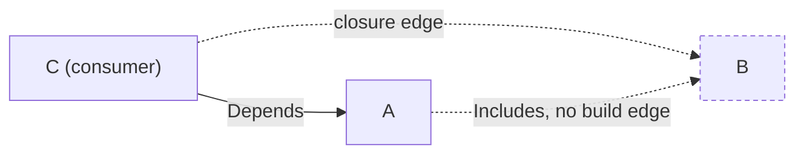
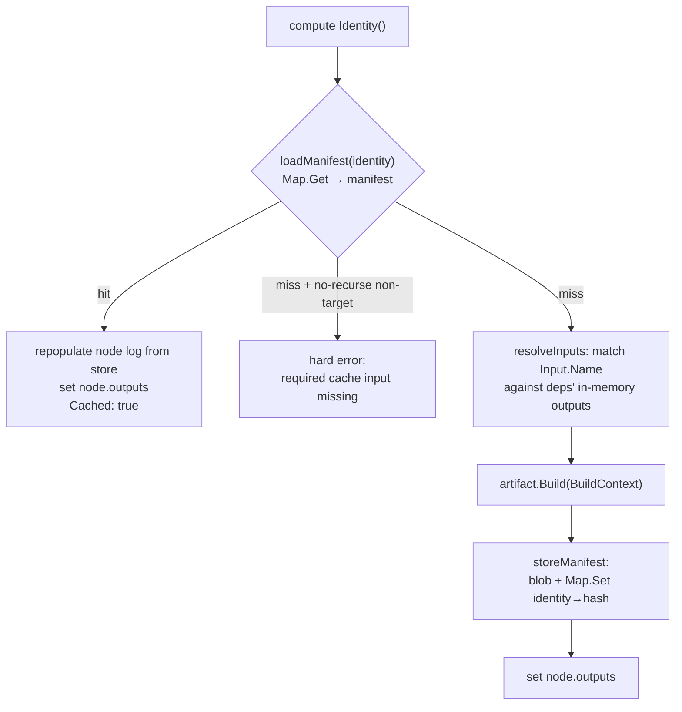

# The artifact engine

The `internal/artifact` package is the heart of glbx's build machinery, and it is
deliberately empty of domain knowledge. It knows about a *graph of things that can
be built*, how to order them, how to run them in parallel, how to decide whether a
given thing is already built, and where to record the logs and outputs of a run.
It knows nothing about Debian source packages, binary `.deb`s, rootfs trees, or
image assembly. Those are the build package's artifact kinds — they implement an
interface the engine traverses, and that interface is the entire contract between
"what gets built" and "how building is scheduled, cached, and recorded".

This chapter is a field guide to that engine: the `Artifact` interface and its
identity model, the graph construction and ordering rules, the scheduler, the
cache semantics, the log and run-record keying, and the reproducibility check.
The concrete kinds are documented in the next chapter.

## The `Artifact` interface

Everything the engine builds is an `Artifact`. The interface (from `artifact.go`)
is the centrepiece of the package:

```go
type Artifact interface {
	Key() string
	Identity() (objstore.Hash, error)
	// Depends are build-order edges: an artifact's dependencies must be built
	// before it. Cycles among Depends are forbidden and rejected by the engine.
	Depends() []Artifact
	// Includes are closure-only edges: included artifacts contribute to the
	// transitive runtime/install closure of consumers but impose no build-order
	// constraint. Cycles among Includes are legal — the engine's cycle detector
	// ignores them. Two artifacts produced by the same source build that
	// reference each other (e.g. libssl3t64 ↔ openssl-provider-legacy) declare
	// the relationship via Includes; their actual co-production happens in the
	// shared parent source build, which IS a Depends.
	Includes() []Artifact
	Inputs() []Input
	Build(ctx BuildContext) ([]Output, error)
	// OutputRefs returns the blob references for an artifact that has already
	// been built, without building. manifest is the hash of the map's target
	// blob (the local manifest / entrypoint); leaves are the output blobs it
	// references. Returns an error if the artifact has not been built (no map
	// entry), so graph-walking callers (GC, upload) can skip on error.
	OutputRefs(store *objstore.Store) (manifest objstore.Hash, leaves []objstore.Hash, err error)
	// ShortName is the display label for the node: the unique part only (the
	// source or binary package name, or "rootfs"), with no type prefix. Unlike
	// Key it is not guaranteed globally unique — it is for human-facing output,
	// not identity.
	ShortName() string
}
```

The two string-valued name methods play distinct roles, and conflating them is a
common source of confusion:

- **`Key()`** is the artifact's globally unique address in the graph. It is what
  `Graph.nodeMap` is keyed by, what deduplicates nodes when two consumers depend
  on the same thing, what the CLI's `--target <Key>` names, and what every
  deterministic ordering falls back to as a tiebreaker. A `Key` is typically a
  typed, qualified string like `rootfs:<label>:<arch>` or `image:<name>:<arch>` —
  structured so that no two distinct nodes ever collide.
- **`ShortName()`** is a human display label — the bare package name, or
  `"rootfs"` — with no type prefix and no uniqueness guarantee. It appears in the
  task UI and the reproducibility report; it is never used for identity or
  lookup.

`Identity()` is the other half of the naming story and is covered in its own
section below.

### Inputs, Outputs, and the BuildContext

An artifact's `Build()` produces named results and consumes named results from
its dependencies. Both sides are opaque to the engine:

```go
type Output struct {
	Name string
	Hash objstore.Hash
}

type Input struct {
	Source Artifact
	Name   string
}

type BuildContext struct {
	Ctx    context.Context
	Store  *objstore.Store
	Inputs map[string]objstore.Hash
}
```

An `Output.Name` is any string the producer chooses — a filename, a qualified name
like `"control:libc6"`, whatever is meaningful to that kind. The engine never
interprets it; it only stores and retrieves outputs by name through the manifest
format.

An `Input` says "I need the output named *N* from artifact *S*". `Input.Source`
must be a `Depends` of the consumer (or reachable through the includes closure of
one) so that it is guaranteed built first. Before calling `Build()`, the engine
resolves every `Input` into a concrete blob hash and hands the result to the
artifact as `BuildContext.Inputs`, a `map[Input.Name]objstore.Hash`. The artifact
therefore never walks the graph itself: it declares what it needs by name and
receives resolved hashes. This is the mechanism by which the engine stays
indifferent to what an artifact builds — it moves opaque named blobs between
opaque nodes.

Note that `Inputs()` and `Depends()` are orthogonal declarations. `Depends()`
establishes build order; `Inputs()` declares which specific outputs of those
dependencies the build consumes. A kind can depend on something for ordering
without consuming any of its outputs, and conversely every `Input.Source` must be
ordered before the consumer or input resolution will fail.

## Identity: folding from the leaves

`Key()` addresses a node in the graph; `Identity()` addresses its *content* in the
object store. Identity is a content hash computed bottom-up: a leaf artifact folds
its own defining bytes (source URLs, config, build parameters) into a hash, and a
higher artifact folds in the identities of everything it is built from. Change any
leaf and the change ripples up through every identity that transitively depends on
it — which is exactly what makes cache invalidation precise. The identity is what
the engine looks up to answer "is this already built?", so two builds that would
produce bit-identical results share an identity and therefore a cache entry.

The composition is seeded. `artifact.go` defines a single global seed and the
accessor every kind folds in first:

```go
const idSeed = "0cd41e1dddf3c1fc2f4c6bd523345898"

func IDSeed() string {
	if override := os.Getenv("GLBX_ID_SEED_OVERRIDE"); override != "" {
		return override
	}
	return idSeed
}
```

`IDSeed()` is the first element every artifact type folds into its identity, so it
namespaces the entire cache at once: change the constant and every identity in the
system changes, invalidating the whole store in one stroke. The constant is an
arbitrary unguessable value, not a format-bearing literal; regenerate it only when
the *shape* of how identities are composed changes system-wide. Setting
`GLBX_ID_SEED_OVERRIDE` in the environment replaces the seed at runtime, which
gives you a completely independent cache namespace without touching source — handy
for experiments that must not collide with a real cache. Per-kind changes do not
touch this global seed; each kind carries its own per-type seed in addition, so a
schema change confined to one kind invalidates only that kind.

## Building the graph

A `Graph` (in `graph.go`) is a set of `node`s keyed by `Key()`. Each node carries
its artifact, a state, its resolved edges, and scheduling bookkeeping:

```go
type node struct {
	artifact Artifact
	state    nodeState
	err      error
	deps     []*node
	includes []*node
	rdeps    []*node
	pending  int
	outputs  []Output
}
```

`deps` are the edges the scheduler waits on (build-order predecessors), `rdeps`
the reverse edges it fans out to on completion, and `pending` the count of
not-yet-complete deps — a node is a root when `pending == 0`. `outputs` holds the
node's results once it is built or restored, which is what input resolution reads.

There are two entry points. `Discover(roots)` walks `Depends()` and `Includes()`
recursively from a set of roots, materialising only the reachable closure.
`NewGraph()` + repeated `Add()` + `Build()` wires a pre-populated node set. Both
converge on the same edge-wiring rules and the same cycle check.

### The includes-closure edge rule

The subtle part of graph construction is how `Includes` becomes ordering edges,
and this rule is worth stating precisely because it is easy to get backwards.
`Depends` edges are direct build-order constraints. `Includes` edges are
closure-only: an included artifact contributes to a consumer's transitive
runtime/install closure but imposes no build-order constraint *on the includer
itself*.

Concretely, when wiring node `C`'s `Depends`, for each dependency `A` the engine
adds an ordering edge `C → A`, and then — recursively — an ordering edge from `C`
to every artifact in `A`'s includes closure. So if `A.Includes(B)` and
`C.Depends(A)`, then `C` gets ordering edges to **both** `A` and `B`. But `A`
itself gets **no** edge to `B`: an includer does not wait for its own includes.



The motivating case: two binaries co-produced by the same source build that
reference each other (for example `libssl3t64` ↔ `openssl-provider-legacy`)
declare the relationship with `Includes`. Their actual co-production happens in a
shared parent source build, which *is* a `Depends`. Encoding the mutual reference
as `Depends` would be a cycle; encoding it as `Includes` lets the closure flow to
consumers without imposing an impossible build order. This is why the two methods
exist as distinct concepts rather than one edge type.

### Cycle detection over `Depends` only

`detectCycles` is a standard white/gray/black DFS, but it traverses **`deps`
only**. Because the includes closure has already been folded into `deps` as
consumer-side ordering edges during `Build`/`Discover`, the cycle check sees every
real build-order constraint — including the closure-induced ones — while the raw
`Includes` back-references that created mutual-reference pairs never appear as
`deps` edges on the includer. The result is exactly the documented contract: a
cycle among `Depends` is rejected (`cycle detected: [...]` with the offending
path), while a cycle among `Includes` is legal and silently fine. If you ever add
an edge kind, this is the invariant to preserve: cycle detection must run over
precisely the set of edges the scheduler waits on.

### Ordering and export

Several traversals read the finished graph:

- `Roots()` returns the nodes with `pending == 0` — the scheduler's initial
  dispatch set.
- `StableTopologicalOrder()` is Kahn's algorithm driven by a `Key`-ordered
  min-heap (`nodeHeap`). Dependencies always precede dependents, and among nodes
  with no ordering constraint between them the `Key` tiebreak makes the order
  deterministic across runs and machines. This determinism is what lets the task
  UI list tasks stably and lets exported structure be diffable.
- `Prune(targetKey)` restricts the graph in place to a target's dependency closure
  (everything reachable through `deps` *and* `includes`), then rewrites the kept
  nodes' `rdeps` to drop any edge pointing outside the kept set, so the scheduler's
  completion fan-out never touches a pruned-away node. It is the mechanism behind
  targeted builds.
- `Edges()` exports the built-from edges sorted lexicographically by `(To, From)`.
  The sort makes a serialised export (consumed by `graph --format=json` and the CI
  workflow generator) stable byte-for-byte across runs. Note that the exported
  edges include the consumer-side includes-closure edges the graph wired, not only
  the raw `Depends`.

## The scheduler

`NewEngine(g, store, workers)` constructs the engine; `workers` is clamped to at
least 1. The default worker count is **not** chosen here — the CLI sets it in
`cmd/glbx/build.go` as `int(math.Sqrt(float64(runtime.NumCPU())))`, i.e. the
square root of the core count. This sublinear default accounts for each node build
being itself internally parallel (the sandboxed `dpkg-buildpackage`, decompression,
tar), so the graph-level fan-out stays well below `NumCPU`. `glbx build --jobs N`
overrides it; the same `sqrt(NumCPU)` default is used by the reproducibility
command.

`run()` (shared by `Run` and `RunWithUI`) is the scheduling loop. It is a
dependency-driven dispatch, not a worker pool draining a queue:

1. It builds the graph (idempotent) and prunes to the target if one is scoped,
   then returns early if the graph is empty.
2. A buffered channel `sem` of capacity `workers` bounds parallelism — every
   dispatched node acquires a slot before building and releases it after.
3. The initial `Roots()` are dispatched. Each node runs in its own goroutine.
4. On completion, under the engine mutex, the node's state is recorded and each
   `rdep` has its `pending` decremented; a `rdep` that reaches `pending == 0`
   while still `statePending` is dispatched. The loop ends when `remaining`
   reaches zero.

Nodes thus become eligible exactly when their last dependency completes; there is
no polling. Because dispatch happens under the mutex, the `pending`/`remaining`
bookkeeping is race-free.

### Per-node build: identity → cache → build → store

`buildNode` is where a single node's lifecycle plays out, and it encodes the cache
semantics:



The sequence:

1. **Compute identity.** `n.artifact.Identity()`. A failure here fails the node.
2. **Cache-hit check.** `loadManifest(identity)` goes through `Store.Map.Get`, so
   with a remote configured a local miss transparently falls through to the
   registry — the manifest and its leaf blobs are pulled, and a would-be rebuild
   becomes a cache hit. On a hit the node's log buffer is repopulated from the
   stored log for that identity (not a synthetic "cache hit" line), `n.outputs` is
   set under the graph mutex, and the result is marked `Cached: true`.
3. **No-recurse guard.** In single-target `--no-recurse` mode, only the target may
   actually build. Any *other* node that misses the cache here is a hard error
   (`required cache input missing (no-recurse)`), because the graph asserted it
   should already have been published. This surfaces a build-ordering mistake
   loudly instead of silently rebuilding half the graph on a CI runner that was
   supposed to do one node.
4. **Resolve inputs.** `resolveInputs(n)` matches each `Input.Name` against the
   named outputs the dependency node holds *in memory* (`sourceNode.outputs`,
   populated by that node's own build or cache hit). A name with no matching
   output is an error listing the available names.
5. **Build and store.** `artifact.Build(bctx)` runs, then `storeManifest` writes
   the manifest blob and maps `identity → manifestHash`. The node's outputs are
   recorded under the graph mutex.

The single most important property here: the rebuild decision is *entirely* a
function of identity and the store. There is no change-tracking database, no
timestamps, no dirty flags — a node is "already built" iff its identity resolves
to a manifest in the store (local or, via pull-through, remote).

### Failure propagation

A node that fails is marked `stateFailed`, and `skipNode` recursively marks its
transitive `rdeps` as `stateSkipped`, each with a reason naming the failed or
skipped dependency. Skipped nodes are appended to the results and their UI task is
marked failed. This means one failing leaf cleanly aborts only its dependent
closure; unrelated subgraphs continue. A targeted build's exit status reflects the
target alone, which is what lets a CI fan-out treat each node job independently.

### Scope and stream

Two setters shape a run, both wired from `cmd/glbx/build.go`:

- `SetScope(target, noRecurse)` names the one node Key the engine may build and,
  when `noRecurse` is true, demands every other node resolve from cache (the guard
  above). `pruneToTarget` then restricts the graph to the target's closure so an
  unrelated node elsewhere in the graph is never even visited. Pruning is
  idempotent.
- `SetStream(stream)` makes `RunWithUI` forward the target node's logs live to the
  console instead of driving the interactive overview or the dot viewer. It
  reuses the same per-task log buffer the UI would fill, attaching a single
  `LogPrinter` to the target's task for the whole run. It is meant for a
  single-target no-recurse build, where only the target does real work and live
  output is what you want.

### The UI observation seam

The engine does not import a UI. Instead `run()` takes a `runHooks` struct with
three optional callbacks — `nodeStarted`, `nodeFinished`, `nodeSkipped` — and the
plain `Run(ctx)` passes an empty one. `RunWithUI` is the only code that populates
hooks: it builds a `taskui` tracker, maps each node Key to a task, and uses the
hooks to drive task state and to install per-node log targets via the context.
`nodeStarted` runs *before* `Build()` without the engine mutex and may return a
context wrapping the parent (this is how a node's logs get routed to its task
buffer); `nodeFinished` and `nodeSkipped` run *with* the mutex held and must only
observe state, never block or re-enter the engine. Keeping the engine UI-agnostic
behind this seam is what lets the CI path run headless and the interactive path
run a TUI over identical scheduling code.

## Manifests: the canonical output format

An artifact's outputs are stored as a **manifest** blob — one `<hash> <name>\n`
line per output. `manifest.go` delegates the byte format to
`objstore.SerializeManifest`, the single source of truth, which sorts entries in
ascending `Name` order before emitting them. The sort is what makes a manifest
*canonical*: the same set of outputs always serialises to the same bytes
regardless of the order the producer assembled them in (filesystem readdir order,
map iteration order, etc.), so a manifest's own hash is a pure function of its
contents. Two builds that produce the same named outputs with the same blob hashes
produce byte-identical manifests — which is precisely the comparison the
reproducibility check relies on.

`storeManifest(identity, outputs)` serialises the manifest, stores it as a blob,
and sets the map entry `identity → manifestHash`. That map entry *is* the record
that the artifact is built; its presence is what every cache-hit check tests.
`parseManifestBlob` reads a manifest back into `[]Output`, and `ResolveOutputs` /
`ResolveOutputRefs` are the shared `OutputRefs` implementation that graph-walking
callers (GC, publish) use to enumerate a built node's blobs — both error cleanly
when a node has no map entry, so a walker can skip an unbuilt node.

## Logs keyed by identity

Each node's build log is stored as its own blob and reachable from the node's
identity, the same way its manifest is. `log.go` defines the key:

```
logKey(identity) = objstore.ConcatHash(identity.String(), "logs")
```

`storeLog` serialises the node's log buffer to a blob and maps
`logKey(identity) → blobHash`. The entry is written for every attempted build,
success or failure, and — crucially — its presence *never* influences the rebuild
decision; only the manifest map entry does. On a cache hit, `loadLogInto` resolves
`logKey(identity)` and repopulates the node's buffer with the *original* build's
log rather than a synthetic placeholder, so reviewing a cache-hit node shows what
actually happened when it was first built. A missing log entry is treated as "no
log", not a hard error, so a node built before logs existed degrades gracefully.

`LogAlias` exposes the log-key → log-blob mapping to the publisher so a node's log
can be mirrored alongside its outputs — but only ever for a node whose manifest is
already being published, so a log is never published on its own.

Keying from `ConcatHash(identity, "logs")` means the log key is derived purely from
the identity (which already folds in all the scheme seeds), so the log key needs no
version of its own and automatically invalidates in lockstep with the content.

## Run records

A single `glbx build` invocation is captured as a `RunRecord` (`runrecord.go`):

```go
type RunRecord struct {
	ID        string
	Nodes     []RunNode
	EngineLog objstore.Hash
}
```

`newRunID` is a random 32-bit value as 8 hex chars — a local name for one
invocation; a collision only overwrites one past record on the same machine, a
tolerable annoyance rather than a correctness problem. The record is stored under:

```
runKey(id) = objstore.ConcatHash(id, "build-run")
```

Each `RunNode` carries the node's Key, the terminal state, the time window, and —
the important detail — the hash of its **log blob**, not its log *map key*. A run
record references logs *by blob hash directly*. The reason is survival across
rebuilds: when a node is rebuilt later, the `logKey(identity)` map entry is
re-pointed at the new log, but the old run record still names the old log blob by
hash, so a past run's view resolves to exactly what it saw at the time. The
engine-narrative log is stored the same blob-only way via `storeLogBlob` — it has
*no* map entry at all, and the only reference to it is the `EngineLog` hash inside
the run record. That narrative (the `building` / `cache hit` / `complete` /
`FAILED` scheduling chatter the engine emits to its own buffer) is therefore
reachable only through `build --view-logs --run <id> --engine-logs`. Run records
live in the local store and are never published.

`TrackerFromRun` rebuilds a `taskui` tracker from a record — one task per node in
its recorded state and window, logs loaded by hash — which backs both the
run-scoped log overview and the run-scoped Gantt chart.

## The reproducibility check

`CheckReproducible` (`reproducible.go`) answers a different question from a normal
build: *does rebuilding an already-built node produce the same output manifest as
the one in cache?* Its design is dominated by one requirement — a non-reproducible
dependency must never cascade into spurious mismatches downstream — and everything
about it follows from that.

The key move is **up-front input resolution against original manifests**. Before
rebuilding anything, the runner resolves each target's original manifest hash
(`store.Map.Get` on its identity — a target that is not built is a hard error, the
check verifies an existing build, it does not create one) and resolves its inputs
with `resolveOriginalInputs`. That function mirrors `Engine.resolveInputs` but
reads each dependency's *committed* manifest from the store rather than an
in-memory node's outputs. Because every input a node needs is already materialised
in the store before the run starts, the run is **flat**: no node waits on another
node's rebuild, so there are no build-order edges and no scheduler — just a bounded
set of independent goroutines capped by `jobs` (defaulting, as in a normal build,
to `sqrt(NumCPU)`). A node that rebuilds non-reproducibly cannot feed a different
blob into a downstream node, because downstream nodes read the *original* cached
inputs, not the freshly rebuilt ones.

`checkOne` rebuilds a single target from those original inputs, serialises the
result with `SerializeManifest`, stores it as a blob, and sets `Match` by
comparing the reproduced manifest hash against the original. The comparison is a
single hash equality precisely because the manifest format is canonical.

The second design requirement is that the check must **not perturb the normal
paths**. So it writes *no map entries whatsoever* — not the reproduced manifest,
not a log key, not a run record. The reproduced manifest blob is stored content-
addressed with no map entry (so the hash in the report resolves to a real blob you
can inspect, but nothing points *at* it as "the" build of that identity); each
rebuild's log is stored blob-only and the only reference to it is the
`ReproResult.Log` hash. Any output blobs a differing build produces land in the
store through the artifact's own `Build` — content-addressed, so identical bytes
are a no-op and differing bytes add a new blob without overwriting the original.
The net effect is that a reproducibility run is observationally invisible to the
normal build and `--view-logs` paths: it reads the cache and reports, it never
changes what those paths resolve.

```go
type ReproResult struct {
	Key                string
	ShortName          string
	OriginalManifest   objstore.Hash
	ReproducedManifest objstore.Hash
	Log                objstore.Hash
	Match              bool
	Err                error
}
```

Like the engine, the runner stays UI-agnostic through a `ReproHooks` seam
(`NodeStarted` returning a log-targeted context, `NodeFinished` with the result)
so the CLI can drive a live view without the runner importing one.

## Mermaid rendering

`mermaid.go` is a small renderer: `Graph.Mermaid()` emits a left-to-right Mermaid
flowchart, one node per artifact labelled with its `Key()`, and one arrow per
`deps` edge pointing dependency → dependent. It walks the same wired `deps` the
scheduler uses, so what it draws is the real build-order graph (closure edges
included), suitable for pasting into docs or a PR description.
