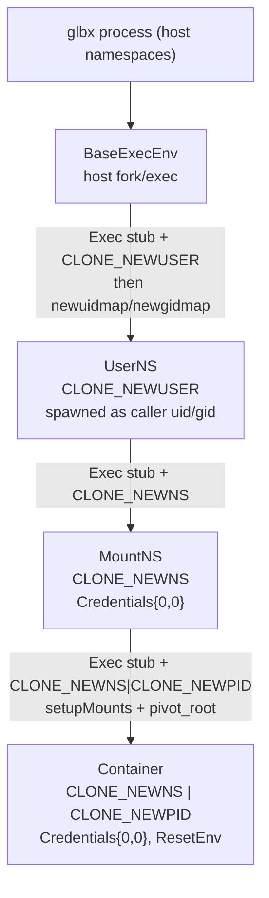

# The execution environment

Every build step in glbx runs inside a hermetic sandbox: an unprivileged nested
set of Linux namespaces with a rearranged mount tree and, at the innermost layer,
a pivoted rootfs. This chapter is a field guide to the three pieces that make
that sandbox work — the IPC control channel (`internal/ipc/`), the namespace
layer stack (`internal/container/`), and the reactive helper binary
(`cmd/exec_env_stub/`). It is written for contributors who will modify the
sandbox, not for operators; the user-facing `exec-chroot` subcommand that opens an
interactive shell in a built rootfs lives in the CLI chapter.

The governing idea is this: operations that must happen *inside* a namespace —
spawning processes, mounting, pivoting root — cannot be performed by the glbx
process itself, because glbx lives in the host namespaces. Instead glbx forks a
tiny helper (the *stub*) into the target namespace and drives it over a socket.
The stub is purely reactive: it registers a handful of handlers, enters a serve
loop on fd 3, and does exactly what it is told until the socket closes. Everything
the orchestrator wants done inside a namespace is expressed as a request on that
channel.

## The control channel

The channel is defined in `internal/ipc/`. It is a connected pair of
`SOCK_SEQPACKET` Unix domain sockets created by `NewSocketPair` (`protocol.go`).
`SOCK_SEQPACKET` is load-bearing: it preserves message boundaries (unlike
`SOCK_STREAM`) while still being connection-oriented and reliable (unlike
`SOCK_DGRAM` over a socketpair), so each `sendmsg`/`recvmsg` carries exactly one
framed message and its ancillary data. The host keeps `fds[0]`; `fds[1]` is handed
to the stub as fd 3 at fork time. Both ends are created `SOCK_CLOEXEC` so they do
not leak into unrelated children.

### Framing and encoding

Messages are the two structs in `protocol.go`:

- `Request{Cookie uint64, FuncID uint32, Payload []byte}` — host → stub.
- `Response{Cookie uint64, Error string, Payload []byte}` — stub → host.

Both are serialized with **`encoding/gob`**, not protobuf. (Protobuf appears
elsewhere in glbx, on the signing channel; it has no role here. If you are editing
this code and reach for a `.proto`, you are in the wrong package.) `MaxMessageSize`
is 64 KiB, enforced at encode time in `EncodeRequest`/`EncodeResponse`: an
over-size message is a hard error rather than a truncated send, which matters
because `SOCK_SEQPACKET` would otherwise silently cap the datagram. Every receive
allocates a `MaxMessageSize` buffer, so a single message always fits in one
`recvmsg`.

The payload inside a `Request`/`Response` is itself a gob-encoded struct, but its
type is **not** carried on the wire. `encoding.go` fixes the mapping from `FuncID`
to payload struct by protocol position:

| FuncID | opcode | request payload | reply |
|--------|--------|-----------------|-------|
| 1 | `FuncExec` | `ExecPayload` | `IntPayload` (spawned pid) |
| 2 | `FuncWait` | `IntPayload` (pid) | `IntPayload` (exit code) |
| 3 | `FuncMount` | `MountPayload` | empty |
| 4 | `FuncMkdir` | `PathModePayload` | empty |
| 5 | `FuncCreateFile` | `PathModePayload` | empty |
| 6 | `FuncSymlink` | `SymlinkPayload` | empty |
| 7 | `FuncPivotRoot` | `PathPayload` | empty |
| 8 | `FuncUmount` | `UmountPayload` | empty |
| 9 | `FuncRmdir` | `PathPayload` | empty |
| 10 | `FuncUnlink` | `PathPayload` | empty |
| 11 | `FuncOpen` | `OpenFilePayload` | empty (fd via ancillary data) |

The `FuncID` is the only discriminator; sender and receiver must agree on the
struct for that opcode out of band. `encodePayload`/`decodePayload` are generic
helpers over `encoding/gob`; several opcodes deliberately share a struct
(`PathPayload` covers rmdir/unlink/pivot-root, `PathModePayload` covers
mkdir/create-file, `IntPayload` is both the wait input and the exec/wait reply).
Only `FuncOpen` returns a file descriptor; every other reply is either an
`IntPayload` or empty.

### One call at a time

`Client.Call` (`client.go`) is the host-side entry point. It takes a `funcID`, a
payload, and an optional slice of `*os.File` to pass as ancillary data, and
returns the reply payload plus any descriptors the handler sent back. It is
strictly serial: a `sync.Mutex` is held for the whole send-then-receive, so there
is never more than one in-flight request on a given channel. The protocol has no
multiplexing and needs none — a stub serves one request at a time anyway.

Each call draws a fresh random `Cookie` from `crypto/rand` (`randomCookie`). The
cookie is echoed in the `Response`; `Call` rejects a reply whose cookie does not
match the request it just sent. On a correctly behaving serial channel the cookie
can only mismatch if framing has desynchronized, so the check is a cheap guard
against a corrupt or confused peer rather than a correlation mechanism for
concurrent calls.

### File-descriptor passing

Descriptors cross the channel via `SCM_RIGHTS`. On send, `Call` builds the
ancillary buffer with `unix.UnixRights` over the raw fds of the supplied files. On
receive it reads into a buffer sized for 16 fds (`unix.CmsgSpace(16*4)`), parses
control messages with `unix.ParseSocketControlMessage`, and extracts descriptors
with `unix.ParseUnixRights`, wrapping each in a fresh `*os.File`. **The caller owns
any returned descriptors and must close them.** The server side
(`Server.Serve` in `server.go`) is symmetric but sizes its receive buffer for 253
fds — the practical per-message kernel limit — because an `Exec` request may carry
a whole set of stdio-plus-extra descriptors in one shot.

Ownership is handled carefully on the error path. If the server returns a non-empty
`Error`, `Call` closes any descriptors that came back before wrapping and returning
the remote error as `ipc client: remote error: <msg>` — the caller never sees a
leaked fd alongside a failure. Inside the kernel, `SendmsgN` duplicates the passed
descriptors into the receiver, so after a successful send each side closes its own
copies independently; `Server.Serve` closes the stub's copies of any reply fds
right after the send, and `closeFds` (shared helper) swallows close errors on these
housekeeping paths.

### The serve loop

`Server.Serve` is a blocking reactive loop. Handlers are registered by `FuncID`
with `Register` before the loop starts; `dispatch` looks one up under an `RWMutex`
and returns an `unknown function ID` error for an unregistered opcode. Each
iteration receives one message, parses its ancillary fds, decodes the request,
dispatches, encodes the response, and sends it back with any reply fds. A receive
of zero bytes (`n == 0`) is EOF — the host closed its end — and `Serve` returns
`nil` for a clean shutdown. A decode failure is swallowed (there is no valid cookie
to answer with, so the loop simply continues); any other transport error returns
and ends the loop. Ownership of received fds is transferred to the handler: the
dispatch path does *not* close them, because a handler such as `handleExec` wires
them into a child and is responsible for their lifetime.

### Environment resolution

`env.go` holds `ResolveEnv`, shared by both the host and stub exec paths so the two
agree exactly on the child's environment. The model is an overlay:

- `reset == false` — the base is the inherited environment (`os.Environ()`).
- `reset == true` — the base is a single entry, `PATH=` + `DefaultPATH`
  (`/usr/sbin:/usr/bin:/sbin:/bin`), giving a clean slate usable both on the host
  and inside a freshly pivoted rootfs.

The request's `Env` entries are then overlaid: a key already present in the base is
overridden *in place* (preserving its original position), a new key is appended in
overlay order. Entries without an `=` are silently dropped. Only the innermost
`Container` layer opts into `ResetEnv`; the outer layers keep the host environment.

## The layer stack

`internal/container/` composes the namespaces. The two central abstractions are in
`execenv.go` and `fscontext.go`. An `ExecEnv` is something you can run processes
in:

```go
type ExecEnv interface {
	Exec(req *ExecRequest) (int, error)
	Wait(pid int) (int, error)
	Close() error
}
```

An `FsContext` is a filesystem view — a namespace (or the host) where filesystem
operations can be performed:

```go
type FsContext interface {
	// creation
	Mkdir(path string, mode uint32) error
	CreateFile(path string, mode uint32) error
	Symlink(target, linkpath string) error
	// deletion
	Rmdir(path string) error
	Unlink(path string) error
	// mounts
	Mount(source, target, fsType string, flags uintptr, data string) error
	Umount(target string, flags int) error
	// file I/O — mirrors os.OpenFile(name, flag, perm)
	Open(path string, flag int, perm uint32) (*os.File, error)
	// MkTempDir creates a new directory inside dir whose name begins with
	// prefix followed by 8 random hex characters. It retries on EEXIST.
	MkTempDir(dir, prefix string) (string, error)
}
```

Note what is *not* in `FsContext`: `PivotRoot`. Pivoting the root is a
once-per-container operation, not a general filesystem edit, so it is a concrete
method on `RemoteExecEnv` and used only by the `Container` layer — do not add it to
the interface.

An `ExecRequest` and its optional `Credentials` are the full description of a spawn:

```go
type Credentials struct {
	UID uint32
	GID uint32
}

type ExecRequest struct {
	Argv         []string
	Cwd          string
	Env          []string   // overlay onto the inherited base; see ResolveEnv
	ResetEnv     bool        // replace inherited base with minimal PATH-only env
	Credentials  *Credentials
	UnshareFlags uintptr     // CLONE_NEW* flags for the child
	DisableASLR  bool        // run the child with ADDR_NO_RANDOMIZE (no ASLR)
	FDs          []*os.File  // FDs[0..2] → stdio, FDs[3:] → ExtraFiles
}
```

`DisableASLR` is honored only by `RemoteExecEnv` (the stub path); `BaseExecEnv`
ignores it. It exists for reproducibility: some build tooling (e.g. the `bpftool`
BTF emission in the systemd package build) produces different output under address
randomization, and disabling ASLR for the build makes it deterministic.

### The two concrete implementations

There are exactly two implementors of these interfaces, and everything else is a
thin wrapper around them.

`BaseExecEnv` / `BaseFsContext` (`base.go`) operate on the *host*. `BaseExecEnv.Exec`
is an `os/exec` fork from the glbx process itself: it resolves the environment with
`ipc.ResolveEnv`, sets `Cloneflags` from `UnshareFlags`, sets a `syscall.Credential`
from `Credentials`, and wires `FDs` into stdin/stdout/stderr and `ExtraFiles`. The
one subtlety is capabilities: when the spawn includes `CLONE_NEWUSER`,
`BaseExecEnv.Exec` grants the child ambient capabilities 0 through 40
(`allCaps()`). The newly created user namespace makes the child full root *within*
that namespace, but ambient caps are what let it actually exercise those privileges
immediately on exec, before any further setup. `BaseFsContext` is the trivial
host-syscall implementation — `os.MkdirAll`, `os.Symlink`, `syscall.Mount`, and so
on — used when a filesystem operation needs to touch the real host tree.

`RemoteExecEnv` (`remote.go`) is the interesting one: it drives *one stub* over a
channel and implements both interfaces by turning each method into an `ipc.Call`.
`NewRemoteExecEnv` creates a socket pair, then asks its *parent* `ExecEnv` to
`Exec` the stub with `FDs = {stdin, stdout, stderr, childFD}` — so the stub always
finds its control socket on fd 3 — and the requested `UnshareFlags`/`Credentials`.
The parent closes its copy of the child fd after the fork; the host end becomes an
`ipc.Client`. From then on `Exec`, `Wait`, `Mount`, `Mkdir`, `CreateFile`,
`Symlink`, `Umount`, `PivotRoot`, `Rmdir`, `Unlink`, and `Open` are each a single
encode-and-`Call`. `Open` is the only one that expects an fd back and errors if the
reply does not carry exactly one. `Close` closes the client socket (which the stub
sees as EOF, ending its serve loop) and then `Wait`s the stub pid through the
parent.

`StubPath` resolves the helper binary: it looks for `exec_env_stub` next to the
running glbx executable (via `os.Executable`) and falls back to the bare name for
`$PATH` lookup if that file is absent. The two binaries are built and shipped
together, so the adjacent-file case is the normal one.

### How the layers nest

The stack is built bottom-up, each layer a `RemoteExecEnv` whose parent is the
layer below. Because `Exec` on a layer forks the next stub *through* that layer's
stub, the new stub inherits that layer's namespaces and then applies its own
`UnshareFlags` on top — this is how the namespaces nest.



The exact `CLONE_NEW*` flag per layer matters and is the thing most likely to be
mis-remembered:

- **`BaseExecEnv`** — no namespace of its own; the host.
- **`UserNS`** (`userns.go`) — `CLONE_NEWUSER` only. Spawned with no explicit
  credentials, i.e. as the calling uid/gid; it becomes root *inside* the new user
  namespace once the id maps are written (below).
- **`MountNS`** (`mountns.go`) — `CLONE_NEWNS` only, spawned with
  `Credentials{UID: 0, GID: 0}` (valid now that its parent is the user namespace).
  At creation it inherits the parent's entire mount tree verbatim, so every host
  path is initially visible at the same path; subsequent `Mount`/`Umount` calls
  rearrange that view.
- **`Container`** (`container.go`) — `CLONE_NEWNS | CLONE_NEWPID`, `Credentials{0,0}`,
  and `ResetEnv` true. A fresh mount namespace again (so its rearrangements, and
  the pivot, do not disturb the enclosing `MountNS`) plus a fresh PID namespace so
  the build sees a clean process tree with its payload near pid 1.

No other namespace types are unshared anywhere in the stack — **not** net, uts,
ipc, cgroup, or time. The sandbox is about filesystem and process isolation and
unprivileged root, not network or hostname isolation.

`NewStack` (`stack.go`) wires the common `BaseExecEnv → UserNS → MountNS` triple
that most build operations need, tearing down a partial stack on any construction
error and tearing the whole thing down in reverse (`MountNS → UserNS → Base`) on
`Close`. A `Container` is layered on top of a `MountNS` when a build step needs to
run *inside* a rootfs. `Run` (`run.go`) is the synchronous `Exec`-then-`Wait`
convenience: a non-zero exit becomes an error tagged with `argv[0]`.

A caution preserved in the type comments: `UserNS` embeds `*RemoteExecEnv` and so
*surfaces* the mount-related methods, but it owns no mount namespace, so calling
`Mount`/`PivotRoot`/etc. on a bare `UserNS` fails at the kernel. Those methods are
artefacts of embedding; use `Exec`/`Wait`/`Close` on a `UserNS` and layer a
`MountNS` or `Container` for filesystem work.

### The id-mapping math

`idmap.go` and the `UserNS` constructor together establish the uid/gid maps that
make the unprivileged user namespace useful. The goal: the caller's own uid should
map to inner uid 0 (so the sandbox's "root" is really you), and a large block of
*subordinate* ids should map to inner ids 1..N (so the sandbox can create files
owned by other uids — needed for a realistic rootfs — without those files escaping
your ownership on the host).

The pieces:

- `IDRange{Start, Count}` is a contiguous span of ids; `IDMapping{Inner, Outer,
  Count}` is one line of a `uid_map`/`gid_map` (inner id, outer id, length).
- `GetSubordinateRanges(uid)` asks `getsubids -u`/`-g` for the current user's
  allocated subordinate ranges, falling back to parsing `/etc/subuid` /
  `/etc/subgid` directly if `getsubids` is unavailable or errors.
- `ReadProcIDMap(pid, uid)` reads an existing process's `/proc/<pid>/uid_map` or
  `gid_map` — used to read glbx's *own* current mapping, which bounds what ids the
  parent is itself allowed to delegate.
- `ComputeIDMappings(subRanges, parentMap, requestedCount)` intersects each
  subordinate range with each entry of the parent map (so you never try to map an
  id the parent cannot see), then greedily packs the usable spans into mappings
  numbered from inner 0 up to `requestedCount`, erroring if the subordinate
  allocation is too small. If the intersection is empty but a parent map exists it
  falls back to the raw subordinate ranges.
- `ApplyIDMappings(pid, uidMappings, gidMappings)` shells out to `newuidmap` and
  `newgidmap` — the setuid helpers that are permitted to write a multi-range map
  for an unprivileged user — against the stub's pid.

`NewUserNS` stitches these together. It requests `IDCount - 1` subordinate ids
(default `IDCount` is 65536), computes their mappings starting at inner 0, then
**shifts every subordinate inner id up by one** so inner 0 is left free. Inner 0 is
then claimed explicitly by a single-id mapping `{Inner: 0, Outer: currentUID,
Count: 1}` (and likewise for gid), which is prepended to the subordinate mappings.
The result: **inner uid 0 is the caller's real uid**, and inner 1..65535 are the
caller's subordinate uids. If reading glbx's own proc map fails, the code assumes
the full identity map (`{0, 0, 4294967295}`) as the parent bound. The maps are
written to the stub's pid before any mount or exec happens inside the namespace.

### Mount setup and the pivot

`Container.setupMounts` (`container.go`) builds the in-namespace mount tree and is
the densest part of the stack. Order and propagation flags matter:

1. **Propagation.** The whole tree is first remounted `MS_REC | MS_SLAVE` on `/`,
   with a fallback to `MS_REC | MS_PRIVATE` if slave fails. Slave is preferred
   because it lets the enclosing `MountNS` push bind-mounts *into* the container
   (the parent can stage inputs under the rootfs and have them appear) while
   preventing the container's own mounts from propagating back out and polluting
   the host. Private severs propagation entirely and is the degraded-but-functional
   fallback.
2. **Rootfs self-bind.** The rootfs is bind-mounted onto itself
   (`MS_BIND | MS_REC`, falling back to plain `MS_BIND`). `pivot_root` requires the
   new root to be a mount point; a plain directory will not do, and the self-bind
   is the cheapest way to turn the rootfs directory into one.
3. **Virtual filesystems.** `proc` on `/proc`, `sysfs` on `/sys` (read-only, with a
   read-only size-0 tmpfs fallback for environments where sysfs cannot be mounted),
   and a tmpfs `/dev` populated by bind-mounting the host's `/dev/{null,zero,full,
   random,urandom,tty}` onto freshly created files, a fresh `devpts` instance for
   `/dev/pts`, and the usual `/dev/{stdin,stdout,stderr,fd,ptmx}` symlinks.
   Finally tmpfs `/run` and tmpfs `/tmp` (mode 1777).

All of these paths are computed as `rootfs + "/..."` and executed through the
container stub, i.e. inside the container's mount namespace, *before* the pivot —
the rootfs is still a subdirectory at this point.

Then `Container` calls `PivotRoot(rootfs)`, which the stub handles in
`handlePivotRoot`: it makes `run/old_root` inside the rootfs, `chdir`s into the
rootfs, `pivot_root(".", "run/old_root")` to swap the roots, `chroot(".")` and
`chdir("/")` to settle into the new root, then unmounts the old root with
`MNT_DETACH` (lazy detach, so a still-busy old root does not block the pivot) and
removes the now-empty `run/old_root`. After this the container's `/` *is* the
rootfs, and the staged `/proc`, `/dev`, etc. are in place.

## The stub

`cmd/exec_env_stub/main.go` is the whole helper. `main` wraps fd 3 in an
`*os.File`, hands it to `ipc.NewServer`, registers the eleven handlers
(`FuncExec` … `FuncOpen`) against a `stubServer` that tracks spawned children in a
pid→`*exec.Cmd` map, and calls `Serve`. When the host closes the control socket the
serve loop sees EOF and returns, and the stub exits. The stub has no logic of its
own beyond the handlers: it never initiates anything, it only answers.

The handlers are thin wrappers over `os`/`syscall`:

- `handleExec` forks a child with `os/exec`, resolving the env with the *same*
  `ipc.ResolveEnv` the host uses, applying `Cloneflags`/`Credential` from the
  payload, and wiring any received fds into stdio/`ExtraFiles` (falling back to the
  stub's own stdio when none are passed). It records the child and replies with its
  pid. When the payload's `DisableASLR` is set, the fork is wrapped so the child
  runs with the `ADDR_NO_RANDOMIZE` personality bit: the handler locks its OS thread
  (`personality(2)` is per-thread and inherited across fork), ORs the bit onto the
  current personality, forks, then restores the old personality. Pinning the thread
  guarantees the fork happens on the thread whose personality was changed, and the
  restore leaves the stub itself unaffected; the serial serve loop means this never
  races another handler. `handleWait` waits a recorded pid and replies with its exit
  code, translating an `*exec.ExitError` into the exit code rather than a transport
  error.
- `handleMount`/`handleUmount`/`handleMkdir`/`handleCreateFile`/`handleSymlink`/
  `handleRmdir`/`handleUnlink` are direct `syscall`/`os` calls, each replying
  empty. `handleSymlink` removes any existing link first, matching
  `BaseFsContext.Symlink`.
- `handleOpen` is the one handler that returns a descriptor: it `os.OpenFile`s the
  path and returns the `*os.File` in the reply's ancillary slot (no payload).
- `handlePivotRoot` is the sequence described above.

Every handler calls `closeFDs` on fds it did not consume, so descriptors received
but unused by a given opcode do not leak in the stub. Because the stub runs in
whatever namespaces its parent gave it, the *same* handler code performs host
syscalls when the stub is the `UserNS`/`MountNS` layer and in-rootfs syscalls once a
`Container` has pivoted — the stub is namespace-agnostic, and all the policy lives
in the orchestrator that decides which requests to send.
