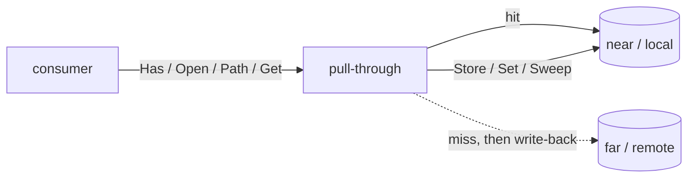

# Foundations

This chapter is a field guide to the layer everything else in glbx sits on: the
content-addressed object store (`internal/objstore`), the directory tree hash
(`internal/dirhash`), and the one-constant build-version package
(`internal/version`). These packages depend on nothing else in glbx. They define
the single hash space that serves as both a blob's content address and an
artifact's identity, the storage that keys on that space, and the registry
backend that lets several machines share it.

Read this chapter to understand *how* an identity is computed, *where* bytes
live on disk and on a registry, and *why* a build run on a cold cache can resolve
entirely from a shared store without rebuilding or re-downloading anything.

## The hash: one identity space

`objstore.Hash` (`hash.go`) is a validated SHA-256 digest wrapped in an opaque
struct. A constructed value is guaranteed to be exactly 64 lowercase hex
characters; the zero value is invalid and reserved for "absent". Construct one
with `NewHash` (validating, returns an error), `MustHash` (panics — constants and
tests only), or `HashBytes` (SHA-256 of a byte slice). The struct holds a single
unexported `hex` field, so nothing outside the package can forge an invalid Hash
or read structure out of a valid one beyond what the methods expose.

A Hash is deliberately opaque: the only structure anyone is allowed to see is
equality (`Equal`), zero-ness (`IsZero`), the display short form (`Short`, first
12 chars), and the two sharding accessors. `Prefix` returns the first two
characters — the shard directory name — and `Suffix` returns the remaining 62 —
the filename within that shard. These two are the entire contract between the
hash type and the on-disk layout; nothing else reads bytes out of a hash.

The hash is marshalled to JSON as its bare hex string, and the zero value
marshals to the empty string, so an optional `Hash` field round-trips cleanly
under `omitempty`. `UnmarshalJSON` decodes the empty string back to the zero
value and rejects anything that is neither empty nor a valid 64-char digest.

The central design fact is that **one hash space is both the content address of a
blob and the identity of an artifact.** A blob's address is the SHA-256 of its
bytes. An artifact's identity is a SHA-256 derived from everything that defines
it. Both are `Hash`, both key into the same two stores, and the store never needs
to know which kind of thing a given hash denotes.

### ConcatHash: folding a tuple into one identity

Artifact identities are built by folding an ordered tuple of strings into a
single hash with `ConcatHash` (`concat_hash.go`). The fold is not a plain
concatenation-then-hash. Each part is first SHA-256'd to a fixed 32-byte digest,
those digests are concatenated *in order*, and the concatenation is SHA-256'd
once more. Reducing every part to a fixed-width frame before concatenation makes
the pre-image unambiguous: because every part occupies exactly 32 bytes, moving a
byte from the end of one part to the start of the next always changes the result.
A naive `hash(a + b)` would collide `("ab","c")` with `("a","bc")`; the framing
closes that. Order is significant, and the empty tuple hashes the empty input.

Callers higher in the system assemble their identity tuples — a package's source
hash plus its resolved dependency identities, a rootfs label plus its
configuration — and run them through `ConcatHash`. The property that matters is
that identity is a pure function of inputs: the same inputs always produce the
same identity, so an identity already present in a shared store means the work is
already done.

## The object store

The store has two halves, each an interface so the concrete backing can be
swapped without the consumer knowing:

- a **blob store**, content-addressed storage keyed by the SHA-256 of the bytes;
- a **map store**, mapping an artifact identity to the hash of its *manifest*
  blob.

`objstore.Store` (`store.go`) is a thin wrapper holding one of each:

```go
type Store struct {
	Blobs BlobStore
	Map   MapStore
}
```

The wrapper holds no state of its own — all state lives behind the interfaces.
This is what lets a `Store` be a local filesystem store, a registry-backed store,
or a pull-through cache composing two others, with every consumer treating all
three identically.

### What a manifest is

A blob is just bytes under their hash; it carries no names. An artifact, though,
produces one or more *named* outputs (e.g. a `.deb` named `libc6_...` plus its
build log). The binding between an artifact's identity and its named output blobs
is a **manifest**: itself a blob, whose bytes are a simple newline-delimited
list, one `<hash> <name>` line per output. The map store points an identity at
the hash of its manifest blob; reading the manifest then yields the named output
blobs.

`objstore.SerializeManifest` (`manifest.go`) is the single definition of that
byte format. It takes a slice of `Output{Name, Hash}`, sorts by `Name` ascending,
and emits one `"<hash> <name>\n"` line each. The sort is what makes a manifest
*canonical*: whatever order a producer happened to assemble outputs in (filesystem
readdir order, map iteration), the same set of outputs always serializes to
byte-identical bytes, and therefore to the same manifest hash. That keeps a
manifest's address a pure function of its contents. The inverse parse lives with
the consumer (`internal/artifact`, `parseManifestBlob`), which splits each line
on the first space back into hash and name; objstore owns only the forward
direction so there is one authority for the format.

One of the named outputs is always the reserved `.glbx-provenance` blob, which
folds the build's target and graph identity into the manifest so that distinct
builds with identical payloads still get distinct manifest hashes; objstore treats
it as an ordinary entry, and [the engine chapter](./engine.md#the-provenance-output-and-manifest-uniqueness)
covers why it is there.

### BlobStore

```go
type BlobStore interface {
	Has(h Hash) bool
	Open(h Hash) (io.ReadCloser, error)
	Path(h Hash) (string, error)
	Store(r io.Reader) (Hash, error)
	Delete(h Hash) error
	Sweep(keep map[Hash]struct{}) (int, error)
	Iterate(fn func(Hash) error) error
}
```

The read operations (`Has`, `Open`, `Path`) are the ones a pull-through
implementation can satisfy from a remote; the write and maintenance operations
(`Store`, `Delete`, `Sweep`) always act on the local layer. `Path` exists
alongside `Open` because some consumers need a filesystem path to hand to another
tool (a sandboxed build, a bind mount) rather than a reader.

The filesystem backing is `localBlobs` (`blobs.go`), rooted at `<root>/blobs`. A
blob lives at `<root>/blobs/<prefix>/<suffix>`, i.e. sharded by the first two hex
characters of its hash. Sharding keeps any one directory from accumulating the
entire store's worth of entries. Because the path is derived purely from the
content hash, identical content always lands at one path and a blob is immutable
under its address.

`Store` is the one subtle operation. It streams the reader into a temp file
(`.blob-tmp-*` in the store root) while hashing the bytes with a `MultiWriter`,
so the content is written and digested in a single pass without buffering it all
in memory. Only once the digest is known does it create the shard directory and
`os.Rename` the temp file into its final content-addressed path. The rename is
atomic on a POSIX filesystem, so a concurrent reader never observes a partial
blob under a valid address, and two writers racing to store the same content
converge on the same final path. If the final path already exists (the content is
already stored), the temp file is simply removed. A `success` flag and a deferred
cleanup ensure a temp file left behind by any error on the write path is removed.
Stored blobs are chmod'd `0o644`.

`Open` has one extra wrinkle: if opening fails with a permission error, it
attempts a `chmod 0o644` and retries once. This covers blobs that arrive with
restrictive modes (for instance, materialized from elsewhere) so the store stays
readable. `Path` and `Open` both report a clear `blob <hash> not found` on
absence rather than leaking an opaque `os.ErrNotExist` downstream.

`Iterate` walks the two-level shard layout, skipping any directory whose name is
not exactly two characters and any entry whose `prefix+suffix` does not parse as a
valid hash — that filter is what lets the in-flight `.blob-tmp-*` temp files
coexist in the root without being mistaken for blobs. `Sweep` is pure mechanism:
it deletes every blob *not* in the caller-supplied `keep` set and returns the
count. It applies no policy of its own — deciding what to keep is the caller's
job (see GC below). `Delete` additionally attempts to remove the now-possibly-empty
shard directory (a bare `os.Remove` that silently no-ops if the directory is not
empty).

### MapStore

```go
type MapStore interface {
	Has(key Hash) bool
	Get(key Hash) (Hash, error)
	Set(key, value Hash, validate bool) error
	Delete(key Hash) error
	Iterate(fn func(key Hash) error) error
	SweepFollowingBlobs() (int, error)
}
```

The filesystem backing is `localMap` (`mapstore.go`), rooted at `<root>/map` and
sharded exactly like blobs: an entry is a one-line file at
`<root>/map/<prefix>/<suffix>` whose contents are the manifest-blob hash the
identity resolves to. `Get` reads the file, trims whitespace, and parses the line
as a hash. `Set` writes the same temp-file-then-rename dance as the blob store, so
a mapping appears atomically or not at all.

`Set` takes a `validate` flag. When true, it first checks that the value
references an existing blob (`m.blobs.Has(value)`) and refuses the write
otherwise — this is why `localMap` holds a reference to the `BlobStore`. The
validating path is used when an entry is reconstructed from a remote (pull-through),
where we want to guarantee the pointed-at blob really landed locally before
recording the mapping. The engine's own `storeManifest` sets `validate=false`
because it has just written the manifest blob itself.

`SweepFollowingBlobs` is the map's half of garbage collection. It iterates every
map entry, and for each one whose target blob no longer exists (either `Get`
errors or `blobs.Has` is false), deletes the entry. This is run *after* a blob
sweep to restore the invariant that every map entry points at a live manifest
blob.

### Local store construction and the cache root

`NewLocal(root)` (`store.go`) opens or creates a local store. An empty root falls
back to `DefaultRoot()`, which resolves in order: `$GLBX_CACHE` if set, else
`~/.cache/glbx`, else `<tmpdir>/glbx-cache` if no home directory is known. The
root is always resolved to an absolute path, because the store may be consulted
from inside a sandbox whose working directory differs from the host's — a
relative root would resolve differently there. Under the root it creates the two
subtrees `blobs/` and `map/`, wires the map store to the blob store, and returns
the wrapper.

The full on-disk shape of a local store:

```
<root>/
├── blobs/
│   ├── ab/
│   │   └── cdef...(62 hex)      ← blob bytes, addressed by sha256
│   └── .blob-tmp-*             ← in-flight Store temp files (swept by name filter)
└── map/
    └── 12/
        └── 3456...(62 hex)      ← one line: the manifest-blob hash
```

### Garbage collection: two sweeps, blobs first

`Store.GC(keep)` reclaims space in a fixed two-phase order:

1. **Blobs first.** `Blobs.Sweep(keep)` deletes every blob not in the keep set.
2. **Then the map follows the blobs.** `Map.SweepFollowingBlobs()` deletes every
   map entry whose manifest blob is now gone.

The order is load-bearing. Sweeping blobs first and then pruning the map to match
guarantees the end state has no dangling map entry pointing at a deleted manifest.
Doing it the other way around could leave a map entry alive while its manifest
blob was swept out from under it. The caller computes `keep` (the transitive
closure of blobs reachable from the identities worth retaining — manifests and
all the output blobs they name); `GC` is the mechanism that enforces it.

## The pull-through cache

A single machine with a local store is the base case. The interesting case is
several machines (CI jobs) sharing one store so that work done on one is cache for
the others. That is done by composing a near (local) store and a far (remote)
store into a **pull-through** with `NewPullThrough(near, far)` (`store.go`,
`pullthrough.go`).

The rule is uniform across both halves:

- **reads** miss in near fall through to far, and the fetched object is written
  back into near, so the next read is a near hit;
- **writes and maintenance** act on near only.



### Blobs: lazy materialization

`pullThroughBlobs` is the subtle part. The key distinction is between *knowing a
blob exists* and *having its bytes*. `Has` returns true if the blob is present
locally **or** on the remote — and the remote check is a cheap HEAD, so `Has`
never drags bytes to disk. Only `Open` and `Path` materialize: they call `ensure`,
which, if the blob is absent locally, opens it from the remote and `Store`s the
pulled bytes into the local layer before answering from local.

This laziness is what makes the warm-cache CI path nearly free. A build that only
needs to check "is this node already built" probes existence (HEADs against the
registry) without pulling a single blob to the runner. Bytes come down only when
something actually reads them.

`ensure` is best-effort by design: a remote miss or an error leaves the local
layer untouched and lets the subsequent local read report the canonical
not-found. And because `local.Store` re-hashes whatever it pulls, a remote that
serves mismatched bytes stores them under their *actual* hash (never the requested
one), so the requested address still reads as absent and the junk blob is left for
GC. There is no path by which a mismatched pull can satisfy a read.

### Map: reconstruct, verify, record

`pullThroughMap.Get` turns a local map miss into a permanent local hit. On a miss
it asks the remote for the identity's value (the manifest-blob hash). A remote
*miss* (an `os.ErrNotExist`, detected by `isNotExist`) falls back to the local
not-found; a genuine transport error surfaces instead, so a network failure is
never silently mistaken for an absent entry. On a remote hit it materializes the
pointed-at blob locally by opening it through the pull-through blob store (which
verifies the bytes against the hash), then records the mapping with a *validated*
`Set`. The validation is guaranteed to pass because the blob was just pulled down.

The map treats its value opaquely: it pulls the one manifest blob so the local
entry has something real to point at, but it does not parse the manifest or pull
the output blobs the manifest names. Those are pulled on demand, later, when a
consumer opens them. `Has` on the pull-through map checks local only — it is the
cheap "do I already have this recorded" probe, distinct from `Get` which is
willing to reach out.

## The OCI registry backend

The far store in CI is an OCI registry (`ghcr.io/<owner>/<repo>/objstore`).
`remote.go` implements the registry-backed `BlobStore` and `MapStore` on top of a
small distribution-spec client, `ociRegistry`. `NewRegistry(ref, insecure)`
builds a `Store` whose two members are `remoteBlobs` and `remoteMap`; a bare
registry store is only useful composed into a pull-through, since its writes are
refused (`errRemoteReadOnly`) — the registry is filled by a separate publish
pass, never built into.

### Mapping the store model onto OCI

An OCI registry stores blobs and manifests and addresses them by digest or by
tag. The store model is mapped on as follows:

- Every stored object (a blob, or a manifest blob) is pushed as a registry blob
  and wrapped in a **minimal one-layer OCI image manifest**: `schemaVersion: 2`,
  the shared empty config, and exactly one layer naming the stored blob by its
  `sha256:` digest. `oneLayerManifest` builds it.
- The config descriptor is `ociEmptyConfig` — the two-byte object `{}`, its
  SHA-256 digest, size 2 — shared by every manifest. The registry stores it once
  and every manifest keeps it alive.
- The media types are exact: manifest
  `application/vnd.oci.image.manifest.v1+json`, config
  `application/vnd.oci.empty.v1+json`, layer
  `application/vnd.oci.image.layer.v1.tar`.

**Tags are the index.** There are two tag namespaces:

- `blob-<hash>` — a blob, resolvable to the one-layer manifest wrapping it;
- `map-<id>` — an identity, resolvable to the one-layer manifest wrapping that
  identity's *manifest* blob.

Note the hyphen. Conceptually these are `blob/<hash>` and `map/<id>`, but an OCI
tag may not contain a slash, so the wire form is `blob-<hash>` / `map-<id>` with
the hex body (itself a legal tag) following. `blobTag` and `mapTag` are the single
definition of that spelling.

### Reading

`remoteBlobs.Open` resolves `blob-<hash>` to its one-layer manifest, reads the
single layer's digest via `manifest.layerHash` (which insists on exactly one
layer and a `sha256:` prefix), and streams that blob. It cross-checks that the
layer digest equals the hash that was asked for: a manifest naming a different
layer, or an absent tag, is treated as a miss. `Has` is a HEAD on the tag
(`tagExists`).

`remoteMap.Get` reads the `map-<id>` tag's one-layer manifest and returns its
single layer digest — which *is* the manifest-blob's hash, i.e. the map value.
The remote parses no manifest-blob bytes; turning that value back into named
outputs is the pull-through consumer's job once the blob is local.

### Authentication

`ociRegistry` performs the standard bearer-token challenge flow. Requests go out
through `do`, which carries any cached bearer token. On a `401` with a
`WWW-Authenticate: Bearer ...` challenge, and only when a credential is
configured, it calls `authenticate`: parse the challenge's `realm`, `service`,
and `scope`; GET the realm with the credentials as HTTP basic auth; decode the
returned `token` (or `access_token`); cache it under a mutex; and retry the
original request once. Because an `http.Request` body is single-use, `do` takes
the body as a byte slice and rebuilds the request for the retry, reapplying the
original headers.

Credentials come from the environment: `GLBX_REGISTRY_USER` is the basic-auth
user and `GLBX_REGISTRY_TOKEN` is the password/token. With no token configured,
`do` simply issues the request unauthenticated, so an anonymous or local test
registry behaves exactly as a plain HTTP client would. The registry reference and
TLS choice come from `GLBX_REGISTRY` (`host[:port]/repo`) and
`GLBX_REGISTRY_INSECURE`; `parseRegistry` also honours an explicit `http://` or
`https://` prefix on the reference, and `insecure` selects plaintext for a local
test registry. The HTTP client carries a 10-minute timeout to tolerate large
layer transfers.

### Writing (publish)

Writes to the registry go through `publish.go`, not the store interfaces. A
`Publisher` (`NewPublisher`) targets a registry and reads bytes from a local blob
store. `Publish` takes a worklist of blob hashes and `MapAlias` entries and
mirrors them, reporting a `PublishResult` tally and invoking an optional
`PublishProgress` callback once per item for live CLI reporting.

Both steps are **idempotent**, which is what lets a warm publish be a near no-op:

- `EnsureBlob(h)` first HEADs `blob-<hash>`; if the tag already exists it uploads
  nothing. Otherwise it reads the blob from the local store and, via
  `publishBlob`, pushes the shared empty config, the blob itself (monolithic
  POST-then-PUT upload, `putBlob`), and the one-layer manifest, then tags it. A
  blob the local store does not hold is reported `missing` and skipped, never
  fatal — publishing only ever mirrors what is actually local.
- `EnsureAlias(a)` HEADs `map-<key>`; if absent it points the tag at the
  byte-identical one-layer manifest that wraps the value blob (`aliasMap`),
  reading the value's bytes locally only to size the layer descriptor. The value
  blob must have been ensured first.

The `MapAlias` type carries a `Key` identity and the `Value` blob hash its value
points at; both identity→manifest entries and log-key→log-blob entries are
published through the same alias mechanism. `Publish` runs all blobs, then all
aliases, so every alias's target blob is guaranteed present before the alias is
set.

## dirhash: reducing a tree to one hash

`dirhash.HashDirectory(path)` (`internal/dirhash`) collapses a directory tree to a
single SHA-256 that changes *if and only if* the tree's build-relevant content
changes. It is how a package's source checkout becomes one stable input to its
artifact identity: two clean checkouts of the same source hash identically,
regardless of when or by whom they were written.

**What is folded in:** file bytes, entry names, entry type, and the single
user-execute bit. **What is deliberately excluded:** owner, group, the rest of the
permission bits, timestamps, and inode numbers. Excluding ownership and mode
(beyond exec) and times is precisely what makes the hash reproducible across
checkouts, where those attributes legitimately differ.

The algorithm is a recursive fold. Each directory is hashed over its immediate
entries *in byte-wise name order* (sorted by `readDirSorted`, so readdir order
cannot perturb the result). For each entry the running SHA-256 absorbs three
things in sequence: a one-byte type tag, the SHA-256 of the entry *name*, and a
32-byte *content hash*. The content hash depends on the entry type:

- **regular file** — the file's own SHA-256; the type byte is `TypeRegular`
  normally, `TypeExecutable` when the user-execute bit (`0100`) is set, so flipping
  a file's exec bit changes the tree hash;
- **directory** — the subdirectory's own dirhash (recursion), hex-decoded back to
  32 raw bytes before being folded in;
- **symlink** — the SHA-256 of the *target string*; the link is never followed,
  only its target text is hashed;
- **anything else** (devices, sockets, fifos) — `TypeSpecial`, content hash is the
  SHA-256 of the mode type string.

The type-byte constants (`TypeRegular` 0, `TypeExecutable` 1, `TypeDirectory` 2,
`TypeSymlink` 3, `TypeSpecial` 4) are part of the hash definition; changing a value
changes every dirhash in existence, so they are fixed.

**Confinement.** Traversal is bounded with `os.OpenRoot`, so every open, lstat,
and readdir is confined to the opened directory and a symlink inside the tree
cannot be followed out of it. One gap this leaves is reading symlink *targets*:
`os.Root` has no `Readlink`, so `hashSymlink` reconstructs the full path with
`filepath.Join(rootPath, relPath)` and calls `os.Readlink` on it. That only reads
the target *string* — the entry is already known to be a symlink from the confined
`Lstat`, and the target is hashed, never opened or followed — so it does not
reintroduce an escape.

## version

`internal/version` is a single constant: `version.Version = "0.0.0-dev"`, the
glbx release identifier. There is nothing else to it. (This is distinct from
`internal/debian/version`, which implements Debian version-string ordering and is
documented with the Debian primitives, not here.)
