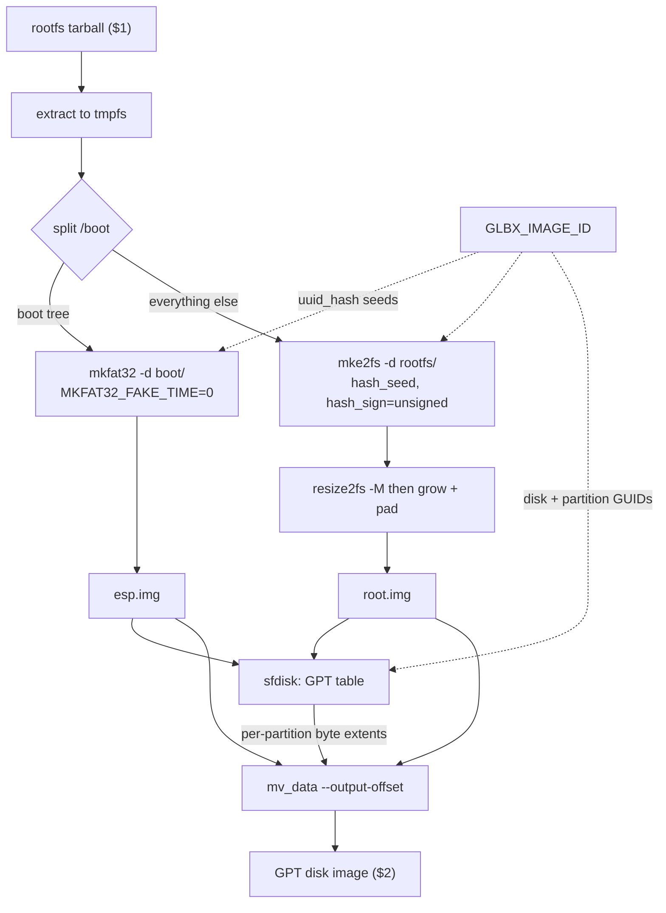

# Reproducible image helpers

The tools described in this chapter do **not** live in glbx. They live in the
reference configuration repository that glbx builds from, under
`images.d/tooling/`, and they are built, pinned, and consumed entirely through
the mechanisms glbx already provides for locally-built image-assembly tooling.
They are documented here because glbx is the single source of documentation for
the whole system; the field guide is the one place a developer looks, so the
helpers that make a disk image reproducible are explained alongside the engine
that drives them.

Concretely, these are the helpers of the configuration repo at
[`gardenlinux/glbf-staging`](https://github.com/gardenlinux/glbf-staging). Each
is a `local_tooling` package: a source build that produces `.deb`s which are
extracted into an image type's assembly container and then overlay the
same-named mirror packages. None of them is ever shipped inside an image. A
tooling package carries a deliberately reduced `build.yml` — a source build and
nothing more, with no runtime or lockfile dependencies and no binary-validation
phase — because its product is consumed at assembly time and has no life beyond
that.

## Why these tools exist

An image type's assembly script turns a rootfs tarball into a bootable disk
image by running inside a sandbox. glbx content-addresses whatever bytes the
script writes to its output path: the image's identity *is* the hash of those
bytes. That makes determinism a hard requirement rather than a nicety. The same
rootfs must assemble to the same image bytes on every run and on every build
host, or the cache lookup that makes an unchanged image a no-op stops working
and every downstream identity churns.

Stock filesystem and disk tooling is the enemy of this. `mkfs.ext4` stamps inode
times from the wall clock and derives a superblock flag from the build host's
`char` signedness; `mkfs.fat` embeds a random volume serial and wall-clock
directory timestamps. Each of those is a source of entropy that would make the
image bytes differ run-to-run. The three helpers below each remove one such
source: a patched `e2fsprogs`, a custom FAT32 formatter (`mkfat32`), and a sparse
data placer (`mv-data`). An assembly script supplies the remaining determinism by
deriving every on-disk identifier — filesystem and partition UUIDs, the GPT disk
GUID, the directory-hash seed — from `GLBX_IMAGE_ID`, the content identity glbx
exports into the script's environment, and by pinning `SOURCE_DATE_EPOCH` rather
than reading the clock.

A second constraint shapes the tools as much as determinism does: the assembly
sandbox has `CAP_SYS_ADMIN` but **no loop device**. The host does not hand out
loopdevs, so a tool cannot `mount` a filesystem image as a block device to
populate it. Every tool here therefore writes a filesystem by walking a directory
tree in userspace — `mke2fs -d <dir>`, `mkfat32 -d <dir>` — and partition images
are placed into the disk by copying bytes at an offset, never by partitioning a
mounted device.

## e2fsprogs — a patched Debian source build

The assembly-time `e2fsprogs`
([source](https://github.com/gardenlinux/glbf-staging/blob/main/images.d/tooling/e2fsprogs))
is a stock Debian `e2fsprogs` source build carrying two Garden Linux patches,
both aimed squarely at making `mke2fs -d` produce byte-identical ext4 images. It
provides the reproducible `mke2fs`/`resize2fs` the disk assembly script uses, plus
the runtime libraries those binaries need (`libext2fs2t64`, `libcom-err2`,
`libss2`, and `logsave`). Because it is an assembly tool and never a shipped
package, its `build.yml` is the reduced tooling schema: `pkg_type: debian` and
nothing more than build profiles. It declares no runtime or lockfile dependencies
and is never subjected to the binary-validation or install-check phases a shipped
package passes.

Its `build_profiles` cut the build down to what assembly needs:

- `nocheck` — skip the upstream test suite.
- `pkg.e2fsprogs.no-fuse2fs` — skip building the FUSE `fuse2fs` helper, which the
  assembly container has no use for.

### `reproducible-inode-times.patch`

Stock `mke2fs -d` under a fake-time build (`E2FSPROGS_FAKE_TIME` /
`SOURCE_DATE_EPOCH`) only *clamps* each source inode's access/change/modify time
down to the fake time when the real time is newer, and otherwise keeps the real
source time. Access time is especially volatile — merely reading the source tree
mutates it, and extraction stamps it with the wall clock — so a clamp-only policy
left the resulting image dependent on the state of the source tree at build time,
not reproducible.

The patch replaces the `clamped_time` helper in `misc/create_inode.c` with a
`fixed_time` helper. Where the original returned the fake time only when the
source time exceeded it (`t > fs->now`), the new one returns the fake time
unconditionally whenever `EXT2_FLAG2_USE_FAKE_TIME` is set:

```c
static time_t fixed_time(ext2_filsys fs, time_t t)
{
	if (fs->flags2 & EXT2_FLAG2_USE_FAKE_TIME)
		return fs->now;
	return t;
}
```

All three inode times (`i_atime`, `i_ctime`, `i_mtime`) are then written through
`fixed_time`, so under fake time every inode's timestamps become a pure function
of the declared epoch rather than of the source tree. Non-fake-time builds are
unaffected: with the flag clear, the real source times still pass through.

### `explicit-dirhash-signedness.patch`

ext4 records in its superblock whether the directory HTREE hash treated `char`
as signed or unsigned. Stock `mke2fs` derived this flag *solely* from the
signedness of `char` on the build host — signed on x86, unsigned on arm — by
running the classic `c = (char) 255; ((int) c) == -1` probe in
`lib/ext2fs/initialize.c`. The same directory tree built on two architectures
therefore produced two different superblocks, defeating cross-architecture
reproducibility.

The patch makes the flag settable by input. In `ext2fs_initialize` it carries a
caller-chosen `EXT2_FLAGS_SIGNED_HASH` / `EXT2_FLAGS_UNSIGNED_HASH` from the
`param` superblock into the real one, and the host-`char` probe becomes a
*fallback* that runs only when the caller has not pinned the flag:

```c
if (!(super->s_flags &
      (EXT2_FLAGS_SIGNED_HASH | EXT2_FLAGS_UNSIGNED_HASH))) {
	/* ... the old host-char probe ... */
}
```

A new `-E hash_sign=signed|unsigned` extended option (parsed in `misc/mke2fs.c`,
documented in the man page) exposes this to callers, clearing both flags and
setting the requested one on the `param` superblock. A reproducible build pins
the value explicitly — the disk assembly script passes `hash_sign=unsigned` — so
the superblock is identical regardless of the architecture `mke2fs` runs on.

## mkfat32 — a reproducible FAT32 formatter

`mkfat32`
([source](https://github.com/gardenlinux/glbf-staging/blob/main/images.d/tooling/mkfat32))
is a small custom Go program, built as a `local_tooling` package (native Go
source build, `nocheck` profile, no runtime deps). It exists because stock
`mkfs.fat` is irreducibly non-reproducible: it embeds a random volume serial
number and stamps directory entries with the wall clock. `mkfat32` formats a
*pre-sized* image file in place as a FAT32 filesystem and populates it from a
directory tree, with every entropy source nailed down.

It builds on `go-diskfs`
([`github.com/diskfs/go-diskfs`](https://github.com/diskfs/go-diskfs), pinned in
`go.mod` alongside `github.com/google/uuid` and `github.com/djherbis/times`),
whose filesystem layer can create and write a FAT32 filesystem entirely in
userspace — exactly the no-loop-device model assembly requires. The program opens
the image read-write and calls `CreateFilesystem` with `Reproducible: true`,
which is what zeroes the volume serial and drives timestamps from a fixed epoch
rather than the clock.

Its determinism rests on four things:

- **`MKFAT32_FAKE_TIME`** — an environment variable giving the epoch (in seconds)
  for all filesystem timestamps. `mkfat32` reads it, clamps it up to a FAT epoch
  floor (`fatEpoch`, 1980-01-01, below which FAT cannot represent a date), and
  exports it onward as `SOURCE_DATE_EPOCH` so the `go-diskfs` layer picks it up.
  The disk assembly script sets `MKFAT32_FAKE_TIME=0`.
- **Zeroed volume serial** — carried by the `Reproducible: true` filesystem spec,
  removing the random serial stock `mkfs.fat` would embed.
- **Deterministic directory ordering** — `populate` walks the source tree,
  records every entry as a slash-normalized relative path, and **sorts the whole
  list lexicographically** before creating anything. Directories and files are
  thus created in a fixed order independent of the host filesystem's readdir
  order, so the on-disk directory layout is stable.
- **Populate-from-directory-tree** — files and directories are created through the
  `go-diskfs` filesystem API (`Mkdir`, `OpenFile`, stream copy), never by mounting
  a block device. `mkfat32 -d <dir> ` formats `` and fills it from
  `<dir>`.

## mv-data — sparse partition placement

`mv-data`
([source](https://github.com/gardenlinux/glbf-staging/blob/main/images.d/tooling/mv-data))
is a small C program (native Debian source build, `nocheck` profile, no runtime
deps) that solves the "place a partition image into a disk at an exact byte
offset" problem *without a loop device*. The assembly script builds each
partition (the FAT32 ESP, the ext4 root) as a standalone image file, lays out a
GPT table with `sfdisk`, and then needs each partition image copied into the disk
image at the byte offset `sfdisk` assigned it. With no loopdev to `dd` onto,
`mv-data` does the copy directly against the files.

Its CLI is an `argp` parser over five options:

- `--input FILE` — the source partition image (required).
- `--input-offset OFFSET` — byte offset to start reading from (default 0).
- `--output FILE` — the destination disk image (required).
- `--output-offset OFFSET` — byte offset in the disk to write at (default 0).
- `--length LENGTH` — number of bytes to move (default: the input file size).

The copy is **sparse** in both directions. It first punches a hole across the
destination range (`fallocate` with `FALLOC_FL_PUNCH_HOLE | FALLOC_FL_KEEP_SIZE`)
so unwritten regions stay as holes rather than zero blocks. It then loops using
`lseek(..., SEEK_DATA)` to skip over holes in the *input* — landing only on
regions that actually contain data — reads up to a 1 MiB buffer, seeks to the
matching offset in the output, and writes. After each chunk it punches a hole in
the *input* at the region just copied (again `FALLOC_FL_PUNCH_HOLE`), freeing that
space immediately. The effect is that a large, mostly-empty partition image can be
moved into the disk with negligible extra storage: zero regions are never
materialized on either side, and the input shrinks as the move proceeds. When
`SEEK_DATA` returns `ENXIO` (no more data), the loop ends.

## How they fit together

The `disk` image type's assembly script
([`images.d/disk/build`](https://github.com/gardenlinux/glbf-staging/blob/main/images.d/disk/build))
ties the three helpers into one GPT disk: a FAT32 EFI System Partition followed
by a minimized ext4 root. Its `conf.yml`
([`images.d/disk/conf.yml`](https://github.com/gardenlinux/glbf-staging/blob/main/images.d/disk/conf.yml))
draws `fdisk` (`sfdisk`), `mount`, and `python3-minimal` from the mirror as
`debian_tooling`, and the reproducible helpers as `local_tooling` — the patched
`e2fsprogs` binaries and libraries, `mv-data`, and `mkfat32` — which overlay their
mirror counterparts in the assembly container.

The flow, with every identifier derived from `GLBX_IMAGE_ID` and
`SOURCE_DATE_EPOCH` pinned to 0:



Reading the diagram as prose: the script extracts the rootfs on a tmpfs it mounts
itself (it has `CAP_SYS_ADMIN`, no loopdev), splits the boot tree out to become
the ESP, and builds the two partitions independently. `mkfat32` formats the ESP
from the boot directory; patched `mke2fs -d` builds the ext4 root from the
remaining tree with a derived filesystem UUID, a derived hash seed, and
`hash_sign=unsigned`, after which `resize2fs -M` shrinks it to its minimum and a
second `resize2fs` grows it to a padded size. `sfdisk` then writes a GPT table
whose disk GUID and both partition GUIDs are derived from `GLBX_IMAGE_ID`, and the
script reads back each partition's byte offset and length from the table and uses
`mv_data` to place each partition image into the disk at exactly that offset,
sparsely. The finished disk is written to the script's output path, where glbx
harvests and content-addresses it.

The `cpio` image type
([`images.d/cpio`](https://github.com/gardenlinux/glbf-staging/blob/main/images.d/cpio))
is the simpler sibling: it needs no filesystem formatter at all, packing the
rootfs into a zstd-compressed cpio initramfs with `3cpio` and `zstd` (both plain
`debian_tooling`). The depth above is on the disk path, where reproducibility
depends on the three custom helpers.
