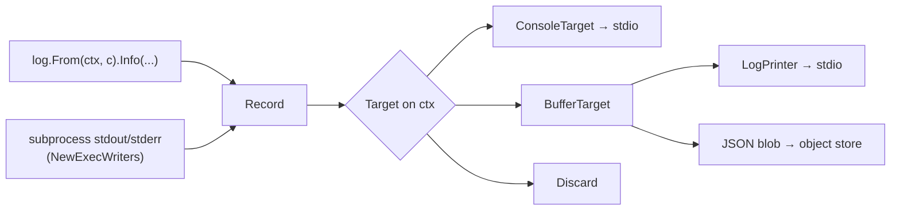

# Logging and the progress UI

Two internal packages carry everything a build prints: `internal/log` is the
structured logging substrate — leveled, component-tagged records flowing from a
call site to a sink — and `internal/taskui` is the progress layer built on top of
it — a flat tracker of per-node tasks, an interactive live overview, a Mermaid
Gantt renderer, and whole-run serialization for replay. The two meet at one
point: every task owns a `log.BufferTarget`, and the build engine runs each node
with that buffer installed as the context's log target, so a node's records land
in its own task's buffer. This chapter walks both packages end to end for a
contributor working on them.

## `internal/log`: records from call site to sink

### The record, its level, and its component

A log line is a `log.Record`: a `Level`, a `Component`, and a formatted `Msg`
string. That is all it carries — notably **no timestamp**. Elapsed time is a
presentation concern derived at the sink from a process-global `startTime`
anchor (`console.go`), not a property of the record, which keeps records
trivially serializable and comparable.

`Level` is an ordered severity (`Debug`, `Info`, `Warn`, `Error`) and `Component`
is the part of the system that produced the line (`Engine`, `Build`, `Container`,
`MountNS`, `UserNS`, `Deps`, `Lockfile`, `Importer`, `Fetch`, `Rootfs`, `Binary`,
`InstallCheck`, `Chroot`, `Exec`, `Reprod`). Both are `int`-backed enums with a
`String()` method and — importantly for replay — custom JSON marshalling: a level
and a component serialize as their lowercase string names and parse back through
a reverse lookup (`componentByName` for components), so a stored log remains
legible and stable across code changes to the enum's numeric values. Adding a
component means extending the `const` block, the `String()` switch, **and**
`componentByName`; an unknown name fails `UnmarshalJSON` rather than silently
mapping to zero.

### The `Target` interface and the `Logger`

Everything downstream of a log call is reached through one small interface:

```go
// Target receives records.
type Target interface {
	Emit(Record)
}
```

A `Logger` is a thin binding of a fixed `Component` to a `Target`. Its
`Debug`/`Info`/`Warn`/`Error` methods take a format string and args, format
eagerly only when args are present, and hand a fully-built `Record` to
`target.Emit`. The logger is deliberately defensive: a nil logger or a logger
with a nil target drops the record silently, so code that fetches a logger from a
context with no target installed is a safe no-op rather than a panic.

Because `Target` is the only contract, every sink in the package — and any a
contributor adds — is interchangeable: the console sink, the in-memory buffer,
and the `Discard` target (`var Discard Target`, drops everything) all satisfy it,
and the build engine swaps between them by choosing what to put on the context.

### Context-carried targets

glbx does not thread a logger through every function signature. Instead the
active `Target` rides on the `context.Context`:

- `WithTarget(ctx, t)` returns a child context carrying `t` under a private
  `ctxKey{}`.
- `From(ctx, c)` returns a `*Logger` for component `c` bound to whatever target
  the context carries — or a no-op logger (nil target) if it carries none, or if
  `ctx` is nil.

So a call site writes `log.From(ctx, log.Rootfs).Info("…")` and never knows
whether the records go to a terminal, a task buffer, or nowhere. The engine, not
the leaf code, decides routing by installing the right target before invoking a
node.

`BufferFrom(ctx)` is the one escape hatch: when the installed target happens to
be a `*BufferTarget`, it hands that concrete buffer back (with an `ok` bool), so
code that normally only emits can also reach the underlying store directly — for
instance to repopulate it from previously stored records before a build runs.

### The console sink

`ConsoleTarget` (`console.go`) writes to stdio under a mutex. Its one structural
decision is stream routing: `Info` goes to **stdout**, every other level to
**stderr**. This split lets a command emit machine-parseable output on stdout
while still logging progress — but a command whose stdout is itself the payload
(JSON graph export, a resolved path) wants nothing leaking there, so
`NewStderrConsoleTarget()` sets `stderrOnly` and routes `Info` to stderr too.
`cmd/glbx/util.go` picks between `NewConsoleTarget()` and
`NewStderrConsoleTarget()` accordingly.

Coloring is TTY-aware: at construction the target records whether stderr is a
terminal (`term.IsTerminal`), and `writeColored` emits ANSI dim/yellow/red for
debug/warn/error only when it is. Each line is prefixed with the elapsed time
since `startTime`, truncated to the millisecond.

### The in-memory buffer and its tailing reader

`BufferTarget` (`buffer.go`) is the sink that makes everything else — per-task
logs, replay, serialization — possible. It is an append-only `[]Record` guarded
by a mutex, with a `sync.Cond` for blocking readers. `Emit` appends under the
lock and `Broadcast`s the condition.

Reads go through `BufferReader`, obtained from `Reader()`, each tracking its own
`pos`. This is a one-writer / many-reader design: any number of readers can tail
the same buffer independently.

- `Read()` returns the next record, or the sentinel `ErrNoMore` when the reader
  has caught up to the current tail. `ErrNoMore` is explicitly **not** terminal —
  more records may still arrive; it just means "nothing new right now".
- `Wait()` blocks on the condition until records exist beyond the reader's
  position, or the buffer is nudged.
- `Notify()` broadcasts the condition without appending, used to wake waiting
  readers so they can re-check an external stop condition.

This read/wait/notify trio is what turns a static buffer into a live tail: a
reader loops `Read` until `ErrNoMore`, then `Wait`s, and a separate `Notify`
breaks it out when it is time to stop. That is exactly how the replay printer
drains a still-growing task buffer in the live overview (below).

### The replay printer

`LogPrinter` (`printer.go`) drains a `BufferTarget` to stdio using the same
console formatting as `ConsoleTarget`, as a goroutine. `Run()` starts the loop;
it reads from the start of the buffer, prints each record, and on `ErrNoMore`
either exits (if stopped) or `waitForData()`s on the condition. `Stop()` sets an
atomic stop flag, `Notify()`s the buffer to break any pending wait, and blocks on
a `done` channel until the goroutine has drained the remainder and exited — a
clean, race-free shutdown guarded by `sync.Once`.

`PrintBuffer(buf)` is the batch form: `Run()` immediately followed by `Stop()`,
i.e. drain-once-and-return with no live tailing. It is how a stored log is echoed
non-interactively (`build --view-logs <target>`).

The printer is used two ways. Against a frozen buffer (a log loaded from the
object store) it prints everything and the stop is immediate. Against a *live*
task buffer still being appended to by a running build, it tails: the overview's
Enter handler runs a `LogPrinter` on the selected task's `Log` and lets it follow
new records until the user presses `q` or the overview shuts down.

### Serialization

`serialize.go` gives `BufferTarget` JSON marshalling and `io` adapters. The
records serialize through an internal `serializedRecord` (level, component, msg)
as a JSON array; `WriteTo`/`ReadFrom` wrap `MarshalJSON`/`UnmarshalJSON` for the
`io.WriterTo`/`io.ReaderFrom` interfaces. `UnmarshalJSON` replaces the buffer's
records wholesale and lazily initializes the `cond` if the buffer was
constructed by the unmarshaller rather than `NewBufferTarget`, so a
deserialized buffer is immediately usable as a live target again. This is the
mechanism behind storing each node's log as a cache blob and replaying it later.

### Bridging a subprocess into the log

`NewExecWriters(ctx, c)` (`exec.go`) wires a child process's output into the log
stream. It returns two `*os.File` write ends (to hand to the subprocess as stdout
and stderr) plus a `closeFn`. Behind each it runs a goroutine scanning the read
end line by line: **stdout lines become `Info` records, stderr lines become
`Warn` records**, both tagged with component `c` and emitted through
`From(ctx, c)` — so a subprocess's output lands in whatever target the context
carries, exactly like native log calls. The caller closes its copies of the write
ends once the child has started, then calls `closeFn`, which closes the writers
and `wg.Wait`s for both drain goroutines to finish. The build engine uses this
for chroot, exec-helper, and rootfs subprocesses (`internal/build`).



## `internal/taskui`: the progress layer

### The task and its state machine

A `Task` (`tracker.go`) is one unit of displayed work — in a build, one artifact
graph node. It holds a `Name`, a `TaskState`, `start`/`end` timestamps, a mutex,
and — the bridge to `internal/log` — an exported `Log *log.BufferTarget`.

`TaskState` is a four-state lifecycle: `Pending` → `InProgress` →
`Success`/`Failed`. Like the log enums it serializes to and from string names
(`pending`, `in_progress`, `success`, `failed`) with a custom JSON codec, so
recorded runs survive enum renumbering. `SetState` is where timestamps are
stamped as a side effect of transitions: entering `InProgress` sets `start` (once),
entering a terminal state sets `end` (once). Timestamps are never set by hand;
driving the state machine is what records the run window the Gantt renderer later
reads. All accessors (`State`, `Start`, `End`, `SetState`) take the task mutex,
so a task is safe to read from the UI goroutine while the build mutates it.

### The tracker

`TaskTracker` is a flat, ordered slice of tasks behind a mutex — no tree, no
nesting; the artifact graph's structure lives elsewhere, and the tracker only
cares about display order. `Add(name)` creates a `Pending` task with a fresh
`BufferTarget` and appends it. `AddSnapshot(name, state, start, end)` appends a
task already in a terminal state with an explicit run window — this is how a
tracker is reconstructed from a recorded run rather than observed live; the
caller then fills the returned task's `Log`. `Tasks()` returns a copy of the
slice so iterators never race the mutex.

There is no observer/callback interface on the tracker: the UI does not subscribe
to change events. The overview and the non-interactive viewer both **poll**
`Tasks()` and each task's `State()` on a timer and redraw when something changed.
This keeps the tracker a plain data structure with no knowledge of any viewer.

### The live overview — rendering and input

`TaskOverview` (`overview.go`, the largest file here) is the interactive
terminal UI: a scrolling list of tasks with animated state icons and a cursor you
can move, driving into a per-task log view on Enter. It runs two goroutines,
started by `Show()` and torn down by `Hide()`:

**The draw loop** (`drawLoop`) redraws on either a 500 ms ticker tick (which also
flips `blinkOn` to pulse in-progress icons) or a signal on the buffered `redraw`
channel (sent by `triggerRedraw` after an input event moves the cursor). Each
redraw calls `draw()`.

`draw()` is the heart of the renderer and worth understanding in detail:

- It snapshots `Tasks()` and the terminal height (`term.GetSize`, defaulting to
  24 if it fails), reserving one line.
- If every task fits, it renders them all. Otherwise it computes a **viewport
  centered on the selected task**: it splits the available lines above and below
  the selection, redistributes any shortfall to the other side (so the selection
  stays centered only when it can, and the window fills otherwise), and reserves a
  line for an "N more" arrow (`▲`/`▼`) at either edge when tasks are scrolled off.
- It then repaints in place. The cursor is moved up by the number of lines drawn
  last time (`linesLast`), each new line is emitted after an ANSI clear-line, any
  surplus lines from a taller previous frame are cleared, and `linesLast` is
  updated. This in-place repaint — not a full-screen clear — is what makes the
  overview coexist with scrollback above it. `clearDrawn()` performs the inverse
  on shutdown, wiping the drawn block.

`formatTask` renders ` <icon> <name>`, cyan-highlighting the selected name;
`icon` maps state to a glyph: empty circle for pending, a *blinking* filled
circle for in-progress (toggled by `blinkOn`), green filled for success, red
filled for failed.

**The input loop** (`inputLoop`) puts the terminal into raw mode (clears `ICANON`
and `ECHO` via `IoctlSetTermios`, restoring the old termios on exit) and polls
stdin with a 200 ms timeout so it can periodically re-check the quit/shown flags.
It decodes:

- arrow up/down (a 3-byte `ESC [ A`/`B`) → `MoveUp`/`MoveDown` + redraw;
- `n` → `MoveToNextInProgress`, which jumps the selection to the first
  in-progress task *after* the current one (a convenience for skipping to live
  work);
- Enter (`\n`/`\r`) → the `OnEnter` callback.

`OnEnter` is the one extension point and the seam back to `internal/log`. It is a
field — `func(task *Task, stop <-chan struct{})` — set by the caller, invoked with
the selected task and the overview's `quit` channel. Before calling it the
overview tears down its own draw loop and clears the screen (so the callback owns
the terminal); after it returns, the overview restarts its draw loop. The
callback **must** return promptly when `stop` closes, since `Hide()` closes
`quit` to interrupt an in-flight log view. In practice (`cmd/glbx/build.go`) the
callback runs a `log.NewLogPrinter(task.Log)` to tail the selected task's buffer
and returns when the user presses `q` or `stop` fires — closing the loop with the
logging package.

Shutdown is carefully sequenced: `Hide()` clears `shown`, closes `quit`
(idempotently, via a `select` default) to break any running `OnEnter` and the
input poll, waits for the draw loop (`done`) and input loop (`inputDone`), then
clears the drawn block. The raw-mode restore is a `defer` in the input loop, so
the terminal is always put back.

### Non-interactive fallbacks

Not every build runs on a TTY. `TaskTracker.PrintPlain()` dumps every task once
with its current icon and name to stderr — no cursor motion, no selection, no
animation. `NonInteractiveViewer` goes one step further: a goroutine that every
second tallies tasks by state and prints a `tasks: N pending, N in progress, N
success, N failed` summary line to stdout, but only when the counts have changed
(or on the first tick), so a non-interactive log stays quiet during steady state.
`Start`/`Stop` bracket it, `Stop` joining the goroutine via a `stopped` channel.
`cmd/glbx/build.go` selects the interactive overview versus these fallbacks on
`term.IsTerminal`.

### Gantt rendering

`Gantt()` (`gantt.go`) renders the tracker as a **Mermaid** gantt chart — the
textual form, suitable for embedding in Markdown or HTML (`build --gantt <run>`
emits it). It collects every task that has started (pending/never-started tasks
are dropped), takes the earliest start as t=0 origin, and sorts entries by start
time. Durations are emitted in milliseconds relative to the origin with `dateFormat
x` (epoch-millis) and `axisFormat %M:%S`. Task state maps to Mermaid's styling
classes: `crit` for failed, `active` for in-progress, `done` for success. A still
-running task (no `end`) is drawn out to the latest observed end; a zero-length
span is widened to one millisecond so Mermaid renders it. The header injects a
dark `themeVariables` init block so the chart reads on a dark background.
`sanitizeGanttName` replaces `:` and `#` — both of which would corrupt a Mermaid
task line, since `:` separates a task's name from its spec — with `_`, which
matters because node keys like `rootfs:label:amd64` and `image:name#arch` are
full of them.

### Whole-tracker serialization for replay

`serialize.go` turns a live tracker into a stored run and back. `Serialize(w)`
snapshots the task slice and writes an indented JSON `serializedTracker` — each
task's name, state, start, end, and its full `*log.BufferTarget` (which marshals
its records through the log package's own codec). `Deserialize(r)` rebuilds a
`TaskTracker`, reconstructing each `Task` with its stored window, state, and log
buffer (allocating an empty buffer if the stored one was null).

This is the backbone of `build --view-logs --run <id>`: a completed build
serializes its tracker as a run record; later, deserializing it yields a tracker
whose tasks carry terminal states, real timings, and full log buffers — enough to
re-drive the overview, print any node's log, or render the Gantt, with no build
running. `AddSnapshot` and `Deserialize` are the two doors into that reconstructed
state.

## A standalone driver

`cmd/taskdemo` is a small standalone program that drives the overview and the
logging printer against synthetic tasks, useful for working on the UI without a
real build. It is covered in the CLI chapter; mentioned here only so you know
where to exercise this code by hand.
