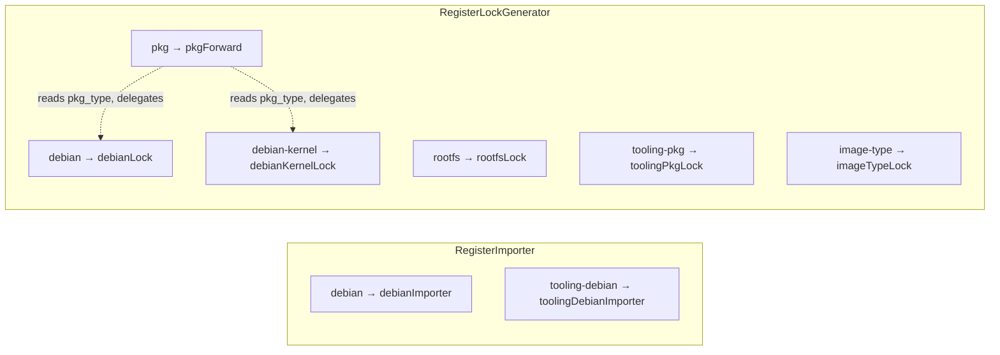
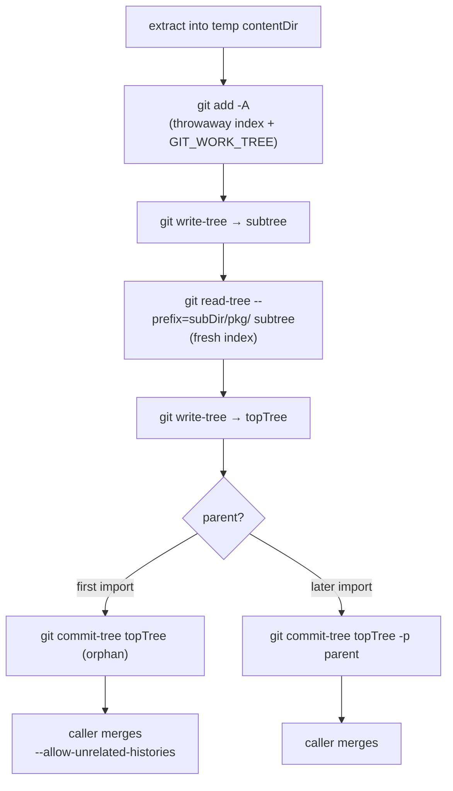

# Source import, lineage, and locking

This chapter covers the *front half* of the pipeline — the operations that read
and write the configuration tree rather than exchanging cache blobs the way a
build does. Four packages carry it:

- `internal/importer/` — fetch a package's pristine upstream source, verify it
  against the signed archive metadata, extract its packaging into the working
  tree, and record the import on a per-package git lineage.
- `internal/lockfile/` — resolve the exact external `.deb` set a build step
  needs and write the pinned lock file (`build-deps.yml`, `rootfs-deps.yml`,
  `tooling-deps.yml`).
- `internal/restore/` — fill a cold object-store cache from the pins already
  recorded in a working tree.
- `internal/provider/` — the namespace dispatch that selects which importer or
  lock generator a command target names.

A build is cache-in, cache-out: it reads content-addressed blobs and writes
content-addressed blobs, never touching the config tree. These operations are
the opposite. They read and mutate `pkgs/<name>/`, the top-level `*-deps.yml`
files, and the `images.d/` tree, *and* they populate the object store with the
source archives and `.deb` blobs a later build will consume. That dual nature —
tree-mutating and cache-filling — is what separates this chapter's code from the
build engine in [the build chapter](./build.md).

On-disk schema details (the `build.yml` fields, the `sources.yml` /
`build-deps.yml` / `rootfs-deps.yml` shapes, the Debian source formats) belong
to the [Debian-format chapter](./debian.md); this chapter references them and
focuses on behaviour.

## Provider dispatch

Import and lock generation are both pluggable. A provider registers itself under
a **namespace string**; the command layer parses a `<namespace>:<arg>` target,
looks the provider up, and hands it an `OpContext`. This keeps `cmd/glbx/` free
of any knowledge of *how* a given package is imported or locked — it only knows
how to parse a target and dispatch.

### Target, params, and OpContext

`target.go`'s `ParseTarget` splits `"ns:arg"` on the first colon. A bare string
with no colon is a namespace with an empty argument (`rootfs` →
`{Namespace: "rootfs", Arg: ""}`); a colon with nothing after it is an error
(`pkg:` is rejected), as is an empty namespace.

`params.go` carries the provider-specific options off a separate channel.
`Params` is an opaque `map[string]string`; `ParseParams` folds one or more
`key=val,key=val` fragments into it, with a later assignment overriding an
earlier one. The command layer never interprets these keys — each provider
validates the set it receives and rejects anything it does not recognize, so a
typo surfaces as an error rather than a silently ignored option. The
Debian-family providers share one validator (`debianRepoConfig` in `debian.go`)
gated on `debianParamKeys`.

Everything ambient a provider needs is bundled in `OpContext`, quoted here
verbatim from `provider.go`:

```go
// OpContext is the ambient environment handed to every provider: the
// logger-bearing context, the object store (cache), the working-tree root whose
// pkgs/<name>/ and top-level *-deps.yml files the provider reads and writes, and
// the validated parameter set. StubPath locates the exec_env_stub binary a
// container-backed provider needs; providers that run no container ignore it.
type OpContext struct {
	Ctx       context.Context
	Store     *objstore.Store
	OutputDir string // working-tree root
	Params    Params
	StubPath  string
}
```

`StubPath` is the one field only some providers read: it locates the
`exec_env_stub` binary that a container-backed provider needs. Pure-Go providers
ignore it.

### The two interfaces

Providers come in two kinds. Quoted verbatim from `provider.go`:

```go
type Importer interface {
	// Namespace is the stable selector, e.g. "debian".
	Namespace() string

	// ParamsHelp is the free-form help string printed by
	// `glbx import --params-help <namespace>`.
	ParamsHelp() string

	// Import imports the named package. It returns a structured result for
	// --no-merge mode and machine consumers.
	Import(op OpContext, name string, opts ImportOptions) (*ImportResult, error)
}
```

```go
type LockGenerator interface {
	// Namespace is the stable selector, e.g. "debian", "debian-kernel",
	// "rootfs", "pkg".
	Namespace() string

	// ParamsHelp is the free-form help string printed by
	// `glbx lockfile --params-help <namespace>`. The pkg forwarder composes its
	// delegates' strings.
	ParamsHelp() string

	// Generate produces the lock for the given argument (a package name for
	// "pkg"/"debian"/"debian-kernel"; "" for "rootfs"), logging its own
	// completion through op.Ctx.
	Generate(op OpContext, arg string) error
}
```

The asymmetry between them is deliberate. `Import` returns an `ImportResult`: the
command layer branches on it to decide whether to run a git merge, and in
`--no-merge` mode serializes it as JSON for the update-PR pipeline. `Generate`
returns only an error — a lock's outcome (which file, how many packages) is a log
line emitted through `op.Ctx`, and anything a machine needs is readable from the
written lock file on disk.

Registration is by `init()` in each provider file. `RegisterImporter` and
`RegisterLockGenerator` populate two package-level maps keyed by namespace;
`LookupImporter` / `LookupLockGenerator` resolve them and report the known set on
a miss.

### The namespace table

A namespace is an importer namespace, a lock-generator namespace, or (for the
Debian family) both — but the two maps are independent, so there is no
requirement that a name appear in both.

| Namespace         | Importer | Lock generator | Notes |
|-------------------|:--------:|:--------------:|-------|
| `debian`          | ✓        | ✓              | plain Debian source import / build-deps lock |
| `debian-kernel`   | —        | ✓              | regenerates `control` in a container, then locks |
| `pkg`             | —        | ✓              | forwarder: dispatches on `build.yml`'s `pkg_type` |
| `rootfs`          | —        | ✓              | zero-arg configuration-tooling lock |
| `tooling-debian`  | ✓        | —              | Debian import into `images.d/tooling/` |
| `tooling-pkg`     | —        | ✓              | build-tooling lock for a tooling package |
| `image-type`      | —        | ✓              | an image type's assembly-tooling lock |

Three namespaces are easy to misclassify: **`tooling-debian` is an importer with
no lock generator**, while **`tooling-pkg` and `image-type` are lock generators
with no importer**. The tooling universe imports under one name
(`tooling-debian`) and locks under two others (`tooling-pkg` for a tooling
package's own build-deps, `image-type` for an image type's assembly tooling).



`import` has no dispatch-by-config forwarder analogous to `pkg:`. An import
*creates* `pkgs/<name>/`, so it runs before any `build.yml` exists (and
`build.yml` is optional besides). The namespace is therefore always explicit on
the command line — `debian:<name>`, never `pkg:<name>`.

### The concrete providers

**`debian.go`** holds `debianImporter` and `debianLock`. The importer wraps the
import pipeline below; the lock generator reads `src/debian/control`, resolves
the build-dependency closure, fetches every `.deb`, and writes
`pkgs/<name>/build-deps.yml`. Both run glbx's own code only — no container.
`runDebianPkgLock` is the shared lock body that `debianLock` and
`debianKernelLock` both end in.

**`kernel.go`** holds `debianKernelLock`, the one container-backed lock
generator. A kernel-style package's committed `debian/control` is a generated
artifact, stale with respect to any template edit, and regenerating it means
running the package's own build tooling. `regenControlInContainer` therefore:

1. fetches the binary index and resolves a *minimal* root set — the essential
   packages plus the package's `gen_control_pkgs` (its hand-authored
   `Build-Depends` bootstrap tier, **not** the full generated build-dep set);
2. bootstraps an ephemeral chroot from those resolved blobs via
   `install.BootstrapResolved`, over a container namespace stack;
3. `cp -a`'s the package's `src/` tree into the container at `/build` (a copy,
   not a read-only bind, because the generator writes `debian/` in place; `cp -a`
   is shelled out because faithful mode/timestamp/symlink/ownership preservation
   is beyond the namespace file interface);
4. runs `debian/bin/gencontrol.py` with `PYTHONHASHSEED=0` (for reproducible
   pickled config) inside the container, cwd `/build`;
5. copies the regenerated `debian/control` back out of the namespace's rootfs
   into the working tree.

It then falls through to `runDebianPkgLock` over the freshly materialized
control. The `gen-repo` / `gen-dist` / `gen-arch` params let the
control-generation container target a different repo/dist/arch than the resolved
lock; they default to the resolved values.

**`pkg.go`** holds `pkgForward`, the recommended developer entry point. It reads
`pkg_type` from `pkgs/<name>/build.yml` and delegates to the concrete generator
of that namespace (`debian` or `debian-kernel`), passing params through
untouched, so a developer runs `glbx lockfile pkg:<name>` without knowing which
kind a package is. It errors if `pkg_type` is unset or names `pkg` itself. Its
`ParamsHelp` composes the delegates' help in `pkgDelegates` order (`debian`
before `debian-kernel`).

**`rootfs.go`** holds `rootfsLock`, the zero-argument configuration-tooling lock.
It ignores its argument (always empty) and writes the top-level
`rootfs-deps.yml`.

**`tooling.go`** holds the three tooling-universe providers, all rooted at the
`images.d/tooling` subtree (constant `toolingSubDir`). `toolingDebianImporter` is
the same Debian importer as `debian:`, differing only in its destination
subtree, so a `pkgs/` import and a tooling import of the same upstream name are
two different, coexisting packages with independent lineages. `toolingPkgLock`
runs the same resolve as `debian:` but rooted at the tooling tree and validates
the reduced tooling `build.yml` schema (`ValidateToolingBuildYML`) first.
`imageTypeLock` reads an image type's `conf.yml` and pins its `debian_tooling`
closure into `images.d/<name>/tooling-deps.yml`; `local_tooling` is *not* pinned
here — those are graph edges resolved through the build, not mirror pins.

## Source import

`internal/importer/` resolves the highest version of a package from a signed
`Sources` index, downloads and hash-verifies its files into the object store,
extracts the packaging into the working tree, writes `sources.yml`, and — by
default — records the import as a commit on the package's git lineage.

### The import pipeline

`Import` (`import.go`) takes an `ImportConfig` and a package name. In order:

1. **Resolve git mode.** `GitHistory && isGitRepo(OutputDir)` decides whether the
   import is recorded on the lineage. A requested git import against a
   non-repository falls back to a direct write with one warning; direct mode is
   silent.
2. **Load the Sources index.** `loadSourceIndex` fetches and GPG-verifies the
   `InRelease`, reads the `main/source/Sources.gz` hash out of it, fetches that
   (served from the object store by content hash on a repeat), and decompresses
   it. One load serves any number of lookups: the index is parsed lazily into a
   name→highest-version map on first `highest` call (`parseAllSourcePackages`,
   using `version.Compare` to keep the highest stanza per name).
3. **Short-circuit on an unchanged version.** In git mode, `findPreviousImport`
   runs *before any download*. If the previous import pins the exact version the
   index would select, `Import` returns early with `AlreadyPresent: true` and
   nothing is fetched.
4. **Download and verify.** `downloadSourceFiles` fetches each source file,
   checks its SHA-256 against the index, and stores it. Files already in the
   store are skipped (re-hashing the cached blob to recover the SHA-1 the
   snapshot URL needs). It returns a filename→hash map and a filename→SHA-1 map.
5. **Extract.** `extractInto` extracts the packaging (format-dispatched, below)
   and writes `sources.yml` from the orig-tarball entries. In direct mode this
   lands straight in `pkgs/<name>/` (`extractToTree`); in git mode it lands in a
   throwaway temp dir that becomes the commit's subtree (`extractAndCommit`).

`sources.yml` records only the *orig* tarballs — `isOrigTarball` deliberately
excludes `.asc`/`.sig` detached signatures that sit next to an orig in some
packages, because they are not extractable archives and the build phase would try
to bind-mount them as component origs. Each entry carries two retrieval URLs: the
archive mirror URL first, then a hash-addressed `snapshot.debian.org` URL keyed
by the file's SHA-1.

A native package writes no `sources.yml` at all; the build phase reads its
absence as "native".

### ImportResult

`Import` returns an `*ImportResult` (`import.go`):

```
Name           // source package name
Version        // version imported (or already present)
Format         // Debian source format string
Sources        // []SourceEntry: the orig tarballs stored
Committed      // true when the import was recorded as a git commit
CommitHash     // that commit's hash
FirstImport    // true when it is the orphan root of the lineage
AlreadyPresent // true when a prior import already pinned this exact version
```

`SourceEntry` is one stored archive: its `Name`, its content `Hash`, and the
ordered `URLs` recorded in `sources.yml`. `Committed`/`FirstImport`/
`AlreadyPresent` drive the command layer's merge decision: `AlreadyPresent` means
there is nothing to merge, `FirstImport` means the merge needs
`--allow-unrelated-histories` (the lineage root is an orphan with no common
ancestor), and a plain `Committed` import is a normal merge.

The provider layer has its *own* `ImportResult` (`provider.go`) with the same
fields plus `ImportedSource` (name + hash string); `debianImporter.Import`
translates between the two.

### Source formats

`formats.go` dispatches on the normalized `Format` field:

- **`3.0 (quilt)`** — extract the `.debian.tar.*` into `src/`, giving the
  `debian/` directory and its quilt patch series.
- **`3.0 (native)`** — extract the whole native tarball into `src/` with
  `strip-components=1`; verify a `debian/` directory is present.
- **`1.0`** — if there is no diff, treat as native. With a `.diff.{gz,xz,bz2}`:
  extract the orig into `a/`, copy to `b/`, apply the diff to `b/` via `patch
  -p1 --fuzz=0`, move `b/debian/` to the output, then **normalize** any
  non-`debian/` changes into a synthesized quilt patch. `diff -Naur a b` over the
  debian-stripped trees produces that patch; `stripDiffTimestamps` removes the
  wall-clock timestamp from each `---`/`+++` header so the patch is
  byte-identical across runs (`patch(1)` ignores the timestamp). The result is
  written as `debian/patches/debian.patch` with a `series` naming it — a legacy
  1.0 package is thereby brought to the same quilt shape the build expects.

See the [Debian-format chapter](./debian.md) for the format semantics in full.

## The import lineage

The subtlest part of this package is `git.go`: each import is recorded as a
commit on a per-package *lineage*, built entirely through git plumbing so the
working tree and index are never disturbed. The caller merges that commit into
the current branch.

### The metadata fence

Every import commit carries a machine-parseable metadata block in its commit
message, fenced by two exact marker lines:

```
---BEGIN PKG IMPORT METADATA---
pkg: <name>
version: <version>
auto_update: <tag>
---END   PKG IMPORT METADATA---
```

The markers must match as **exact, full lines**. Note the asymmetry: the begin
marker is `---BEGIN PKG IMPORT METADATA---`, and the end marker is
`---END   PKG IMPORT METADATA---` — **three spaces between `END` and `PKG`**, so
the two markers are the same visual width. `formatImportMessage` writes the block
after a human subject line (`import <pkg> <version> from debian`);
`parseImportMetadata` finds the begin marker as a whole line, then the end marker,
and parses the `key: value` lines between them. A begin marker with no matching
end marker is a hard error; a begin marker that only appears as a *substring* of a
longer line is not an import commit (`ok == false`). `hasExactLine` enforces the
full-line match.

The `auto_update` tag records the logical series the package tracks (e.g.
`debian:testing`). It is decoupled from the dist the bytes came from: an import
can pull from a frozen snapshot while recording the series it logically follows,
so the commit is indistinguishable in lineage terms from a normal import of that
series. This is the mechanism the update-replay method relies on.

### Building the commit through plumbing

`commitImportTree` is where the subtlety lives. It must produce a commit whose
sole content is `<subDir>/<pkg>/`, parented correctly, **without** touching the
real index, the working tree, or any branch. It does this against a throwaway
index:

1. Create a temp file for `GIT_INDEX_FILE`, then `os.Remove` it — git refuses to
   read a zero-byte index, so the path must *not* exist for git to create it
   fresh.
2. `git add -A` with `GIT_INDEX_FILE` **and** `GIT_WORK_TREE` both pointed at the
   throwaway index and the temp content dir respectively. This stages the
   extracted package content into the throwaway index. `git write-tree` captures
   it as a `subtree` object — a tree whose root *is* the package content.
3. Remove the throwaway index again and `git read-tree --prefix=<subDir>/<pkg>/
   <subtree>` into a fresh index. This re-roots the subtree one level down, so
   the resulting top-level tree's only content is the package directory at its
   proper path. `git write-tree` captures that as `topTree`.
4. `git commit-tree <topTree> -m <message>` — with `-p <parent>` when a parent
   exists, and no parent (an **orphan**) for a first import.

The two-step `write-tree` / `read-tree --prefix` dance is what lets the commit
land the content at `pkgs/<pkg>/` while the extraction happened in a flat temp
dir. Every `git` invocation in this function carries `GIT_INDEX_FILE` in its
environment so none of it ever touches the repository's real index.



### Walking the lineage

`findPreviousImport` locates the most recent valid import commit for a package
reachable from `HEAD`. It runs `git log --full-history --topo-order --format=%H
-- <subDir>/<pkg>` and scans the commits newest-first for the first one whose
message carries the begin marker. Two flags are load-bearing:

- **`--full-history`** disables history simplification. When a merge brings the
  import onto a side branch whose `<subDir>/<pkg>` tree matches the first parent,
  default path-filtered `git log` would follow only the first parent and prune
  the side holding the import — hiding it from the walk.
- **`--topo-order`** keeps the output strictly newest-ancestor-first, so the
  first marker match *is* the most recent import.

An unborn branch (no `HEAD` yet) trivially has no prior import and is handled
before `git log`, which would otherwise error. A commit that matches the marker
but fails `validateImportCommit` is a **hard error** (corrupt lineage), not a
reason to fall through to an older commit. `validateImportCommit` checks both
exact markers are present and that the commit's tree contains **nothing** outside
`<subDir>/<pkg>/` — an import commit is a single-package commit by construction.

### Collecting metadata across the tree

`CollectPkgMetadata` returns the most-recent import for *every* package currently
present under `pkgs/`. It uses one `git rev-list` call rather than per-package
`git log`:

```
git rev-list --topo-order --no-commit-header \
  --grep=<begin-marker> -F --format=%H%x00%B%x1e HEAD
```

`--grep=<begin-marker> -F` pre-filters to commits whose message contains the
marker (fixed-string, not regex); `--format=%H%x00%B%x1e` emits each as hash, a
NUL, the raw body, and a record-separator byte (`0x1e`) so bodies with blank
lines parse unambiguously. Topological order means the first commit seen for a
package is its newest import. For each record it re-parses the metadata (the grep
can match a *substring*, so `parseImportMetadata` re-validates the full-line
marker), filters to packages whose `pkgs/<name>/` directory actually exists
(`presentPackages`) — so a removed package drops out as soon as its directory is
gone, even if its lineage is still reachable — and keeps the first (newest) entry
per package. Entries come back in discovery order. An unborn branch yields none.

`PkgMetadata` is the per-package record: `Commit`, `Pkg`, `Version`,
`AutoUpdate`, with YAML/JSON struct tags fixing the serialized key order.

### Update checking

`CheckUpdates` (`check.go`) reports which present packages have a newer version
available. The critical ordering is that **filtering happens before any
network**: it calls `CollectPkgMetadata`, narrows the candidate set by the
`UpdateTag` filter (keep only packages whose recorded `auto_update` equals it) and
the optional explicit `Only` name list, and **returns early with no index load if
the candidate set is empty**. Only then does it load the Sources index once and
query each candidate with `version.Compare`. A pinned package absent from the
current archive is warned and skipped (the archive may have dropped or renamed
it), not a hard failure. Results (`Update{Pkg, Old, New}`) come back in lineage
discovery order.

## Lock generation

`internal/lockfile/generate.go` resolves the exact `.deb` set a build step needs,
fetches every one into the object store, and writes the pinned, explicit lock. It
drives three closely related outputs through two code paths.

### A package's build-deps

`Generate` produces `pkgs/<name>/build-deps.yml` (or the tooling-tree equivalent
when `SubDir` is set):

1. `extractBuildDeps` reads `src/debian/control` and concatenates
   `Build-Depends`, `Build-Depends-Arch`, and `Build-Depends-Indep` into one
   dependency list.
2. `FetchBinaryIndex` fetches, caches, and parses the binary `Packages` index for
   the target arch. **It passes `NoVerify: true`** — a deliberate contrast with
   the importer, which GPG-verifies the `InRelease`. The lock's integrity comes
   from pinning every resolved `.deb` by SHA-256, not from trusting the index
   signature at lock time.
3. `buildResolverRoots` assembles the resolver roots: the index's essential
   packages, the implicit build infrastructure (`build-essential`, `fakeroot`,
   `debconf`), and each arch- and profile-active build dependency from the control
   file (honouring `MatchesArch` / `ExcludedByProfiles` and the package's
   `BuildProfiles`).
4. `resolveAndFetch` runs the backtracking resolver over those roots, then
   `FetchDebs` downloads and hash-verifies every resolved `.deb`.
5. `writeBuildDeps` serializes the result.

### Rootfs and image-type tooling

`GenerateRootfs` and `GenerateImageType` share `generateToolingLock`, differing
only in the resolver roots and the output path. Their root floor is
`buildToolingRoots`: **every essential package plus `perl-base` and `mawk`** (the
postinst-script infrastructure — perl for perl maintainer scripts, mawk as the
default awk), then any extra named roots. **`apt` is excluded** — these containers
are dpkg-only. `GenerateRootfs` appends no extra roots and writes top-level
`rootfs-deps.yml`; `GenerateImageType` appends an image type's `debian_tooling`
names and writes `images.d/<name>/tooling-deps.yml`. (`local_tooling` is never
pinned — those are graph edges, not mirror pins.)

### The lock YAML shape

All three outputs share one shape, written by `writeBuildDeps` — one tool per
resolved package, each with its exact version and a single file recording the
arch, hash, and ordered retrieval URLs of its `.deb`:

```yaml
tools:
  - name: <pkg>
    version: <exact version>
    files:
      - arch: <arch>
        sha256: <hash>
        urls:
          - <mirror url>          # repoURL/<Filename>
          - <snapshot url>        # SHA1-addressed snapshot.debian.org
```

The mirror URL is recorded first, the hash-addressed snapshot URL second — the
same two-URL preference order the importer records for source archives.
`writeBuildDeps` errors if a package is missing its hash, filename, or SHA-1 (the
last is set only once a `.deb` has actually been fetched).

### FetchDebs

`FetchDebs` is the shared download primitive. It fetches and hash-verifies every
package's `.deb` into the store **16 at a time** (`sem := make(chan struct{},
16)`), skipping blobs already present but re-hashing a cached blob to recover its
SHA-1 for the snapshot URL. A SHA-256 mismatch on a download is a hard error.
Errors from all goroutines are collected and the first is surfaced with a count.
`restore.Restore` uses a configurable concurrency (also defaulting to 16) for the
same work from a different source of truth.

## Cold-cache restore

`internal/restore/restore.go` fills an empty object-store cache from the pins
*already recorded* in a working tree — the inverse of lock generation, which
*produces* those pins. Where a lock resolves against a live archive, restore
never resolves anything: it reads the exact hashes and URLs already written to
disk and ensures each blob is present.

### Collecting the pin set

`collectItems` walks the whole working tree into a deduplicated restore set
(keyed by hash string, so a blob pinned by several packages is fetched once):

- **Shipped packages** — for each `pkgs/<name>/`: every `sources.yml` archive and
  every arch-matching `build-deps.yml` `.deb` (`FilesForArch`).
- **Rootfs configuration tooling** — `rootfs-deps.yml`.
- **Image-assembly tooling packages** — each `images.d/tooling/<name>/` (same
  subtree shape as `pkgs/`); the directory is optional.
- **Image types** — each `images.d/<type>/tooling-deps.yml`, discovered via
  `DiscoverImageTypes`.

A missing optional file (`sources.yml` on a native package, an absent
`images.d/`) is not an error; only a genuine read failure is.

### Fetching and the registry-present rule

`Restore` fans the item set out across a semaphore (default concurrency 16) and
classifies each as restored (downloaded), cached (already present), or failed (no
URL supplied it). `fetchItem` first asks `cfg.Store.Blobs.Has(it.hash)` — and this
is where the pull-through composition matters: **`Has` reports existence across
the local store *and* a configured remote without materializing the blob.** A
blob already on the registry counts as present and is **not** downloaded to this
runner; the build stage pulls what it actually needs, lazily. Only a blob absent
everywhere is downloaded, trying `it.urls` in preference order and keeping the
first whose bytes match the pinned hash. `download` streams into the store (which
hashes as it writes) and rejects a digest mismatch; a mismatched blob is left for
garbage collection and is never the hash a build looks up.

This registry-present behaviour is what makes the warm CI path a near no-op:
`restore-inputs` issues HEADs against ghcr and pulls nothing when the inputs are
already mirrored.

### InputHashes

`InputHashes` returns the content hashes of exactly the set `collectItems`
enumerates for an arch. The `publish` command uses it to mirror precisely the
recorded inputs to a remote — the publish side of the same pin set restore reads.

## Where this fits

These four packages are the bridge between a human-curated config tree and a
content-addressed build. Import and lock generation *write* the tree's pins
(source hashes, `.deb` hashes, lineage commits) while filling the cache; restore
*reads* those pins to refill a cold cache; provider dispatch routes a command
target to the right implementation. Everything downstream — the artifact graph
and the build engine in [the build chapter](./build.md) — consumes the blobs and
locks these operations produce and never reaches back into the config tree.
