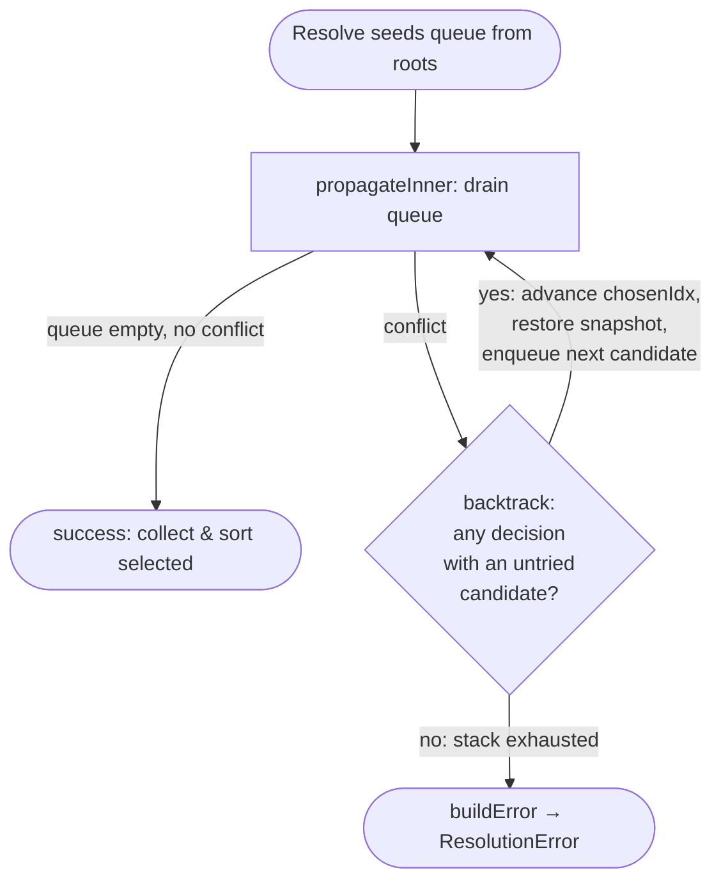

# The dependency resolver

`internal/resolver/` is glbx's dependency solver: given a package index and a set
of root requirements, it computes a closed, conflict-free install set that
satisfies every `Depends`, `Pre-Depends`, and `Conflicts` relation reachable from
the roots. It is the single most algorithmically intricate component in the tree —
a backtracking constraint solver with a decision stack, state snapshots, and
undo-on-backtrack. This chapter is a field guide for anyone who needs to change
that algorithm. It assumes you already understand the Debian format layer
(`internal/debian/index` and `internal/debian/depends`): the resolver consumes an
`index.Index` of `index.Package` values and the parsed relationship types
(`depends.Dependency`, `depends.Alternative`, `depends.DependencyList`,
`depends.VersionConstraint`), and those types are documented in their own chapter.

The package is two files. `resolver.go` holds the index pre-expansion, the solver
state machine, and the propagate/decide/backtrack loop. `error.go` holds the
structured failure tree that a dead end produces.

## The public shape

Two small value types bound the API:

```go
type Requirement struct {
	Name            string // package name (or virtual package name)
	VersionOp       string // "", ">=", ">>", "=", "<=", "<<"
	Version         string // version string for constraint
	VirtualEligible bool   // if true, can be satisfied by Provides
}

type Result struct {
	Packages []*index.Package // the fully closed, conflict-free install set
}
```

A `Requirement` is one root the caller insists be installed. `VersionOp`/`Version`
carry an optional version constraint (the operators are Debian's five:
`>=`, `>>`, `=`, `<=`, `<<`). `VirtualEligible` decides how the root is looked up:
when false the root must be a concrete package present under exactly that name;
when true the root may be satisfied by any package whose `Provides` names it. This
distinction matters only for roots — once inside the dependency graph, every atom
is resolved uniformly through the provider machinery.

`Resolve(roots []Requirement) (*Result, error)` is the only entry point besides
`New`. On success `Result.Packages` is the complete transitive closure, sorted by
name. On failure the error is always a `*ResolutionError` (see
[The error tree](#the-error-tree)).

## Construction and pre-expansion

`New(idx *index.Index, arch string)` does all the one-time index analysis up front,
so the hot solver loop never re-parses relationship fields. The `Resolver` caches
four maps:

```go
type Resolver struct {
	idx  *index.Index
	arch string

	expandedDepends    map[string][]depGroup
	expandedPreDepends map[string][]depGroup
	expandedConflicts  map[string][]conflictEntry
	providedBy         map[string][]string
}
```

`New` runs two passes.

**`buildProvidedBy`** walks every package's `Provides` and inverts it into
`providedBy`: virtual name → concrete package names that provide it. Each slice is
sorted, which is the first of several determinism anchors — the provider ordering
feeds directly into candidate ordering later, and a map iteration there would make
the solver's choices depend on Go's randomized map order.

**`expandRelations`** pre-computes, for every package, the candidate sets of its
dependency and conflict relations:

- `expandedDepends[pkg]` / `expandedPreDepends[pkg]` are slices of `depGroup`, one
  per OR-clause in the field. A `depGroup` keeps the original atoms
  (`depends.Alternative`) alongside `candidates` — the flattened, de-duplicated,
  sorted list of concrete package names that satisfy *any* atom in the clause.
- `expandedConflicts[pkg]` is a slice of `conflictEntry`, one per conflict atom,
  each holding the atom and its expanded target package names, with the package's
  own name filtered out (a package never conflicts with itself).

Expansion bottoms out in two helpers worth knowing precisely:

`expandAtom(atom)` turns one `depends.Dependency` into the set of concrete package
names that satisfy it. It first applies the **architecture filter**: an atom whose
`Arch` qualifier is set to something other than `""`, `"any"`, `"native"`, or the
build `arch` is dropped entirely (returns `nil`). That is how a foreign-arch atom
like `libc6:i386` on an amd64 build is excluded — such packages are not in our
single-arch index, so treating the atom as unsatisfiable-but-ignorable is correct.
Having passed the filter, `expandAtom` collects a direct name match (if the index
has a package by that name satisfying the version constraint) plus every provider
from `providedBy[atom.Name]` that satisfies it, de-duplicating and sorting the
result.

`atomMatchesPkg(pkg, atom)` is the version-constraint gate. For a direct name
match it checks the atom's constraint against the package's own version via
`version.CheckConstraint`. For a provider match it scans the provider's `Provides`:
an unversioned atom is satisfied by any matching provide, but a *versioned* atom is
satisfied only by a provide that itself carries a version matching the constraint —
an unversioned `Provides` can never satisfy a versioned dependency, matching
Debian's rule.

The key invariant from this phase: **after `New`, every relation is reduced to
sorted concrete-name candidate lists.** The solver works purely over package names
and these pre-computed lists; it never re-parses a relationship field.

## Solver state

`Resolve` builds a fresh `solverState` per call — the `Resolver` itself is
immutable and reusable across resolutions. The state is the mutable heart of the
algorithm:

```go
type solverState struct {
	resolver  *Resolver
	trail     []string            // order of selections
	selected  map[string][]string // package name -> reason chain
	excluded  map[string]string   // package name -> reason for exclusion
	decisions []*decision         // active decision stack
	exhausted []*decision         // fully-explored decisions (for error reporting)
	queue     []workItem          // pending work
}
```

- `selected` is the growing install set. The value is the dependency chain that
  caused the selection, carried only for diagnostics.
- `excluded` is the set of packages ruled *out* — populated when a selected package
  conflicts with them. The value is a human reason. A name in `excluded` can never
  enter `selected` without a conflict.
- `trail` records selection order. It exists so backtracking can undo selections
  made after a given point: `restore` truncates the trail and deletes exactly the
  names added since the snapshot.
- `queue` is the work list, processed FIFO.
- `decisions` is the active decision stack; `exhausted` collects decisions that
  have been fully explored, kept only to build a rich error.

### Work items

The queue holds `workItem`s of three shapes, discriminated by which fields are set:

- a **direct selection** (`pkg` set) — select this concrete package;
- a **virtual choice** (`virtual` set, `cands` populated) — satisfy this virtual
  name by choosing among its providers;
- a **deferred group choice** (`choice` true, `depender`/`atoms`/`cands` set) — a
  multi-candidate dependency OR-clause whose decision has been pushed onto the
  queue rather than made inline.

The deferral is subtle and load-bearing. When a selected package has an OR-clause
with more than one viable candidate, the solver does **not** decide on the spot.
It appends a `choice` work item to the queue and moves on, so the rest of that
package's dependency groups are enqueued *before* the choice is resolved. Only when
the choice reaches the front of the queue is a decision made. The reason:
a decision snapshots the queue (below), and we want that snapshot to include the
depender's other dependency groups, so that backtracking to this decision restores
them too. Deciding inline would snapshot a queue missing those sibling groups and
lose them on backtrack.

### Decisions

Every genuine choice between two-or-more candidates creates a `decision`, the unit
of backtracking:

```go
type decision struct {
	depender         string
	atoms            depends.Alternative
	candidates       []string
	chosenIdx        int
	trailLen         int
	excludedSnapshot map[string]string
	queueSnapshot    []workItem
	branchFailures   []branchFailure
	chain            []string
}
```

`candidates` is the *ranked* list of viable choices; `chosenIdx` points at the one
currently being tried. The three snapshot fields capture everything needed to rewind
to the moment just before the choice was made: `trailLen` (how long the trail was),
`excludedSnapshot` (a copy of `excluded`), and `queueSnapshot` (a copy of the queue
*as it stood after* the choice item was dequeued — i.e. with the depender's sibling
groups still pending). `branchFailures` accumulates, per exhausted candidate, the
conflict message that killed it — pure diagnostics for the error tree.

Note what is *not* snapshotted: `selected`. Selections are undone by replaying the
trail, not by copying the selected map. This keeps snapshots cheap even when the
install set is large.

## The propagate / decide / backtrack loop

`Resolve` seeds the queue from the roots, then hands off to `propagate`, which is
the outer control loop:



### Seeding from roots

For each root, `Resolve` validates eagerly and enqueues. A `VirtualEligible` root is
expanded via `findCandidatesForRequirement`; zero candidates is an immediate
`ResolutionError` ("not found and has no providers"), otherwise it is enqueued as a
virtual choice. A non-virtual root must exist by exact name (else immediate error),
and if it carries a version constraint the index package must satisfy it (else
immediate error); then it is enqueued as a direct selection. These root-validation
errors are the only ones produced *before* the solver loop runs.

### propagateInner — the drain

`propagateInner` pulls work items until the queue empties (success) or a `conflict`
is raised (backtrack trigger). Dispatch by item kind:

- **Virtual choice** → `handleVirtualChoice`. Filter out excluded candidates; zero
  viable is a conflict. If any candidate is already selected, the virtual is already
  satisfied — do nothing. If exactly one is viable, enqueue it directly. If several,
  rank them and `makeDecision`.
- **Group choice** → `handleGroupChoice`. Same logic, with one extra early exit: a
  candidate already *selected* means the OR-clause is already satisfied, so return
  immediately. This re-filtering against *current* state is essential — between the
  moment the choice was enqueued and the moment it is handled, candidates may have
  become selected or excluded.
- **Direct selection** → the inline body. If already selected, skip. If excluded,
  raise a conflict. Otherwise select it: record in `selected`, append to `trail`,
  then enforce its relations.

Selecting a package enforces two things, in order:

1. **Conflicts.** For every target of the package's `expandedConflicts`: if that
   target is already *selected*, raise a conflict immediately (two incompatible
   packages both chosen). Otherwise add it to `excluded` with a reason. This is the
   exclusion mechanism — a conflict doesn't remove anything already present (that
   case is the error), it forbids the target from being selected later.
2. **Dependencies**, pre-depends first then depends, both via `processDepGroups`.

`processDepGroups` handles one package's dependency groups. For each group it
computes viability in stages, each stage its own early outcome:

- `candidates` empty (nothing in the index ever satisfied this clause) → conflict,
  with a detailed reason from `explainNoCandidates`.
- all candidates excluded → conflict ("all candidates excluded").
- some candidate already selected → clause satisfied, skip.
- exactly one viable candidate → enqueue it directly (no decision — a forced move).
- two-or-more viable → defer: append a `choice` work item (the deferral described
  above).

### makeDecision and candidate ranking

`makeDecision` snapshots the current trail length, excluded map, and queue, pushes a
`decision`, and enqueues the first ranked candidate. Ranking is `rankCandidates`, a
stable sort with this preference order:

1. **Already-selected candidates first** — reusing a package already in the set adds
   nothing new, so it is strictly preferred. This biases the solver toward smaller
   install sets and toward reusing prior choices.
2. **Direct name match over provider** — a candidate whose name literally appears in
   the clause's atoms beats one that only satisfies it via `Provides`. This encodes
   Debian's convention that the first-named real package is the preferred default.
3. **Fewer dependencies** — among equals, the candidate pulling in the smaller
   transitive burden (measured by count of its own depend + pre-depend groups) is
   tried first. A minimality heuristic, not a guarantee.
4. **Alphabetical** — the final tie-break, purely for determinism.

Because the sort is `SliceStable` and every prior input (candidate lists, provider
lists) is itself sorted, ranking is fully deterministic for a given index and state.

### backtrack and restore

When `propagateInner` returns a conflict, `propagate` calls `backtrack`. It walks the
decision stack from the top:

- Record the current candidate's failure in the top decision's `branchFailures`
  (for the eventual error).
- If that decision has an untried candidate (`chosenIdx+1 < len(candidates)`),
  advance `chosenIdx`, call `restore(d)` to rewind state to the decision's snapshot,
  enqueue the next candidate, and return `true` — the outer loop re-enters
  `propagateInner` from the rewound state.
- Otherwise the decision is exhausted: move it from `decisions` to `exhausted` and
  pop up to the next decision down the stack, repeating.

If the stack drains with no candidate left anywhere, `backtrack` returns `false` and
`propagate` calls `buildError`. This is chronological backtracking: the *most recent*
unexhausted decision is retried first, which — combined with the queue snapshot
including sibling groups — keeps the search sound without any conflict-directed
jump-back.

`restore(d)` is the exact inverse of everything done since the decision was made:
delete from `selected` every name on `trail[d.trailLen:]`, truncate `trail` to
`d.trailLen`, and replace `excluded` and `queue` with fresh copies of the decision's
snapshots. The copies (`copyMap`, `copyQueue`) matter — the decision's snapshots must
stay pristine in case this same decision is restored again for its next candidate.

### Collecting the result

When `propagate` returns `nil`, every name in `selected` is looked up in the index
and collected into `Result.Packages`, then sorted by name. The sort makes the output
deterministic regardless of the order selections happened to land in the map.

## Invariants and gotchas for a modifier

- **The `Resolver` is immutable after `New`; all mutable state lives in
  `solverState`.** You can resolve many requirement sets against one `Resolver`
  concurrently only if you give each its own state — which `Resolve` already does per
  call. Don't cache mutable data on the `Resolver`.
- **Every ordering is deliberately sorted.** Provider lists, candidate lists, the
  final result — all sorted; ranking is a stable sort over sorted inputs. If you add
  a new candidate source, sort it, or you reintroduce map-iteration nondeterminism
  and the solver's choices (and thus produced install sets) become unstable.
- **Exclusion is forward-only.** Selecting a package excludes its conflict targets;
  it never evicts an already-selected one (that is the immediate-conflict case).
  A backtrack can un-exclude by restoring the snapshot, but within one
  `propagateInner` pass exclusion only grows.
- **Decisions snapshot the queue, not the selected set.** Selections are undone by
  trail replay. If you add state that selection mutates, you must either snapshot it
  in `decision` and restore it, or make it reconstructible from the trail — otherwise
  backtracking will leave it stale.
- **The defer-the-choice dance exists for snapshot correctness.** If you ever make a
  multi-candidate group decision inline in `processDepGroups`, be aware the decision's
  queue snapshot will miss the depender's remaining groups and backtracking will drop
  them. The comment on `workItem.choice` guards this.
- **Forced moves (single viable candidate) create no decision.** Only genuine
  branches push onto the decision stack, so the stack depth tracks real choice points,
  not install-set size.

## The error tree

A failed resolution produces a `*ResolutionError`, a tree built to make a dead end
diagnosable rather than a bare "unsatisfiable".

```go
type ResolutionError struct {
	Attempts []Attempt
}

type Attempt struct {
	Package   string    // package name at this decision point
	Reason    string    // why this candidate failed
	Chain     []string  // dependency chain that led here
	SubErrors []Attempt // nested resolution failures (alternatives tried)
}
```

`buildError` assembles it from `exhausted` plus any still-active `decisions`. For
each decision that recorded at least one `branchFailure`, it emits one `Attempt` for
the depender ("depends on `<atoms>`") whose `SubErrors` are one entry per failed
candidate, each carrying the candidate name and the conflict message that killed it.
This directly answers the diagnostic question: *for the clause that couldn't be
satisfied, here is every alternative we tried and the specific reason each one
failed.* If no decision ever recorded a failure — a conflict with no choice points,
e.g. a root's hard dependency that simply has no candidates — `buildError` falls back
to a single `Attempt` from the final `conflict`.

The `Chain` on each attempt is the dependency path that reached the failing clause,
accumulated in `processDepGroups` as it descends ("`pkg` depends on `<atoms>`"
appended at each hop). `explainNoCandidates` enriches the leaf reason when a clause
has *no* candidates at all, distinguishing the cases: the named package exists but
its version doesn't match, the name is virtual but no provider satisfies the
constraint, or the name is simply absent from the index.

`ResolutionError.Error()` renders the tree with indentation: a parent line
"`pkg reason:`" followed by its indented sub-attempts, and leaf lines append the
chain as "`(via a -> b -> c)`". `FormatChain` is the standalone helper for rendering
a chain the same way elsewhere. Because the tree preserves which decision each failure
belongs to, reading it top-to-bottom reconstructs the search: each top-level
`Attempt` is a branch point the solver exhausted, and its children are the paths it
ruled out beneath it.
