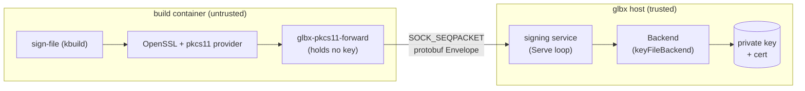

# Out-of-container signing

Some package builds must produce signatures. The kernel package signs every
module it installs (and, under a signed-image configuration, the EFI image); the
signatures must verify against a certificate the running kernel trusts, and they
must be byte-identical across rebuilds or the whole content-addressed cache stops
hitting. A signature needs a private key. But a glbx package build runs arbitrary
upstream build machinery inside an unprivileged sandbox — Debian packaging rules,
upstream Makefiles, `dpkg-buildpackage` — none of which glbx trusts with a signing
key. The requirement is absolute: **the private key is never present inside the
container.**

The mechanism that makes this possible is the one the kernel already offers.
`CONFIG_MODULE_SIG_KEY` accepts a `pkcs11:` URI, which `scripts/sign-file` hands
to OpenSSL, which loads a PKCS#11 provider module to perform the signature.
PKCS#11 is designed precisely for "sign with a key I cannot see" — the key lives
in a token (classically an HSM) and the caller only ever submits a digest and
receives a signature. glbx supplies a PKCS#11 module that holds no key and does no
cryptography. Every operation that would touch the key is forwarded over a Unix
socket to a signing service running on the host, which holds the key and produces
the signature. The container sees signatures, never key bytes.



The two halves live in two repositories. The **host side** — the signing service,
the `Backend` interface, and the build-lifecycle wiring — is Go code in glbx
(`internal/signing/` and `internal/build/signing.go`). The **container side** —
the forwarding PKCS#11 module itself — is a C shared object that lives in the
glbf-staging config repository, built as a native Debian package
(`pkgs/glbx-pkcs11-forward/`). Because glbx is the single source of documentation
for the whole system, the C module is documented here even though its source
lives elsewhere. Both ends share one wire protocol definition
(`internal/signing/sign.proto` in glbx, copied verbatim as
`pkgs/glbx-pkcs11-forward/src/sign.proto` in staging); they must stay identical,
and this chapter treats the glbx copy as authoritative.

## The wire protocol

The socket carries protobuf3 messages, one per datagram. This is a deliberate
contrast with the build engine's control channel (`internal/ipc`), which is
encoded with Go's `encoding/gob`: gob is a Go-to-Go encoding and would be useless
to a C peer. The signing channel has a C module on one end, so it uses a
language-neutral schema from which both the Go (`protoc-gen-go`) and C
(`protobuf-c`) bindings are generated. `pkgs/glbx-pkcs11-forward/build.yml`
carries the single build-dependency this implies, `libprotobuf-c-dev`; the C
module links nothing else cryptographic, because it performs no cryptography.

Every message on the socket is wrapped in a single `Envelope` whose `oneof`
discriminates the request and response types:

```proto
message Envelope {
  oneof msg {
    PublicKeyRequest public_key_request = 1;
    PublicKeyResponse public_key_response = 2;
    SignRequest sign_request = 3;
    SignResponse sign_response = 4;
    CertRequest cert_request = 5;
    CertResponse cert_response = 6;
  }
}
```

An exchange is always one request datagram followed by one response datagram on a
freshly connected socket, which then closes. There are three request/response
pairs, corresponding to the three things the module needs from the key it cannot
see: the public key material, a signature, and the certificate.

**Public key.** Before a PKCS#11 consumer will sign, it fetches enough of the key
object to describe it. The module has no key, so it asks the service:

```proto
message ECPublicKey {
  bytes params = 1; // DER of the named-curve OID (PKCS#11 CKA_EC_PARAMS)
  bytes point = 2;  // DER octet string of the public point (CKA_EC_POINT)
}

message RSAPublicKey {
  bytes modulus = 1;  // CKA_MODULUS
  bytes exponent = 2; // CKA_PUBLIC_EXPONENT
}

message PublicKeyResponse {
  oneof key {
    ECPublicKey ec = 1;
    RSAPublicKey rsa = 2;
  }
  string error = 3;
}
```

The fields are shaped directly by the PKCS#11 attributes the module must later
report. For an EC key, `params` is the DER encoding of the named-curve object
identifier and maps to `CKA_EC_PARAMS`; `point` is the DER octet string of the
public point and maps to `CKA_EC_POINT`. For an RSA key, `modulus` and `exponent`
map to `CKA_MODULUS` and `CKA_PUBLIC_EXPONENT`. The `key` oneof is how the key
type is communicated: whichever variant is set tells the module whether it is
fronting an EC or an RSA key, which in turn decides the mechanism it advertises.
No private material appears in this message or any other.

**Signature.** The one operation that truly needs the key:

```proto
message SignRequest {
  bytes digest = 1;    // pre-computed message digest
  string hash_algo = 2;
}

message SignResponse {
  bytes signature = 1; // raw r||s for ECDSA, raw block for RSA PKCS#1 v1.5
  string error = 2;
}
```

The request carries a **pre-computed digest**, not the message to be hashed: the
OpenSSL provider hashes the module and hands `C_Sign` the finished SHA-256 digest
under the plain `CKM_ECDSA` mechanism (the digest-input variant), so the service
signs the digest directly and never hashes. The response is the raw signature in
exactly the form PKCS#11's `C_Sign` returns: concatenated `r||s` for ECDSA, or the
raw PKCS#1 v1.5 block for RSA. There is deliberately **no key identifier** in the
request — the socket *is* the key. A service listening on a given socket signs
with exactly one key, so which key to use is determined by which socket the module
connected to, not by anything in the message.

**Certificate.** `sign-file` needs the public X.509 certificate that matches the
signing key, and the module serves it from the token the same way it serves the
key:

```proto
message CertRequest {}

message CertResponse {
  bytes der = 1; // the public X.509 certificate, DER-encoded
}
```

The certificate is public, so routing it over the signing channel is harmless; it
simply spares the kernel build from carrying the cert in by another path.

## The host side

The host half is the `signing` package. It never leaves the host, and the private
key is read only here.

### The Backend interface

Everything key-specific is behind one interface, so the service loop knows nothing
about key types, PEM files, or crypto:

```go
// Backend produces signatures and exposes the matching public key. It is key-type
// agnostic to its callers: the backend decides EC vs RSA from the key it holds.
type Backend interface {
	// PublicKey returns the public parameters a PKCS#11 consumer needs to
	// describe the key object (never any private material).
	PublicKey() *pb.PublicKeyResponse
	// Sign returns a signature over the given pre-computed digest. For EC keys
	// the result is raw r||s; for RSA it is the raw PKCS#1 v1.5 block.
	Sign(digest []byte, hashAlgo string) ([]byte, error)
	// Certificate returns the public X.509 certificate in DER form.
	Certificate() []byte
}
```

The three methods are exactly the three wire exchanges. A future backend could
front a hardware token, a cloud KMS, or a secrets manager with no change to the
module, the protocol, or the container — only a new `Backend` implementation.

### keyFileBackend

The implementation that ships is `keyFileBackend`, constructed by
`NewKeyFileBackend(keyPath, certPath)`. It reads a PEM private key and its PEM
certificate off the host disk and prepares the public material once. The key is
parsed by `parsePrivateKey`, which tries PKCS#8, then SEC1 EC, then PKCS#1 RSA, so
either key type loads from the common PEM encodings. From the parsed key it
precomputes the `PublicKeyResponse`:

- For an EC key it records the curve field width (`coordSz`, used later to
  zero-pad `r` and `s`), and derives `CKA_EC_PARAMS` / `CKA_EC_POINT` via
  `ecPublic`: the curve OID is looked up (`curveOID` supports P-256, P-384,
  P-521) and ASN.1-marshalled for `params`, and the uncompressed public point is
  marshalled as a DER octet string for `point`.
- For an RSA key it records the big-endian modulus and public exponent.

`Certificate()` returns the DER bytes read from the PEM cert at construction.
`Sign` accepts only `sha256` (any other hash is an error) and branches on key
type. For RSA it is a direct `rsa.SignPKCS1v15`, which is deterministic by
construction — no nonce. For EC it is the interesting case.

### Deterministic ECDSA via RFC 6979

Go's `crypto/ecdsa` signs with a random nonce and exposes no deterministic mode,
which would make every build's module signatures differ and defeat the cache. So
`keyFileBackend` implements ECDSA signing itself with an RFC 6979 deterministic
nonce (`signECDSADeterministic` + `rfc6979Nonce`). RFC 6979 derives the nonce `k`
from the private key and the digest alone, via an HMAC-SHA256 construction, so a
given `(key, digest)` always yields byte-identical `(r, s)` — and therefore a
byte-identical signature. `rfc6979Nonce` follows RFC 6979 §3.2 (the `int2octets` /
`bits2octets` conversions, the `K`/`V` HMAC chaining, the candidate-rejection
loop); `signECDSADeterministic` computes `(r, s)` from that `k`, retrying with the
next candidate in the degenerate cases where `r` or `s` is zero. The resulting `r`
and `s` are each left-zero-padded to `coordSz` bytes and concatenated, which is
exactly the raw `r||s` form `CKM_ECDSA`'s `C_Sign` is expected to return.

This is the sole reason determinism lives here rather than in the kernel build: in
PKCS#11 the nonce is the token's choice, invisible to and uncontrollable by the
caller, so putting the key behind PKCS#11 moves the one remaining source of
non-determinism entirely into code glbx controls. No patch to `sign-file`, OpenSSL,
or the kernel source is involved.

### The Serve loop

`Serve(ctx, socketPath, backend)` runs the service. It listens on a
`SOCK_SEQPACKET` Unix socket — `net.ListenUnix("unixpacket", …)` — chosen because
it is connection-oriented, reliable, ordered, *and* message-boundary-preserving,
so each protobuf `Envelope` is exactly one datagram with no length-prefix framing.
After binding, it `chmod`s the socket to `0666`. That is safe and necessary: the
build connects as an unprivileged, ID-mapped user inside the container while the
socket was created by the host-side service under a different uid, and the socket
is a request channel, not a secret — the private key never crosses it, so world-
connectability costs nothing.

The accept loop handles one connection at a time: read one datagram, unmarshal the
`Envelope`, dispatch on its `oneof`, marshal the reply, write it, close. The
dispatch is a direct mapping to the `Backend`: a `PublicKeyRequest` returns
`backend.PublicKey()`, a `SignRequest` calls `backend.Sign(digest, hashAlgo)` and
puts either the signature or the error string into the `SignResponse`, and a
`CertRequest` returns `backend.Certificate()`. A cancelled `ctx` closes the
listener and removes the socket file. `GLBX_SIGN_DEBUG` turns on stderr tracing on
this side, matching the module's own debug switch so both ends of a socket can be
traced together.

### Per-key service startup and the socket handoff

`DebianPkgBuild.setupSigning` (`internal/build/signing.go`) wires a build to the
service. If the package declares no signing keys it is a no-op and the build
behaves exactly as an unsigned one. Otherwise, for each configured key it:

1. builds a `keyFileBackend` from the key and cert files, resolved **relative to
   the conf dir on the host** — these paths never enter the container;
2. starts `signing.Serve` in a goroutine on a host socket under a per-build
   scratch directory (`glbx-sign-*.sock`, one file per key named `<key>.sock`);
3. **waits for the socket to exist and be `chmod`ed `0666`** before proceeding.

That wait (`waitForSocket`) is load-bearing. The socket is bind-mounted into the
container immediately after setup, and a bind-mount captures the source *inode* —
and its mode — at mount time. Binding before the goroutine has created and
`chmod`ed the socket would capture a nonexistent or wrong-mode inode, so setup
polls until the socket is present as a socket with mode `0666`.

The resulting mount is recorded as a `signingMount`: host socket path plus the
container path `/glbx/signing-service/<key_name>`. `bindSigningMounts` performs
the bind in the parent mount namespace (where the host socket is still visible),
creating the target file first; the mount target sits under `/glbx`, outside the
directories the container later overmounts with fresh tmpfs (`/run`, `/tmp`,
`/proc`, `/sys`, `/dev`), so the bind survives container setup. Finally
`signingEnv` exports **`GLBX_SIGN_SOCKET`** into the build environment, pointing at
the single key's in-container socket path (the kernel package uses one key), and
forwards `GLBX_SIGN_DEBUG` when set so the module's diagnostics can be toggled
without rebuilding it.

One identity note carried here because it shapes what the host wires in: the
**certificate is folded into the build node's content identity, the private key
is not.** The key only ever produces signatures on the host and must not perturb
the cache; the cert is a genuine, public build input whose change should
invalidate the node. (The build-artifact machinery that performs the hashing is
the package-build chapter's; this chapter only notes which bytes count.)

## The container side: the PKCS#11 contract

The forwarding module (`pkgs/glbx-pkcs11-forward/src/module.c`) is a PKCS#11
(Cryptoki) provider `.so` that OpenSSL's pkcs11 provider loads. Crucially, **a
PKCS#11 module never sees the `pkcs11:` URI** — the consumer (the provider) parses
the URI itself and turns it into a sequence of standard Cryptoki `C_*` calls,
matching the URI's fields against what the module *reports*. So the module's job is
to present a believable token with one key, answer the handful of calls OpenSSL
makes on the way to a signature, and forward the two calls that actually need the
key. It holds no key and performs no cryptography; it is pure forwarding plus a
little static bookkeeping.

### What the module exports and how it is selected

A PKCS#11 module exports exactly one symbol by name, `C_GetFunctionList`;
everything else is reached through the `CK_FUNCTION_LIST` it returns:

```c
CK_RV C_GetFunctionList(CK_FUNCTION_LIST_PTR_PTR out);

static CK_FUNCTION_LIST function_list = {
	.version = { 3, 0 },
	.C_Initialize = f_Initialize,
	.C_GetSlotList = f_GetSlotList,
	.C_GetTokenInfo = f_GetTokenInfo,
	/* … the rest of the implemented subset … */
	.C_Sign = f_Sign,
	.C_GenerateRandom = f_GenerateRandom,
};
```

Every slot in the table that the module does not fill stays null, and the consumer
treats an absent function as unsupported. The module is selected out of band (the
provider's `PKCS11_PROVIDER_MODULE`), not through the key URI; the URI only names
the token.

### Slots, tokens, objects, and the URI

In this minimal world the addressing is fixed:

- **One slot.** `C_GetSlotList` reports a single slot (`SLOT_ID` 0) with a token
  present, implementing the standard two-call size-then-fill convention.
  `C_GetSlotInfo` returns a static description. The consumer's only route to
  discovering any token is `C_GetSlotList`, so it is mandatory.
- **One token, labelled "glbx".** `C_GetTokenInfo` reports the token label
  `"glbx"` (the `TOKEN_LABEL` constant), blank-padded into the fixed 32-byte
  label field. This label is what a `pkcs11:token=glbx` URI selects: the consumer
  compares the URI's `token=` against the label the module reports and picks the
  matching slot. The token reports initialized, with no login required.
- **Two objects, fixed handles.** `C_FindObjectsInit` records the `CKA_CLASS` the
  search filters on (or an unfiltered match), and `C_FindObjects` yields the two
  objects whose class matches — the private key at handle `KEY_HANDLE` (1) and the
  certificate at handle `CERT_HANDLE` (2) — each exactly once, using a cursor so a
  second call reports zero and the consumer's enumeration terminates. (Returning an
  object repeatedly makes the provider loop forever.) `C_FindObjectsFinal` is a
  no-op.
- **One read-only public session.** `C_OpenSession` hands back a fixed session
  handle (`SESSION_HANDLE` 1) — there is no real resource behind it — and
  `C_GetSessionInfo` reports a `CKS_RO_PUBLIC_SESSION`. `C_Login`/`C_Logout`
  succeed trivially; no login is required, so there is nothing to do.

There is no `object=` or `id=` in the URI and none is needed: there is exactly one
key under the token, and *which* physical key it is was decided by which socket got
bind-mounted, not by the address. The token label is generic and permanent across
all builds and all keys; key selection is the socket's job.

### The functions that do I/O

Two calls reach past the static metadata to the service:

- **`C_GetAttributeValue`** serves the key object's and certificate object's
  attributes. For the key it reports `CKA_CLASS = CKO_PRIVATE_KEY`, `CKA_KEY_TYPE`
  (EC or RSA), `CKA_SIGN = true`, and the public parameters — `CKA_EC_PARAMS` /
  `CKA_EC_POINT` for EC, `CKA_MODULUS` / `CKA_PUBLIC_EXPONENT` for RSA — all
  **fetched from the service** via a `PublicKeyRequest` the first time and cached
  (`fetch_pubkey`). The key type the service reports (the `PublicKeyResponse` key
  oneof) decides which attributes are real and which report the unavailable-length
  sentinel. For the certificate it reports `CKA_CLASS = CKO_CERTIFICATE`,
  `CKA_CERTIFICATE_TYPE = CKC_X_509`, and `CKA_VALUE` = the DER bytes, fetched via a
  `CertRequest` and cached (`fetch_cert`). Boolean metadata the consumer probes in
  the same batched request (`CKA_TOKEN`, `CKA_PRIVATE`, `CKA_MODIFIABLE`,
  `CKA_COPYABLE`, `CKA_EXTRACTABLE`, …) is answered with a concrete `CK_FALSE`/
  `CK_TRUE` rather than refused: a batched `C_GetAttributeValue` fails as a whole if
  any requested attribute returns the unavailable-length sentinel, so a probed
  boolean must be answered.
- **`C_SignInit` / `C_Sign`.** `C_SignInit` is a no-op — there is nothing to set
  up, since the socket identifies the key and no state spans the handle calls.
  `C_Sign` builds a `SignRequest` carrying the digest it was handed (and the fixed
  `hash_algo` `"sha256"`), exchanges it with the service, and returns the raw
  signature bytes. It implements the two-call size-then-fill convention: a null
  output buffer returns the signature length; a sufficient buffer returns the
  bytes.

`C_GetMechanismList` advertises the single mechanism the key supports — `CKM_ECDSA`
for an EC key, `CKM_RSA_PKCS` for RSA — decided by the fetched public key type.
`C_GenerateRandom` is implemented (filling with a constant) because the provider
calls it unconditionally and dereferences the result; without it the provider
faults. Everything else in Cryptoki is left unimplemented.

### The socket exchange

`C_Initialize` reads `GLBX_SIGN_SOCKET` (and `GLBX_SIGN_DEBUG`, matching the
service's switch) and stores the socket path; it opens no connection. All socket
I/O is confined to one helper, `exchange`, called by `C_Sign`, `fetch_pubkey`, and
`fetch_cert`. Each call opens a fresh `AF_UNIX`/`SOCK_SEQPACKET` socket, connects
to the stored path, writes one packed `Envelope`, reads one response datagram,
closes, and unpacks the reply. There is no persistent connection and no socket
state bound to any handle — a handle is just a small integer the module hands out
and recognises. One connection per operation keeps the module stateless and robust:
nothing to reconnect, nothing to tear down in `C_Finalize` beyond freeing the
cached public-key and cert responses.

## How the kernel build consumes it

The pieces compose end to end with no cryptographic code inside the container.
`CONFIG_MODULE_SIG_KEY` is set to `pkcs11:token=glbx`. During
`modules_install`, kbuild invokes `scripts/sign-file sha256 "pkcs11:token=glbx"
<cert> <module.ko>`. `sign-file` hands the URI to OpenSSL, whose pkcs11 provider
loads the forwarding module (selected by the provider's module-path setting). The
provider matches `token=glbx` against the label the module reports, finds the one
key object, fetches its public parameters — which the module pulls from the host
service — and then calls `C_Sign` with the SHA-256 digest of the module. The module
forwards the digest over `GLBX_SIGN_SOCKET` to the service; the service's
`keyFileBackend` signs it deterministically and returns raw `r||s`; the module
returns that to OpenSSL, which assembles the CMS signature kbuild appends to the
module. The certificate `sign-file` needs is read from the same token (the
`CertRequest`/`CKA_VALUE` path), so the public cert matches the private key the
service holds and the signed modules verify against the cert the kernel trusts.
The private key never existed inside the container; the signatures are identical on
every rebuild. (The kernel-package configuration that drives this — the kconfig
value, the cert placement, the build-dependency on `glbx-pkcs11-forward` — lives in
glbf-staging.)

## Staging implementation reference

The container-side C module and its copy of the wire schema live in glbf-staging:

- [`pkgs/glbx-pkcs11-forward/src/module.c`](https://github.com/gardenlinux/glbf-staging/blob/main/pkgs/glbx-pkcs11-forward/src/module.c)
  — the forwarding PKCS#11 module.
- [`pkgs/glbx-pkcs11-forward/src/sign.proto`](https://github.com/gardenlinux/glbf-staging/blob/main/pkgs/glbx-pkcs11-forward/src/sign.proto)
  — the wire protocol, identical to glbx's `internal/signing/sign.proto`.
